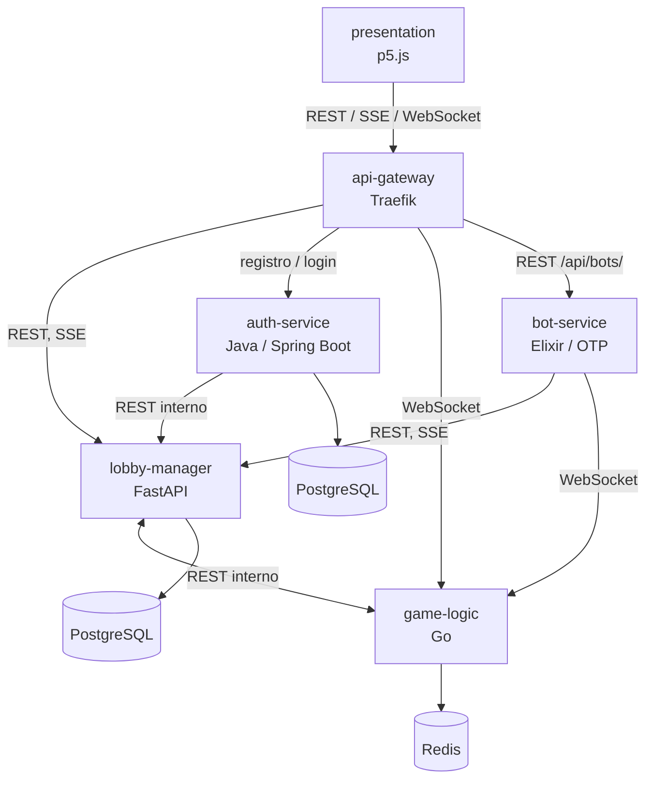

# Bololó (ArchSoft 1-F)

Juego de cartas con dos modos, construido como sistema distribuido:

- **Clásico** (`CLASSIC`): 5 rondas de tríos y cuartetos, 4 jugadores, por turnos. Pantalla `/ingame/`.
- **Camaleón** (`CHAMELEON`): en tiempo real, 2 a 4 jugadores; un repartidor tira cartas y gana quien reúne los 8 colores. Pantalla `/chameleon/`. Reglas: [game-logic/docs/MODO_CAMALEON.md](game-logic/docs/MODO_CAMALEON.md).

El modo se elige al crear la sala. Cada componente de la vista C&C tiene su propia carpeta, que se construye y despliega como un contenedor independiente (RNF-06, RNF-11).



## Estructura

```
ArchSoft-Group1F/
├── presentation/        Presentación web (p5.js)
│   ├── libraries/       p5 compartido por todas las pantallas
│   ├── lobby/           pantalla de ingreso y salas (elige el modo)
│   ├── game/            mesa del modo clásico (/ingame/)
│   └── chameleon/       mesa básica del modo camaleón (/chameleon/)
├── api-gateway/         Traefik (por implementar)
├── auth-service/        Cuentas y credenciales en Java + Spring Boot
├── lobby-manager/       Gestión de sesiones y salas en FastAPI + PostgreSQL
├── game-logic/          Lógica de la partida, servicio Go y persistencia Redis
├── bot-service/         Bots que llenan salas y juegan solos, en Elixir/OTP
├── docs/                Documentación transversal del sistema
└── .github/workflows/   CI, un workflow por componente
```

Convenciones:

- Cada componente es autocontenido: su código, pruebas, `Dockerfile` y `README.md` viven en su carpeta.
- Cada base de datos pertenece a un solo componente: PostgreSQL al Auth, PostgreSQL al Lobby y Redis a Game Logic. Su configuración va dentro de la carpeta del componente dueño.
- La documentación propia de un componente va en `<componente>/docs/`. En `docs/` solo va lo que cruza componentes.
- El `docker-compose.yml` que levante todo el sistema irá en la raíz cuando haya más de un servicio ejecutable.

## Componentes

| Carpeta | Estado | Cómo usarlo |
|---|---|---|
| [`presentation/`](presentation) | Pantallas iniciales | Abrir `presentation/lobby/index.html` o servir la carpeta: `python -m http.server -d presentation 8080` |
| [`auth-service/`](auth-service) | Registro/login, BCrypt y sesión compatible con Lobby | Ver [auth-service/README.md](auth-service/README.md) |
| [`game-logic/`](game-logic) | Motor, API interna, WebSocket y persistencia Redis | Ver [game-logic/README.md](game-logic/README.md) |
| [`lobby-manager/`](lobby-manager) | Sesiones de invitado, identidad de jugador y salas | Ver [lobby-manager/README.md](lobby-manager/README.md) |
| [`bot-service/`](bot-service) | Llenar sala con bots que juegan la partida completa | Ver [bot-service/README.md](bot-service/README.md) y [docs/bot-service.md](docs/bot-service.md) |
| [`api-gateway/`](api-gateway) | Por implementar | Ver su README |
