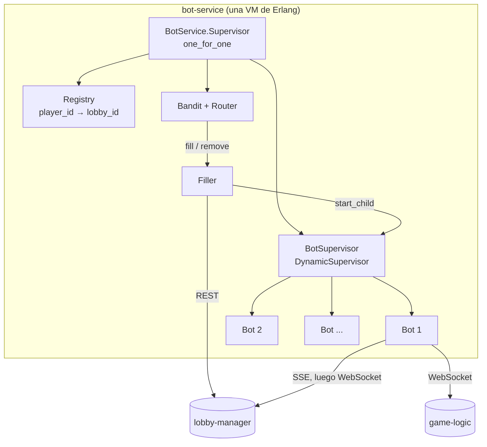

# Bololó: Bot Service (Elixir/OTP)

Componente lógico que llena una sala con bots que juegan la partida por su cuenta. Para el resto del sistema un bot es un jugador más: entra por la API del Lobby y juega por el WebSocket de Game Logic. Contrato con los demás componentes: [docs/bot-service.md](../docs/bot-service.md). Por qué Elixir: [docs/DECISION_LENGUAJE.md](docs/DECISION_LENGUAJE.md).

## Estructura

```
bot-service/
├── lib/bot_service/
│   ├── application.ex   árbol de supervisión
│   ├── router.ex        API HTTP (/api/bots/..., /healthz)
│   ├── filler.ex        casos de uso: llenar, quitar, listar
│   ├── bot.ex           proceso de un bot: sala de espera -> partida -> fin
│   ├── strategy.ex      qué jugada hacer dada la vista (función pura)
│   ├── melds.ex         búsqueda de tríos y cuartetos (función pura)
│   ├── lobby_client.ex  REST del Lobby Manager (Req)
│   ├── lobby_stream.ex  SSE de la sala (Mint)
│   ├── game_socket.ex   WebSocket de la partida (Mint.WebSocket)
│   ├── sse.ex           parser de Server-Sent Events
│   ├── names.ex         nombres "Bot ..."
│   ├── api_error.ex     errores {code, message}
│   └── config.ex
├── config/              config.exs y runtime.exs (variables de entorno)
├── test/                pruebas (con un Lobby falso en test/support)
└── Dockerfile
```

## Arquitectura interna



Cada bot es un `GenServer` con tres etapas:

| Etapa | Conexión | Qué espera | Sale a |
|---|---|---|---|
| `:waiting` | SSE de la sala | `game_starting` | `:playing`; o termina si no quedan humanos, la sala se cierra o vence la espera |
| `:playing` | WebSocket de la partida | `view` tras cada cambio | `:finished` al recibir `game_ended` |
| `:finished` | ninguna | | el proceso termina normalmente |

Las decisiones se separan de los procesos: `Strategy.turn_action(view, bloqueadas)` devuelve la acción a enviar y `Strategy.steal?/3` si roba. Las dos son funciones puras de la vista que manda Go, así que se prueban sin red. Si Go rechaza una acción, el bot la agrega a `bloqueadas` para ese turno y `Strategy` propone la siguiente.

### Estrategia

1. **Bajar** en cuanto el momento lo permite (`can_lay_down`) y tiene las jugadas. `Melds.find` prueba todas las asignaciones de figura a jugada y elige la que gasta menos comodines (el bot de simulación de Go es voraz y a veces no encuentra jugadas que sí existen).
2. **Depositar** todo lo que encaje en un banco, normales antes que comodines.
3. **Tomar** del banco de vistas si la carta es comodín, encaja en un banco (si ya bajó) o forma pareja (si no ha bajado); si no, de ocultas.
4. **Botar** la carta que menos aporta: nunca un comodín si hay otra, nunca una carta de una jugada ya armada, y después de bajar conserva lo que se puede depositar.
5. **Robar** en el turno de otro solo antes de bajar y si la carta acerca a la jugada (comodín o figura repetida). Se decide una vez por carta botada, con una probabilidad que depende de la "personalidad" del bot.

Cada bot tiene una personalidad al azar (qué tanto roba y qué tan rápido juega) para que no se comporten todos igual.

## Uso

Requiere Elixir 1.17 y Erlang/OTP 27, o solo Docker.

```powershell
mix deps.get
mix test
mix format --check-formatted
```

Sin instalar Elixir:

```powershell
docker build -t bololo/bot-service .            # formato, compilación sin advertencias y pruebas; luego la imagen
docker build --target test .                    # solo pruebas
```

En el sistema completo se levanta con el `docker-compose.yml` de la raíz. Para ver las partidas más rápido, bajar la pausa en `.env`:

```
BOT_THINK_MIN_MS=100
BOT_THINK_MAX_MS=300
```

Probar a mano con `curl` (con el token de sesión del anfitrión):

```bash
curl -X POST http://localhost/api/bots/lobbies/$LOBBY_ID/fill -H "Authorization: Bearer $TOKEN"
curl http://localhost/api/bots/lobbies/$LOBBY_ID -H "Authorization: Bearer $TOKEN"
```
