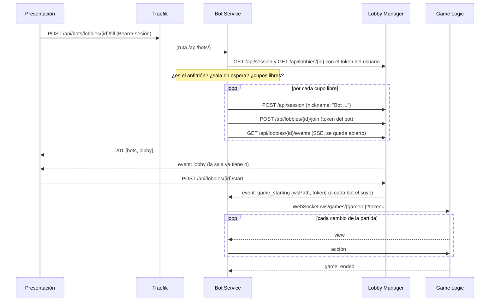

# Bololó - Bot Service: contrato de integración

| | |
|---|---|
| Componente | Bot Service |
| Tecnología | Elixir 1.17 / Erlang OTP 27 (Bandit, Req, Mint) |
| Tipo | Lógico |
| Estado | Implementado y probado, versión 1.0 (octubre 2026) |

Permite que el anfitrión de una sala ocupe los cupos libres con bots que juegan la partida solos. Este documento es lo que necesitan los demás componentes. El detalle interno está en [bot-service/README.md](../bot-service/README.md) y la decisión del lenguaje en [bot-service/docs/DECISION_LENGUAJE.md](../bot-service/docs/DECISION_LENGUAJE.md).

## 1. Idea central

Un bot **es un jugador más**. Usa exactamente las mismas interfaces que el navegador:

- REST del Lobby Manager para tener sesión y unirse (`POST /api/session`, `POST /api/lobbies/{id}/join`).
- SSE de la sala de espera para enterarse del inicio (`game_starting`) y no ser expulsado por ausencia.
- WebSocket de Game Logic para recibir la vista (`view`) y enviar acciones (`draw`, `discard`, `steal`, `lay_down`, `deposit`).

Por eso **ni el Lobby Manager ni Game Logic cambiaron**: no saben que hay bots. Go sigue siendo el árbitro y valida cada acción de un bot igual que la de un humano.

## 2. Para Presentación

Las rutas pasan por el gateway y usan el **mismo token de sesión** del Lobby (`Authorization: Bearer <token>`). Con el helper `api()` del menú: `api("POST", "/bots/lobbies/" + id + "/fill")`.

| Método y ruta | Cuerpo | Respuesta | Quién |
|---|---|---|---|
| `POST /api/bots/lobbies/{id}/fill` | opcional `{"count": 1..3}` | `201 {lobbyId, bots, lobby}` | Anfitrión |
| `DELETE /api/bots/lobbies/{id}` | | `200 {lobbyId, removed}` | Anfitrión |
| `GET /api/bots/lobbies/{id}` | | `200 {lobbyId, bots}` | Cualquier jugador de la sala |

- Sin `count`, llena todos los cupos libres. Con `count`, agrega como máximo esa cantidad.
- `bots` es una lista de `{id, nickname}` (en el `GET`, además `stage`: `waiting` o `playing`).
- `lobby` es la sala después del llenado, con la misma forma que devuelve el Lobby. Además todos reciben el evento SSE `lobby` de siempre, así que no hace falta hacer nada especial para refrescar la pantalla.
- **Anfitrión** = el jugador con el menor asiento (`lobby.players[0]`, porque la lista llega ordenada). Es quien creó la sala o, si salió, el que lleva más tiempo.
- Los nombres de los bots empiezan con `"Bot "` (p. ej. `Bot Cometa`), para distinguirlos en la sala y en la mesa sin cambiar ningún contrato.
- Quitar bots solo funciona antes de iniciar la partida.

Errores, con la misma forma `{code, message}` que el Lobby (`message` en español, se puede mostrar tal cual):

| HTTP | `code` | Cuándo |
|---|---|---|
| 401 | `invalid_session` | Falta el token o no es válido |
| 403 | `not_in_lobby` | El usuario no pertenece a la sala |
| 403 | `not_lobby_host` | No es el anfitrión |
| 404 | `lobby_not_found` | La sala no existe |
| 409 | `lobby_full` | No hay cupos libres |
| 409 | `lobby_started` | La partida ya inició |
| 422 | `invalid_request` | `count` fuera de 1..3 o JSON inválido |
| 502 | `lobby_service_unavailable` | El Lobby no respondió |

## 3. Comportamiento de los bots

| Situación | Qué hace el bot |
|---|---|
| Esperando en la sala | Mantiene el SSE abierto (el Lobby no lo expulsa) |
| No queda ningún humano en la sala | Sale; si la sala queda vacía, el Lobby la elimina y libera el cupo |
| La partida no inicia en 10 min (`BOT_LOBBY_TIMEOUT_S`) | Sale de la sala |
| Su turno | Baja si puede, deposita, toma y bota, con una pausa de 0,9 a 2,2 s |
| Turno de otro | Puede robar la carta botada si le sirve (decide una vez por carta) |
| Go rechaza una acción | No la repite en ese turno y pasa a la siguiente alternativa |
| Se cae la red | Reintenta con espera creciente; mientras tanto Go juega por él en automático |
| El proceso del bot falla | El supervisor lo reinicia y retoma la partida |
| `game_ended` | Cierra el WebSocket y termina |

## 4. Para despliegue

Servicio en `docker-compose.yml` (ya agregado):

| | |
|---|---|
| Puerto interno | `8090` |
| Ruta pública | `PathPrefix(/api/bots/)` con `priority=30`, más alta que la de `/api/` (19, la longitud de la regla) |
| Healthcheck | `GET /healthz` → `{"status":"ok","bots":N}` (con `wget`, la imagen es Alpine) |
| Depende de | `lobby-manager` y `game-logic` sanos |
| Secretos | Ninguno: la identidad se valida preguntándole al Lobby, y los tokens de partida los firma el Lobby |
| Datos | Ninguno persistente: el estado de cada bot vive en su proceso y se reconstruye desde la sala si se reinicia |

Variables:

| Variable | Defecto | Uso |
|---|---|---|
| `LOBBY_URL` | `http://lobby-manager:8000` | REST y SSE del Lobby (directo, sin Traefik) |
| `GAME_LOGIC_URL` | `http://game-logic:8081` | WebSocket de la partida (directo, sin Traefik) |
| `BOT_THINK_MIN_MS` / `BOT_THINK_MAX_MS` | `900` / `2200` | Pausa antes de cada acción en su turno |
| `BOT_REACT_MIN_MS` / `BOT_REACT_MAX_MS` | `400` / `1200` | Reacción para robar |
| `BOT_LOBBY_TIMEOUT_S` | `600` | Espera máxima en la sala |
| `PORT` | `8090` | Puerto HTTP |

El WebSocket de los bots no manda cabecera `Origin`, así que `ALLOWED_ORIGINS` de Go no lo afecta.
