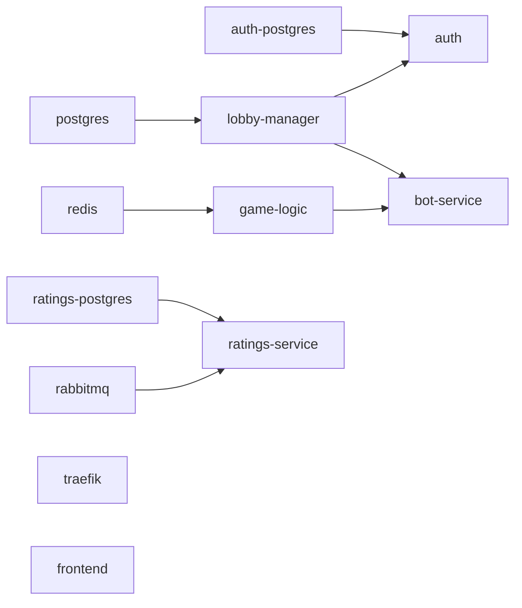

# BOLOLó · Deployment View

| | |
|---|---|
| View type | Allocation (Views and Beyond), **deployment style** |
| Notation | UML 2.5 deployment diagram (nodes, execution environments, artifacts, communication paths) |
| Editable diagram | [`deployment-view.drawio`](deployment-view.drawio) (draw.io / diagrams.net or the VS Code "Draw.io Integration" extension) |
| Source of truth | `docker-compose.yml`, `api-gateway/traefik.yml`, every component's `Dockerfile`, `pom.xml`, `go.mod`, `mix.lock`, `requirements.txt`, on branch `fix/diseño` @ `4fcb57e` |
| Related views | C&C view (component names `bololo_*` and connector IDs C1–C20 are reused here) |

## Contents

1. [Primary presentation](#1-primary-presentation)
2. [Element catalog](#2-element-catalog)
3. [Allocation relation (software → environment)](#3-allocation-relation-software--environment)
4. [Connector catalog](#4-connector-catalog)
5. [Traceability with the C&C view](#5-traceability-with-the-cc-view)
6. [Networks, ports and volumes](#6-networks-ports-and-volumes)
7. [Startup order and health](#7-startup-order-and-health)
8. [Variability](#8-variability)
9. [Rationale](#9-rationale)
10. [Findings](#10-findings)
11. [Revision history](#11-revision-history)
12. [Sources](#12-sources)

---

## 1. Primary presentation

The draw.io file is the main deliverable. It uses the deployment-style notation of Views and Beyond: **software elements** (C&C components) are drawn **outside** the infrastructure, and a dashed `deployed_in` arrow points from each one to the **environmental element** (device, execution environment or container) where it runs. Communication paths between environmental elements carry the C&C connector IDs. The Mermaid diagram below carries the same content so it renders on GitHub.

```mermaid
flowchart TB
  subgraph SW["SOFTWARE ELEMENTS · C&C components (outside the infrastructure)"]
    direction LR
    LFE["«component» bololo_lobby_fe<br/>/menu/ · p5.js 1.10.0 + p5.sound 1.0.1"]
    GFE["«component» bololo_game_fe<br/>/ingame/ (p5.js 1.10.0) · /chameleon/ (DOM)"]
    GAT["«component» bololo_gat<br/>Traefik v3.7.14"]
    WEBS["«component» bololo_web_ssr<br/>Node.js 22.14.0 · node:http + gzip"]
    RATS["«component» bololo_ratings<br/>Python 3.12 · FastAPI 0.143.0 · aio-pika 10.2.1"]
    MQS["«component» bololo_mq<br/>RabbitMQ 3.13.7 · exchange bololo.events"]
    LOBS["«component» bololo_lobby<br/>Python 3.12 · FastAPI 0.143.0 · asyncpg 0.32.0<br/>PyJWT 2.15.1 · httpx 0.28.1 · aio-pika 10.2.1"]
    GAMS["«component» bololo_game<br/>Go 1.27.2 · Classic + Chameleon engines<br/>gorilla/websocket 1.5.3 · go-redis v9.7.3 · amqp091-go 1.16.0"]
    BOTS["«component» bololo_bots 1.0.0<br/>Elixir 1.17.3 · Erlang/OTP 27.1.2"]
    AUTHS["«component» bololo_auth 1.0.0<br/>Java 21 · Spring Boot 3.5.5"]
    RDBS[("«data store» bololo_ratings_db<br/>PostgreSQL 16.15")]
    LDBS[("«data store» bololo_lobby_db<br/>PostgreSQL 16.15")]
    GDBS[("«data store» bololo_game_db<br/>Redis 7.4.11")]
    ADBS[("«data store» bololo_auth_db<br/>PostgreSQL 16.15")]
    SPEC["«deployment spec»<br/>docker-compose.yml + .env"]
  end

  subgraph INFRA["Infrastructure"]
    subgraph USER["USER ZONE · Internet / LAN (untrusted)"]
      subgraph PC["«device» Player PC / laptop / phone"]
        BR["«executionEnvironment» Web browser<br/>ES modules · WebSocket · EventSource"]
      end
    end
    subgraph HOST["«device» Docker host · Docker Engine + Compose v2 · project bololo-integrado"]
      subgraph PUB["NETWORK public · only published port: host 80"]
        TRN["«container» traefik<br/>traefik:v3.7.14 · :80"]
      end
      DOCK["«executionEnvironment» Docker Engine<br/>/var/run/docker.sock"]
      subgraph INT["NETWORK internal · internal: true"]
        FEN["«container» frontend<br/>node:22.14.0-alpine · :3000"]
        RATN["«container» ratings-service<br/>python:3.12-slim · :8000"]
        MQN["«container» rabbitmq<br/>rabbitmq:3.13.7-management-alpine · :5672"]
        LOBN["«container» lobby-manager<br/>python:3.12-slim · :8000"]
        GAMN["«container» game-logic<br/>distroless/static-debian12:nonroot · :8081"]
        BOTN["«container» bot-service<br/>alpine:3.20.3 · :8090"]
        AUTHN["«container» auth<br/>eclipse-temurin:21-jre-alpine · :8080"]
        RPGN["«container» ratings-postgres<br/>postgres:16.15-alpine · :5432"]
        PGN["«container» postgres<br/>postgres:16.15-alpine · :5432"]
        RDN["«container» redis<br/>redis:7.4.11-alpine · :6379"]
        APGN["«container» auth-postgres<br/>postgres:16.15-alpine · :5432"]
      end
      subgraph VOL["Host storage · Docker named volumes"]
        V1[("auth-pg-data")]
        V2[("pg-data")]
        V3[("ratings-pg-data")]
        V4[("redis-data")]
        V5[("rabbitmq-data")]
      end
    end
  end

  LFE -.->|deployed_in| BR
  GFE -.->|deployed_in| BR
  GAT -.->|deployed_in| TRN
  WEBS -.->|deployed_in| FEN
  RATS -.->|deployed_in| RATN
  MQS -.->|deployed_in| MQN
  LOBS -.->|deployed_in| LOBN
  GAMS -.->|deployed_in| GAMN
  BOTS -.->|deployed_in| BOTN
  AUTHS -.->|deployed_in| AUTHN
  RDBS -.->|deployed_in| RPGN
  LDBS -.->|deployed_in| PGN
  GDBS -.->|deployed_in| RDN
  ADBS -.->|deployed_in| APGN
  SPEC -.->|deployed_in| DOCK

  BR ==>|"C1 · HTTP/1.1 :80 · REST + SSE"| TRN
  BR ==>|"C2 · HTTP/1.1 :80 · WebSocket"| TRN
  TRN -->|"C3 · HTTP :3000"| FEN
  TRN -->|"C4 · REST :8000 · /api/ratings/"| RATN
  TRN -->|"C5 · REST :8080 · /auth/"| AUTHN
  TRN -->|"C6 · REST + SSE :8000 · /api/"| LOBN
  TRN -->|"C7 · REST :8090 · /api/bots/"| BOTN
  TRN -->|"C8 · WebSocket :8081 · /ws/games/"| GAMN
  FEN -->|"C9 · REST :8000 · leaderboard"| RATN
  AUTHN -->|"C10 · REST · /internal/auth/session"| LOBN
  BOTN -->|"C11 · REST + SSE :8000"| LOBN
  BOTN -->|"C12 · WebSocket :8081"| GAMN
  LOBN -->|"C13 · REST · POST /internal/games"| GAMN
  GAMN -->|"C14 · AMQP · publish game.ended"| MQN
  LOBN -->|"C15 · AMQP · consume game.ended"| MQN
  RATN -->|"C16 · AMQP · consume game.finished"| MQN
  RATN -->|"C17 · SQL driver :5432"| RPGN
  AUTHN -->|"C18 · JDBC :5432"| APGN
  LOBN -->|"C19 · SQL driver :5432"| PGN
  GAMN -->|"C20 · Redis RESP3 :6379"| RDN
  LOBN -->|"D1 · AMQP · publish game.finished"| MQN
  TRN -.->|"D2 · Docker API · socket (ro)"| DOCK
  APGN -.- V1
  PGN -.- V2
  RPGN -.- V3
  RDN -.- V4
  MQN -.- V5

  classDef comp fill:#FFFFFF,stroke:#7F7F7F,stroke-width:2px,color:#000
  classDef container fill:#C9DAF8,stroke:#2F5597,color:#000
  classDef gateway fill:#F8CECC,stroke:#B85450,stroke-width:2px,color:#000
  classDef broker fill:#FFE6CC,stroke:#D79B00,color:#000
  classDef data fill:#D5E8D4,stroke:#548235,color:#000
  classDef volume fill:#FFF2CC,stroke:#BF9000,color:#000
  classDef env fill:#FFFFFF,stroke:#595959,color:#000

  class LFE,GFE,GAT,WEBS,RATS,MQS,LOBS,GAMS,BOTS,AUTHS,RDBS,LDBS,GDBS,ADBS,SPEC comp
  class FEN,RATN,LOBN,GAMN,BOTN,AUTHN container
  class TRN gateway
  class MQN broker
  class RPGN,PGN,RDN,APGN data
  class V1,V2,V3,V4,V5 volume
  class DOCK,BR env

  style SW fill:#FFFFFF,stroke:#BFBFBF,stroke-dasharray:4 4
  style INFRA fill:#E2F0D9,stroke:#00A651,stroke-width:2px
  style USER fill:#F5F5F5,stroke:#666666,stroke-dasharray:8 4
  style PC fill:#B4C6E7,stroke:#2F5597
  style HOST fill:#F7FBF4,stroke:#548235,stroke-width:2px
  style PUB fill:#FFF2CC,stroke:#D6B656,stroke-dasharray:8 4
  style INT fill:#DAE8FC,stroke:#6C8EBF,stroke-dasharray:8 4
  style VOL fill:#FFFBEA,stroke:#BF9000,stroke-dasharray:4 4

  linkStyle 0,1,2,3,4,5,6,7,8,9,10,11,12,13,14 stroke:#E06666,stroke-width:2px
  linkStyle 15 stroke:#1F4E79,stroke-width:3px
  linkStyle 16 stroke:#7030A0,stroke-width:3px
  linkStyle 17,18,19,20,21,23,24,25,27 stroke:#1F4E79,stroke-width:1.5px
  linkStyle 22,26 stroke:#7030A0,stroke-width:2px
  linkStyle 28,29,30,35 stroke:#C55A11,stroke-width:2px
  linkStyle 31,32,33,34 stroke:#548235,stroke-width:1.5px
  linkStyle 36 stroke:#7F7F7F,stroke-width:1.5px
  linkStyle 37,38,39,40,41 stroke:#BF9000,stroke-width:1.5px
```

**Key.** White boxes outside the infrastructure are **software elements**: C&C components (`«component»`), C&C data stores (`«data store»`) and the Compose deployment specification. Boxes with `«device»`, `«executionEnvironment»` or `«container»` inside the infrastructure are **environmental elements**; containers carry their Compose service name. The red dashed `deployed_in` arrow is the allocated-to relation. Dashed zones are trust boundaries (Docker networks). Connector arrows point from the side that opens the connection; for the AMQP consumers (C15, C16) messages flow broker → consumer. **C**-IDs are the C&C connectors; **D**-IDs exist in the deployed code but not in the C&C view ([section 5](#5-traceability-with-the-cc-view)). Colours: blue HTTP/REST/SSE, purple WebSocket, orange AMQP, green database drivers, grey Docker API, yellow volume mounts. In the draw.io diagram the gateway routes C3–C8 share one line from `traefik` and branch to each container.

## 2. Element catalog

### 2.1 Environmental elements

| Element | Type | Properties |
|---|---|---|
| Player PC / laptop / phone | «device» | Any machine on the Internet or the LAN. One browser tab is one player (`sessionStorage` is per tab) |
| Web browser | «executionEnvironment» | Needs ES modules, `WebSocket`, `EventSource` and Canvas. Runs `bololo_lobby_fe` and `bololo_game_fe`, downloaded from `frontend` |
| Docker host | «device» | One machine with Docker Engine + Docker Compose v2. Compose project `bololo-integrado`. Linux containers |
| Docker Engine (dockerd) | «executionEnvironment» | Starts the 12 containers from `docker-compose.yml` + `.env`, runs healthchecks, applies `restart: unless-stopped`, exposes `/var/run/docker.sock` |
| `public` network | Docker bridge network | `bololo-integrado_public`. Only `traefik` is attached, and only it publishes a port (`80:80`) |
| `internal` network | Docker bridge network | `bololo-integrado_internal`, `internal: true`: no route to the Internet, no published ports. Docker DNS resolves service names |
| 12 containers | «container» | Table below |
| 5 named volumes | Docker volume | `auth-pg-data`, `pg-data`, `ratings-pg-data`, `redis-data`, `rabbitmq-data` |

| Container | C&C component | Image (runtime) | Build | Networks | Internal port(s) | Persistent data |
|---|---|---|---|---|---|---|
| `traefik` | `bololo_gat` | `traefik:v3.7.14` | pulled | public, internal | 80 (web), 8080 (ping, not published) | none (bind mounts `traefik.yml` and `docker.sock`, read-only) |
| `frontend` | `bololo_web_ssr` | `node:22.14.0-alpine` | `presentation-ssr/Dockerfile`, context = repo root | internal | 3000 | none |
| `auth` | `bololo_auth` | `eclipse-temurin:21-jre-alpine` | `./auth-service`, built in `maven:3.9.9-eclipse-temurin-21-alpine` | internal | 8080 | none |
| `lobby-manager` | `bololo_lobby` | `python:3.12-slim` | `./lobby-manager` | internal | 8000 | none (state in `postgres`) |
| `game-logic` | `bololo_game` | `gcr.io/distroless/static-debian12:nonroot` | `./game-logic`, `APP=server`, built in `golang:1.27.2-bookworm` | internal | 8081 (WebSocket + internal REST + `/healthz`) | none (state in `redis`) |
| `bot-service` | `bololo_bots` | `alpine:3.20.3` | `./bot-service`, built in `hexpm/elixir:1.17.3-erlang-27.1.2-alpine-3.20.3` | internal | 8090 | none (bots live in memory) |
| `ratings-service` | `bololo_ratings` | `python:3.12-slim` | `./ratings-service` | internal | 8000 | none (state in `ratings-postgres`) |
| `rabbitmq` | `bololo_mq` | `rabbitmq:3.13.7-management-alpine` | pulled | internal | 5672 (AMQP), 15672 (management, not routed) | `rabbitmq-data` → `/var/lib/rabbitmq` |
| `auth-postgres` | `bololo_auth_db` | `postgres:16.15-alpine` | pulled | internal | 5432 | `auth-pg-data` → `/var/lib/postgresql/data` |
| `postgres` | `bololo_lobby_db` | `postgres:16.15-alpine` | pulled | internal | 5432 | `pg-data` → `/var/lib/postgresql/data` |
| `ratings-postgres` | `bololo_ratings_db` | `postgres:16.15-alpine` | pulled | internal | 5432 | `ratings-pg-data` → `/var/lib/postgresql/data` |
| `redis` | `bololo_game_db` | `redis:7.4.11-alpine` | pulled | internal | 6379 | `redis-data` → `/data` (AOF) |

### 2.2 Software elements and versions

| C&C component | Language / runtime | Main libraries (exact versions) | Responsibility |
|---|---|---|---|
| `bololo_lobby_fe` (`/menu/`) | JavaScript in the browser | p5.js 1.10.0, p5.sound 1.0.1 (local `/libraries/`) | Guest session, login/register, create/join lobbies, waiting room by SSE, ranking (reuses the SSR CLASSIC leaderboard on first open), fill with bots |
| `bololo_game_fe` (`/ingame/`, `/chameleon/`) | JavaScript (ES modules) | p5.js 1.10.0 for the classic table (local); the chameleon table uses plain DOM | Game tables for both modes, shared `GameSocket` WebSocket client |
| `bololo_web_ssr` | Node.js 22.14.0 | `node:http`, `node:zlib`, no npm dependencies | Renders the HTML for `/menu/` (with the CLASSIC top 10 from Ratings, C9), `/ingame/`, `/chameleon/`; serves assets with gzip; `/` → `302 /menu/`; `/healthz` |
| `bololo_gat` | Traefik 3.7.14 | Docker provider | Single entry point, path routing, WebSocket and SSE pass-through |
| `bololo_auth` 1.0.0 | Java 21 (Temurin JRE) | Spring Boot 3.5.5 (web, jdbc, validation, security, oauth2-resource-server), PostgreSQL JDBC driver | Accounts, BCrypt passwords, lockout, JWT HS256 validation, asks the lobby for a player session |
| `bololo_lobby` | Python 3.12 | FastAPI 0.143.0, Uvicorn 0.54.0, asyncpg 0.32.0, PyJWT 2.15.1, httpx 0.28.1, aio-pika 10.2.1 | Sessions, lobbies, SSE, starts matches in Go, consumes `game.ended`, stores results, publishes `game.finished` through an outbox |
| `bololo_game` | Go 1.27.2 (module `go 1.26.0`), static binary | gorilla/websocket 1.5.3, go-redis/v9 9.7.3, rabbitmq/amqp091-go 1.16.0 | WebSocket hub, internal REST, Classic engine (`internal/game`) and Chameleon engine (`internal/chameleon`), Redis snapshots, publishes `game.ended` |
| `bololo_bots` 1.0.0 | Elixir 1.17.3 on Erlang/OTP 27.1.2 | Bandit 1.14.0, Plug 1.20.3, Req 0.7.5 (Finch 0.24.0), Mint 1.11.0, mint_web_socket 1.0.6, Jason 1.4.5 | Fills lobbies with bots that play CLASSIC and CHAMELEON matches like a browser |
| `bololo_ratings` | Python 3.12 | FastAPI 0.143.0, Uvicorn 0.54.0, asyncpg 0.32.0, aio-pika 10.2.1 | Elo ranking per mode, fed by `game.finished` |
| `bololo_mq` | RabbitMQ 3.13.7 | — | Exchange `bololo.events` (topic). Queues `lobby.game-ended` (DLX `lobby.dead`) and `ratings.game-finished` (DLX `bololo.events.dead`) |
| `bololo_auth_db`, `bololo_lobby_db`, `bololo_ratings_db` | PostgreSQL 16.15 | — | One database per owning component |
| `bololo_game_db` | Redis 7.4.11 | — | `bololo:game:{gameId}` hashes (snapshot + mode), `games:active` |

## 3. Allocation relation (software → environment)

| Software element | Allocated to | Host / network |
|---|---|---|
| `bololo_lobby_fe`, `bololo_game_fe` | Downloaded from `frontend`, **executed** in the player's browser | User zone |
| `bololo_web_ssr` + HTML views + client bundles | `frontend` | Docker host / internal |
| `bololo_gat` | `traefik` | Docker host / public + internal |
| `bololo_auth` | `auth` | Docker host / internal |
| `bololo_lobby` | `lobby-manager` | Docker host / internal |
| `bololo_game` (both engines, one process) | `game-logic` | Docker host / internal |
| `bololo_bots` | `bot-service` | Docker host / internal |
| `bololo_ratings` | `ratings-service` | Docker host / internal |
| `bololo_mq` | `rabbitmq` | Docker host / internal |
| `bololo_auth_db`, `bololo_lobby_db`, `bololo_ratings_db` | `auth-postgres`, `postgres`, `ratings-postgres` | Docker host / internal |
| `bololo_game_db` | `redis` | Docker host / internal |

## 4. Connector catalog

| ID | Source → Target (container) | Connector / protocol | Target port | Purpose / payload | Security |
|---|---|---|---|---|---|
| C1 | `bololo_lobby_fe` (browser) → `traefik` | HTTP/1.1 over TCP: REST (JSON) + SSE | host 80 → 80 | `/menu/` page, `/auth/*`, `/api/*` (incl. `/api/ratings/`, `/api/bots/`), SSE `/api/lobbies/{id}/events` | No TLS; `Authorization: Bearer`; SSE token in `?token=` |
| C2 | `bololo_game_fe` (browser) → `traefik` | HTTP/1.1 + WebSocket upgrade (RFC 6455) | host 80 → 80 | `/ingame/` and `/chameleon/` pages, `/ws/games/{gameId}` | No TLS; game JWT in `?token=` |
| C3 | `traefik` → `frontend` | HTTP/1.1 | 3000 | SSR HTML + static assets (gzip) | Router `web`, priority 1 |
| C4 | `traefik` → `ratings-service` | HTTP/1.1 REST (JSON) | 8000 | `GET /api/ratings/leaderboard`, `/players/{id}`, `/players/{id}/history` | Read-only; priority 30 |
| C5 | `traefik` → `auth` | HTTP/1.1 REST (JSON) | 8080 | `/auth/register`, `/auth/login`, `/auth/me`, `/auth/password` | BCrypt; JWT HS256 (`JWT_SECRET`) |
| C6 | `traefik` → `lobby-manager` | HTTP/1.1 REST (JSON) + SSE | 8000 | `/api/session`, `/api/lobbies…`, `/api/lobbies/{id}/events` | Bearer session token |
| C7 | `traefik` → `bot-service` | HTTP/1.1 REST (JSON) | 8090 | `POST /api/bots/lobbies/{id}/fill`, `GET`, `DELETE` | Bearer session token; priority 30 |
| C8 | `traefik` → `game-logic` | WebSocket (RFC 6455) | 8081 | `/ws/games/{gameId}?token=<JWT>` | Game JWT; `Origin` checked against `ALLOWED_ORIGINS` |
| C9 | `frontend` → `ratings-service` | HTTP/1.1 REST (Node `fetch`) | 8000 | `GET /api/ratings/leaderboard?mode=CLASSIC&limit=10`, rendered into `/menu/`. 800 ms timeout (`SSR_DATA_TIMEOUT_MS`); on failure the menu is served without the ranking. Direct, not through the gateway | Public data, no token. Target from `RATINGS_URL` |
| C10 | `auth` → `lobby-manager` | HTTP/1.1 REST (Spring `RestClient`) | 8000 | `POST /internal/auth/session` | `X-Service-Token` (`SERVICE_SECRET`) |
| C11 | `bot-service` → `lobby-manager` | HTTP/1.1 REST (Req) + SSE (Mint) | 8000 | `/api/session`, `/api/lobbies/{id}`, join, leave, `/events`, directly (not through the gateway) | Session token per bot |
| C12 | `bot-service` → `game-logic` | WebSocket (mint_web_socket) | 8081 | `/ws/games/{gameId}`, CLASSIC and CHAMELEON | Game JWT |
| C13 | `lobby-manager` → `game-logic` | HTTP/1.1 REST (httpx) | 8081 | `POST /internal/games {gameId, lobbyId, mode, players}`, `GET /internal/games/{id}` | `X-Service-Token` |
| C14 | `game-logic` → `rabbitmq` | AMQP 0-9-1 over TCP (amqp091-go 1.16.0) | 5672 | Publishes `game.ended {gameId, lobbyId, mode, winners, endReason, standings, finishedAt}` to `bololo.events`. Persistent, publisher confirms + `mandatory`; 6 attempts with 1–16 s backoff | RabbitMQ user/password (`RABBITMQ_URL`) |
| C15 | `lobby-manager` → `rabbitmq` | AMQP 0-9-1 over TCP (aio-pika) | 5672 | Consumes `lobby.game-ended`, prefetch 1, ack after DB commit (idempotent by `gameId`), unrecordable messages to `lobby.game-ended.dead` | RabbitMQ user/password |
| C16 | `ratings-service` → `rabbitmq` | AMQP 0-9-1 over TCP (aio-pika) | 5672 | Consumes `ratings.game-finished`, prefetch 1, ack after commit, invalid messages to `ratings.game-finished.dead` | RabbitMQ user/password |
| C17 | `ratings-service` → `ratings-postgres` | SQL driver: PostgreSQL protocol v3 (asyncpg) | 5432 | `ratings`, `processed_games`, `rating_changes` | DB user `bololo_ratings` |
| C18 | `auth` → `auth-postgres` | JDBC driver (PostgreSQL protocol v3) | 5432 | `accounts` | DB user `bololo_auth` |
| C19 | `lobby-manager` → `postgres` | SQL driver: PostgreSQL protocol v3 (asyncpg) | 5432 | `players`, `lobbies`, `lobby_players`, `game_results` | DB user `bololo` |
| C20 | `game-logic` → `redis` | Redis driver: RESP3 over TCP (go-redis v9) | 6379 | `bololo:game:{id}`, `games:active` | `requirepass` (`REDIS_PASSWORD`) |
| D1 | `lobby-manager` → `rabbitmq` | AMQP 0-9-1 over TCP (aio-pika) | 5672 | Publishes `game.finished` to `bololo.events` from an outbox every 2 s, after recording `game.ended`. Publisher confirms + `mandatory` | RabbitMQ user/password |
| D2 | `traefik` → Docker Engine | Docker Engine API (HTTP over Unix socket) | `/var/run/docker.sock` | Reads container labels to build routes | Read-only bind mount |

Shared secrets: `JWT_SECRET` (lobby signs; game-logic and auth verify), `SERVICE_SECRET` (`X-Service-Token` on C10 and C13), plus one password per data store and the broker, all from `.env`.

## 5. Traceability with the C&C view

All 20 C&C connectors are deployed. The remaining differences:

| Item | C&C view | Deployed code |
|---|---|---|
| Event name on C14 / C15 | `game.finished` | **`game.ended`** (routing key `game.ended`, queue `lobby.game-ended`). `game.finished` is a separate event, lobby → ratings (D1 → C16) |
| Lobby publishes `game.finished` (**D1**) | Not drawn. Lobby and broker are joined only by C15 (consume) | Exists: the lobby's outbox publishes `game.finished`, which Ratings consumes on C16. The C&C view needs a second lobby → MQ connector |
| Traefik → Docker socket (**D2**) | Not drawn | Infrastructure connector; it belongs only in the deployment view |
| C9 path | `bololo_web_ssr` → `bololo_ratings` | Matches; it goes straight to `ratings-service:8000`, not through `bololo_gat` |

The old REST callback `POST /internal/lobbies/{id}/result` (game → lobby) was removed. Only the lobby calls Go now (C13), so the lobby ↔ game cycle is gone.

## 6. Networks, ports and volumes

| Port | Where it listens | Reachable from |
|---|---|---|
| 80/tcp | Host (`0.0.0.0:80`) → `traefik:80` | User zone (C1 and C2 share it) |
| 8080 | `traefik` ping entrypoint | Inside the container only |
| 3000, 8080, 8000, 8081, 8090, 8000 | `frontend`, `auth`, `lobby-manager`, `game-logic`, `bot-service`, `ratings-service` | `internal` only (through Traefik or service-to-service) |
| 5672, 15672 | `rabbitmq` | `internal` only; 15672 has no route |
| 5432 (×3), 6379 | PostgreSQL containers, `redis` | `internal` only; never routed (`exposedByDefault: false`) |

`/internal/*` paths and every `/healthz` have no Traefik router.

## 7. Startup order and health

| Service | Healthcheck |
|---|---|
| `traefik` | `traefik healthcheck --ping` |
| `frontend` | `wget --spider http://127.0.0.1:3000/healthz` |
| `auth` | `wget --spider http://127.0.0.1:8080/healthz` (runs `SELECT 1`) |
| `lobby-manager`, `ratings-service` | `python -c "urllib.request.urlopen('http://127.0.0.1:8000/healthz')"` |
| `game-logic` | `/app -healthcheck` (distroless image has no shell) |
| `bot-service` | `wget --spider http://127.0.0.1:8090/healthz` |
| PostgreSQL ×3 | `pg_isready` |
| `redis` | `redis-cli ping` |
| `rabbitmq` | `nc -z 127.0.0.1 5672` |

Neither `lobby-manager` nor `game-logic` waits for `rabbitmq` at startup. Both connect to the broker on their own and reconnect after failures. `frontend` does not wait for `ratings-service`; the menu is served without the ranking until Ratings answers.

## 8. Variability

- **Host port**: change `"80:80"` on `traefik`.
- **TLS**: needs a `websecure` entryPoint and certificates in Traefik; the clients already switch to `wss://` under `https:`.
- **SSR data**: `RATINGS_URL` and `SSR_DATA_TIMEOUT_MS` (default 800 ms) on `frontend`.
- **Result publishing**: `RESULT_PUBLISH_TIMEOUT` (default 5 s) on `game-logic`.
- **Bot timing**: `BOT_THINK_*` and `BOT_REACT_*` in `.env`.
- **Chameleon duration**: `CHAMELEON_GAME_DURATION` on `game-logic`.
- **Scaling limits**: `lobby-manager` must stay at one worker and one replica (SSE subscriptions are in memory). `game-logic` keeps live matches in memory with Redis for recovery, so it also runs as one replica. `frontend` is stateless and could be replicated.

## 9. Rationale

- **Single entry point.** Only Traefik publishes a port and is on both networks. `internal: true` removes Internet egress from every other container.
- **Database per service.** Auth, Lobby and Ratings each own a PostgreSQL container and volume; Game owns Redis.
- **Events for results.** Go publishes `game.ended` and does not know who consumes it. The lobby records it and publishes `game.finished` for Ratings. If the lobby, Ratings or the broker is briefly down, matches still finish and results wait in durable queues.
- **Pinned versions.** Every pulled or base image uses an exact tag.
- **Unprivileged images.** Go runs on distroless `nonroot`, Python as `nobody`, Node, Java and Elixir as dedicated users.

## 10. Findings

Found while reading the code; nothing was changed.

1. **Result can stay pending.** Go retries `game.ended` 6 times (about 31 s). If RabbitMQ is down that long, or `lobby.game-ended` has not been declared yet (the publish is `mandatory`), Go gives up and the result is only published again when Go restarts and restores the match.
2. **C&C labels** use `game.finished` on C14/C15 and do not show D1 ([section 5](#5-traceability-with-the-cc-view)).
3. **Build context is the repo root without a `.dockerignore`.** Building `frontend` sends `.env`, `.git` and `lobby-manager/.venv` to the Docker daemon. They do not end up in the image, but the secrets leave the working folder on every build.
4. **Dead files.** `presentation/Dockerfile` and `presentation/nginx.conf` are unused. `presentation/game/index.html` still loads p5.js 1.11.3 from jsDelivr, but `/ingame/` returns `views/ingame.html`, so that file is only reachable at `/ingame/index.html`.
5. **No TLS.** Public traffic is plain HTTP/WS on port 80, with JWTs in query strings for SSE and WebSocket (not logged by Traefik or Uvicorn).
6. **Calls that skip the gateway**: C9, C11, C12 go straight to the services on the internal network.
7. **Docker socket** mounted read-only is still a privileged path.

## 11. Revision history

| Date | Changes |
|---|---|
| 2026-11-02 | First version (12 containers, Nginx frontend) |
| 2026-11-02 | PR #10 (`presentation-ssr`): Node.js 22.14.0 SSR on :3000 instead of Nginx; CDN removed; bots play both modes; names and connector IDs aligned with the C&C view |
| 2026-11-02 | Branch `fix/diseño`: C9 (SSR ranking), C14 (Go publishes `game.ended`) and C15 (lobby consumes it) added; REST result callback removed; lobby publish renamed D1, Docker socket D2; gzip restored; diagram title simplified |
| 2026-11-02 | Notation changed to the Views and Beyond deployment style: software elements (C&C components and data stores) drawn outside the infrastructure with `deployed_in` arrows to their environmental elements; containers keep only environment properties |

## 12. Sources

- Clements et al., *Documenting Software Architectures: Views and Beyond*, 2nd ed., ch. 5 (allocation views, deployment style): [O'Reilly](https://www.oreilly.com/library/view/documenting-software-architectures/9780132488617/ch05.html)
- UML deployment diagram notation: [uml-diagrams.org](http://www.uml-diagrams.org/deployment-diagrams.html)
- Stereotyped communication paths: [Visual Paradigm guide](https://guides.visual-paradigm.com/docs/mastering-uml-2-5-a-use-case-driven-approach-to-agile-modeling/module-3-the-skeleton-the-7-structural-uml-diagrams/deployment-diagrams/)
