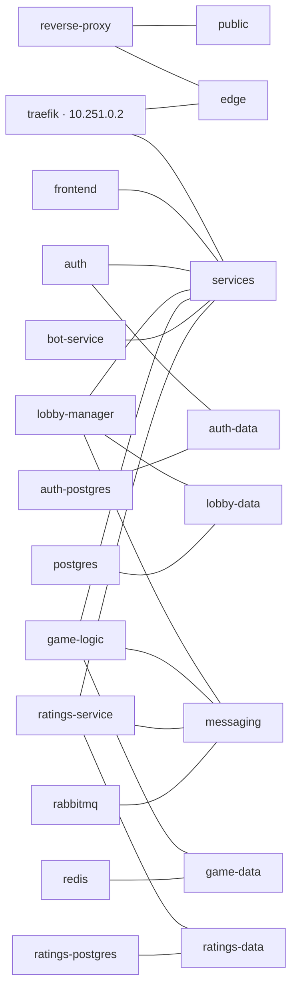
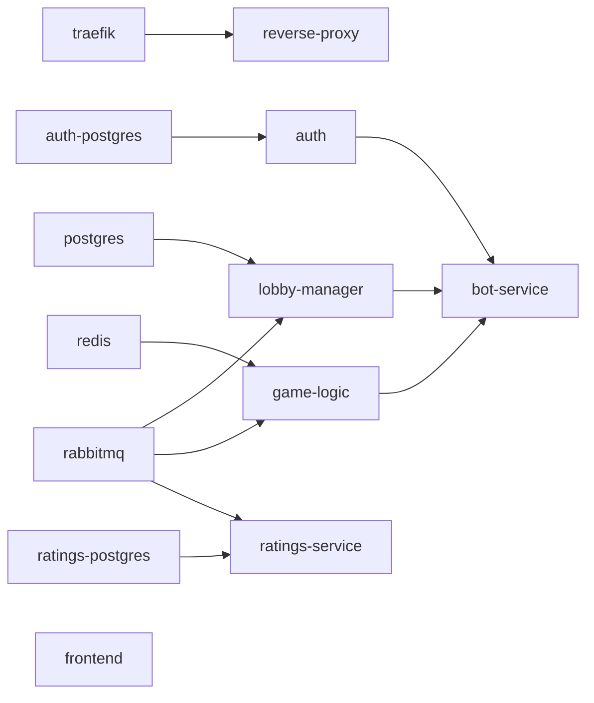

# BOLOLó · Deployment View

| | |
|---|---|
| View type | Allocation (Views and Beyond), **deployment style** |
| Notation | UML 2.5 deployment diagram (nodes, execution environments, artifacts, communication paths) |
| Editable diagram | [`deployment-view.drawio`](deployment-view.drawio) (draw.io / diagrams.net or the VS Code "Draw.io Integration" extension); the `Network Segmentation (P3 Escenario 3)` page maps every service to its networks |
| Source of truth | `docker-compose.yml`, `reverse-proxy/`, `api-gateway/traefik.yml`, `rabbitmq/topology.json`, every component's `Dockerfile`, `pom.xml`, `go.mod`, `mix.lock`, `requirements.txt`, on branch `feature/mis-cambios` |
| Related views | C&C view by dependency levels, with decisions 1–7 (component names `bololo_*` and connector IDs C1–C21 are the same) |
| View type | Allocation view, **deployment structure** (Bass, Clements, Kazman) |
| Notation | Software elements outside the infrastructure with `«deployed_in»` arrows to their execution environment; UML-style nodes and communication paths labelled with the channel only (`«internet»`, `«edge network»`, `«internal network»`, `«local socket»`), as in Bass et al. |
| Editable diagram | [`deployment-view.drawio`](deployment-view.drawio) (draw.io / diagrams.net or the VS Code "Draw.io Integration" extension) |
| Description for the deliverable (Spanish) | [`deployment-view-descripcion.md`](deployment-view-descripcion.md): elements, relations and architectural patterns |
| Source of truth | `docker-compose.yml`, `reverse-proxy/`, `api-gateway/traefik.yml`, `rabbitmq/topology.json`, every component's `Dockerfile`, `pom.xml`, `go.mod`, `mix.lock`, `requirements.txt`, on `main` @ `53c479d` |
| Related views | C&C view and layered view (software element names `bololo_*`) |

## Contents

1. [What a deployment view shows](#1-what-a-deployment-view-shows)
2. [Primary presentation](#2-primary-presentation)
3. [Element catalog](#3-element-catalog)
4. [Allocation relation and communication paths](#4-allocation-relation-and-communication-paths)
5. [Port mapping](#5-port-mapping)
6. [Startup order and health](#6-startup-order-and-health)
7. [Variability](#7-variability)
8. [Rationale](#8-rationale)
9. [Findings](#9-findings)
10. [Revision history](#10-revision-history)
11. [Sources](#11-sources)

---

## 1. What a deployment view shows

In Bass, Clements and Kazman, the deployment structure belongs to the **allocation structures**: it maps software elements onto the environment in which they execute.

| | Deployment view (this document) | C&C view |
|---|---|---|
| Question it answers | *Where* does each software element run, and which nodes are connected to which? | *How* do the components interact at runtime? |
| Elements | Software elements (taken from the C&C view) and **environmental elements**: devices, execution environments, containers, networks, storage | Components and connectors |
| Relations | **allocated-to** (`«deployed_in»`) and **communication paths** between nodes, plus port mappings and storage mounts | Attachment of components to connectors (HTTP, WebSocket, AMQP, SQL…) |
| Properties | Images, runtime versions, ports, networks, users, volumes, secrets, hardening, healthchecks | Protocols, endpoints, messages, payloads |

Consequences for this view:

- **`«deployed_in»`** goes from each software element to the execution environment that runs it, inside its container. Every software element has exactly one target (section 4).
- **Communication paths, not connectors.** A line between two nodes means they exchange data at runtime. As in the Bass figure (`«internet»`, `«intranet»`), the line is labelled only with the channel it travels over: `«internet»`, `«edge network»`, `«internal network»` or `«local socket»`. It has no arrowhead, protocol or message: the direction, the protocol and the content of each interaction are the connectors of the C&C view.
- **The browser is an external element, not an execution environment.** It belongs to the player, not to BOLOLó, and lets the player interact with the system. `bololo_lobby_fe` and `bololo_game_fe` are deployed in the `frontend` container, which hosts their files.

## 2. Primary presentation

The draw.io file is the main deliverable. The Mermaid diagram below carries the same content so it renders on GitHub.

```mermaid
flowchart TB
  subgraph SW["SOFTWARE ELEMENTS · outside the infrastructure"]
    direction LR
    BRW["«external component»<br/>Web browser"]
    RPSPEC["«deployment spec»<br/>TLS certificate"]
    RPS["bololo_reverse_proxy"]
    GAT["bololo_gat"]
    LFE["bololo_lobby_fe"]
    GFE["bololo_game_fe"]
    WEBS["bololo_web_ssr"]
    RATS["bololo_ratings"]
    MQS["bololo_mq"]
    LOBS["bololo_lobby"]
    GAMS["bololo_game"]
    BOTS["bololo_bots"]
    AUTHS["bololo_auth"]
  end

  subgraph INFRA["Infrastructure"]
    subgraph USER["USER ZONE · outside BOLOLó"]
      PC["«device» (external)<br/>Player PC / laptop / phone"]
    end
    subgraph HOST["«device» Docker host · Docker Engine + Compose v2"]
      DOCK["«executionEnvironment»<br/>Docker Engine"]
      subgraph PUB["NETWORK public"]
        subgraph RPC["«container» reverse-proxy · 80:80, 443:443"]
          RPX["Nginx 1.30.5"]
        end
      end
      subgraph EDGE["NETWORK edge · internal: true · 10.250.0.0/28"]
        TRN["«container» traefik<br/>traefik:v3.7.14 · :8000 web<br/>no published ports · also on services"]
      end
      DOCK["«executionEnvironment» Docker Engine<br/>/var/run/docker.sock"]
      subgraph SERVICES["NETWORK services · internal: true · 10.251.0.0/24 · dynamic range .128/25"]
        FEN["«container» frontend<br/>node:22.14.0-alpine · :3000"]
        RATN["«container» ratings-service<br/>python:3.12-slim · :8000"]
        LOBN["«container» lobby-manager<br/>python:3.12-slim · :8000"]
        GAMN["«container» game-logic<br/>distroless/static-debian12:nonroot · :8081"]
        BOTN["«container» bot-service<br/>alpine:3.20.3 · :8090"]
        AUTHN["«container» auth<br/>eclipse-temurin:21-jre-alpine · :8080"]
      end
      subgraph AUTHDATA["NETWORK auth-data · internal: true"]
        APGN["«container» auth-postgres<br/>postgres:16.15-alpine · :5432"]
      end
      subgraph LOBBYDATA["NETWORK lobby-data · internal: true"]
        PGN["«container» postgres<br/>postgres:16.15-alpine · :5432"]
      end
      subgraph RATDATA["NETWORK ratings-data · internal: true"]
        RPGN["«container» ratings-postgres<br/>postgres:16.15-alpine · :5432"]
      end
      subgraph GAMEDATA["NETWORK game-data · internal: true"]
        RDN["«container» redis<br/>redis:7.4.11-alpine · :6379"]
      end
      subgraph MESSAGING["NETWORK messaging · internal: true"]
        MQN["«container» rabbitmq<br/>rabbitmq:3.13.7-management-alpine · :5672"]
      end
      subgraph VOL["Host storage · Docker named volumes"]
        V1[("auth-pg-data")]
        V2[("pg-data")]
        V3[("ratings-pg-data")]
        V4[("redis-data")]
        V5[("rabbitmq-data")]
      subgraph EDGE["NETWORK edge · internal: true"]
        subgraph TRC["«container» traefik"]
          TRX["Traefik 3.7.14"]
        end
      end
      subgraph INT["NETWORK internal · internal: true"]
        subgraph FEC["«container» frontend"]
          FEX["Node.js 22.14.0"]
        end
        subgraph RATC["«container» ratings-service"]
          RATX["CPython 3.12 + Uvicorn"]
        end
        subgraph MQC["«container» rabbitmq"]
          MQX["Erlang/OTP 26 + RabbitMQ"]
        end
        subgraph LOBC["«container» lobby-manager"]
          LOBX["CPython 3.12 + Uvicorn"]
        end
        subgraph GAMC["«container» game-logic"]
          GAMX["Go 1.27.2 runtime"]
        end
        subgraph BOTC["«container» bot-service"]
          BOTX["Erlang/OTP 27.1.2"]
        end
        subgraph AUTHC["«container» auth"]
          AUTHX["JVM · Temurin JRE 21"]
        end
        subgraph RPGC["«container» ratings-postgres"]
          RPGX["PostgreSQL 16.15"]
        end
        subgraph PGC["«container» postgres"]
          PGX["PostgreSQL 16.15"]
        end
        subgraph RDC["«container» redis"]
          RDX["Redis 7.4.11"]
        end
        subgraph APGC["«container» auth-postgres"]
          APGX["PostgreSQL 16.15"]
        end
      end
    end
  end

  subgraph SWDB["SOFTWARE ELEMENTS · data stores and deployment spec"]
    direction LR
    RDBS[("bololo_ratings_db")]
    LDBS[("bololo_lobby_db")]
    GDBS[("bololo_game_db")]
    ADBS[("bololo_auth_db")]
    SPEC["«deployment spec»<br/>docker-compose.yml + .env + secrets"]
  end

  RPSPEC -.->|«deployed_in»| RPX
  RPS -.->|«deployed_in»| RPX
  GAT -.->|«deployed_in»| TRX
  LFE -.->|«deployed_in»| FEX
  GFE -.->|«deployed_in»| FEX
  WEBS -.->|«deployed_in»| FEX
  RATS -.->|«deployed_in»| RATX
  MQS -.->|«deployed_in»| MQX
  LOBS -.->|«deployed_in»| LOBX
  GAMS -.->|«deployed_in»| GAMX
  BOTS -.->|«deployed_in»| BOTX
  AUTHS -.->|«deployed_in»| AUTHX
  RDBS -.->|«deployed_in»| RPGX
  LDBS -.->|«deployed_in»| PGX
  GDBS -.->|«deployed_in»| RDX
  ADBS -.->|«deployed_in»| APGX
  SPEC -.->|«deployed_in»| DOCK
  BRW -.->|runs on, external| PC

  PC ---|"«internet» · * to 1"| RPC
  RPC ---|«edge network»| TRC
  TRC ---|«internal network»| FEC
  TRC ---|«internal network»| RATC
  TRC ---|«internal network»| LOBC
  TRC ---|«internal network»| GAMC
  TRC ---|«internal network»| BOTC
  TRC ---|«internal network»| AUTHC
  FEC ---|«internal network»| RATC
  RATC ---|«internal network»| MQC
  LOBC ---|«internal network»| MQC
  GAMC ---|«internal network»| MQC
  LOBC ---|«internal network»| GAMC
  BOTC ---|«internal network»| LOBC
  BOTC ---|«internal network»| GAMC
  BOTC ---|«internal network»| AUTHC
  RATC ---|«internal network»| RPGC
  LOBC ---|«internal network»| PGC
  GAMC ---|«internal network»| RDC
  AUTHC ---|«internal network»| APGC
  TRC -.-|«local socket»| DOCK

  classDef comp fill:#FFFFFF,stroke:#7F7F7F,stroke-width:2px,color:#000
  classDef ext fill:#EDEDED,stroke:#A6A6A6,stroke-width:2px,stroke-dasharray:4 3,color:#404040
  classDef exec fill:#FFFFFF,stroke:#595959,color:#000

  class RPSPEC,RPS,GAT,LFE,GFE,WEBS,RATS,MQS,LOBS,GAMS,BOTS,AUTHS,RDBS,LDBS,GDBS,ADBS,SPEC comp
  class BRW,PC ext
  class DOCK,RPX,TRX,FEX,RATX,MQX,LOBX,GAMX,BOTX,AUTHX,RPGX,PGX,RDX,APGX exec

  style SW fill:#FFFFFF,stroke:#BFBFBF,stroke-dasharray:4 4
  style SWDB fill:#FFFFFF,stroke:#BFBFBF,stroke-dasharray:4 4
  style INFRA fill:#E2F0D9,stroke:#00A651,stroke-width:2px
  style USER fill:#F5F5F5,stroke:#666666,stroke-dasharray:8 4
  style HOST fill:#F7FBF4,stroke:#548235,stroke-width:2px
  style PUB fill:#FFF2CC,stroke:#D6B656,stroke-dasharray:8 4
  style EDGE fill:#F3EEF7,stroke:#9673A6,stroke-dasharray:8 4
  style INT fill:#DAE8FC,stroke:#6C8EBF,stroke-dasharray:8 4
  style RPC fill:#E1D5E7,stroke:#9673A6,stroke-width:2px
  style TRC fill:#F8CECC,stroke:#B85450,stroke-width:2px
  style MQC fill:#FFE6CC,stroke:#D79B00
  style FEC fill:#C9DAF8,stroke:#2F5597
  style RATC fill:#C9DAF8,stroke:#2F5597
  style LOBC fill:#C9DAF8,stroke:#2F5597
  style GAMC fill:#C9DAF8,stroke:#2F5597
  style BOTC fill:#C9DAF8,stroke:#2F5597
  style AUTHC fill:#C9DAF8,stroke:#2F5597
  style RPGC fill:#D5E8D4,stroke:#548235
  style PGC fill:#D5E8D4,stroke:#548235
  style RDC fill:#D5E8D4,stroke:#548235
  style APGC fill:#D5E8D4,stroke:#548235

  linkStyle 0,1,2,3,4,5,6,7,8,9,10,11,12,13,14,15,16 stroke:#E06666,stroke-width:2px
  linkStyle 17 stroke:#A6A6A6,stroke-width:2px
  linkStyle 18 stroke:#000000,stroke-width:3px
  linkStyle 19 stroke:#7B4FA0,stroke-width:2.5px
  linkStyle 20,21,22,23,24,25,26,27,28,29,30,31,32,33,34,35,36,37 stroke:#1F4E79,stroke-width:2px
  linkStyle 38 stroke:#7F7F7F,stroke-width:2px
```

The Mermaid version shows elements and relations only; ports, volumes and properties are in the draw.io file and in sections 3 and 5.

**Key.** White boxes outside the infrastructure are **software elements**: C&C components, C&C data stores (cylinders) and deployment specifications. The grey dashed box is an **external component** (web browser); its grey "runs on" arrow is context only. Inside the infrastructure, `«device»` and `«container»` are **nodes**, and the white `«executionEnvironment»` inside each container is what executes the software element. Red dashed `«deployed_in»` arrows are the allocated-to relation. Solid lines without arrowheads are **communication paths** between nodes, labelled with the channel only: black `«internet»` (multiplicity `*` player devices to `1` host), purple `«edge network»`, blue `«internal network»`, grey dashed `«local socket»`. Inside the host every path is 1 to 1. In the draw.io file the paths from `traefik` share one line that branches to each container. Black arrows are port mappings; yellow dashed lines are volume mounts. Dashed zones are Docker networks; `reverse-proxy` and `traefik` sit on the boundary of two networks.

## 3. Element catalog

### 3.1 Nodes and communication channels

| Element | Type | Properties |
|---|---|---|
| Player PC / laptop / phone | «device» | Any machine on the Internet or the LAN. One browser tab is one player (`sessionStorage` is per tab) |
| Web browser | «executionEnvironment» | Needs ES modules, `WebSocket`, `EventSource` and Canvas. Runs `bololo_lobby_fe` and `bololo_game_fe`, downloaded from `frontend` |
| Docker host | «device» | One machine with Docker Engine + Docker Compose v2. Compose project `bololo-integrado`. Linux containers |
| Docker Engine (dockerd) | «executionEnvironment» | Starts the 13 containers from `docker-compose.yml` + `.env`, runs healthchecks, applies `restart: unless-stopped`, exposes `/var/run/docker.sock` |
| `public` network | Docker bridge network | `bololo-integrado_public`. Only `reverse-proxy` is attached, and only it publishes ports (`443:443`, and `80:80` that only redirects to https) |
| `edge` network | Docker bridge network | `bololo-integrado_edge`, `internal: true`, subnet `10.250.0.0/28`. Only `reverse-proxy` (`10.250.0.2`) and `traefik` (`10.250.0.3`). The proxy reaches the gateway and nothing else |
| `services` network | Docker bridge network | `bololo-integrado_services`, `internal: true`, subnet `10.251.0.0/24`, dynamic range `10.251.0.128/25`. Contains the gateway and app services; Traefik is fixed at `10.251.0.2`, outside the dynamic range |
| `auth-data` network | Docker bridge network | `internal: true`; only `auth` and `auth-postgres` |
| `lobby-data` network | Docker bridge network | `internal: true`; only `lobby-manager` and `postgres` |
| `ratings-data` network | Docker bridge network | `internal: true`; only `ratings-service` and `ratings-postgres` |
| `game-data` network | Docker bridge network | `internal: true`; only `game-logic` and `redis` |
| `messaging` network | Docker bridge network | `internal: true`; `rabbitmq`, `lobby-manager`, `game-logic` and `ratings-service` |
| 13 containers | «container» | Table below |
| 5 named volumes | Docker volume | `auth-pg-data`, `pg-data`, `ratings-pg-data`, `redis-data`, `rabbitmq-data` |
| 4 Compose secrets | Read-only files in `/run/secrets/` | RS256 key pairs from `scripts/gen-jwt-keys.sh` (`secrets/jwt/`, not versioned). Each container gets only the keys it needs ([section 4](#4-connector-catalog)) |

| Container | C&C component | Image (runtime) | Build | Networks | Internal port(s) | Persistent data |
|---|---|---|---|---|---|---|
| `reverse-proxy` | `bololo_reverse_proxy` | `nginx:1.30.5-alpine` | pulled | public, edge | 443 (TLS 1.2+, HTTP/2, HSTS), 80 (redirect only), 8080 on loopback (`/healthz`) | none (read-only root filesystem, `tmpfs` for runtime files; read-only bind mounts: `nginx.conf`, `proxy-headers.conf`, `templates/`, `api-gateway/certs/`). All capabilities dropped except five, `no-new-privileges` |
| `traefik` | `bololo_gat` | `traefik:v3.7.14` | pulled | edge, services (`10.251.0.2`) | 8000 (web, from the proxy only), 8080 (ping) | none (read-only bind mounts: `traefik.yml`, `docker.sock`) |
| `frontend` | `bololo_web_ssr` | `node:22.14.0-alpine` | `presentation-ssr/Dockerfile`, context = repo root | services | 3000 | none |
| `auth` | `bololo_auth` | `eclipse-temurin:21-jre-alpine` | `./auth-service`, built in `maven:3.9.9-eclipse-temurin-21-alpine` | services, auth-data | 8080 | none (secrets: session private and public keys) |
| `lobby-manager` | `bololo_lobby` | `python:3.12-slim` | `./lobby-manager` | services, lobby-data, messaging | 8000 | none (state in `postgres`; secrets: session public key, game private key) |
| `game-logic` | `bololo_game` | `gcr.io/distroless/static-debian12:nonroot` | `./game-logic`, `APP=server`, built in `golang:1.27.2-bookworm` | services, game-data, messaging | 8081 (WebSocket + internal REST + `/healthz`) | none (state in `redis`; secret: game public key) |
| `bot-service` | `bololo_bots` | `alpine:3.20.3` | `./bot-service`, built in `hexpm/elixir:1.17.3-erlang-27.1.2-alpine-3.20.3` | services | 8090 | none (bots live in memory) |
| `ratings-service` | `bololo_ratings` | `python:3.12-slim` | `./ratings-service` | services, ratings-data, messaging | 8000 | none (state in `ratings-postgres`) |
| `rabbitmq` | `bololo_mq` | `rabbitmq:3.13.7-management-alpine` | pulled | messaging | 5672 (AMQP), 15672 (management, not routed) | `rabbitmq-data` → `/var/lib/rabbitmq`; `rabbitmq/topology.json` (read-only), imported at startup |
| `auth-postgres` | `bololo_auth_db` | `postgres:16.15-alpine` | pulled | auth-data | 5432 | `auth-pg-data` → `/var/lib/postgresql/data` |
| `postgres` | `bololo_lobby_db` | `postgres:16.15-alpine` | pulled | lobby-data | 5432 | `pg-data` → `/var/lib/postgresql/data` |
| `ratings-postgres` | `bololo_ratings_db` | `postgres:16.15-alpine` | pulled | ratings-data | 5432 | `ratings-pg-data` → `/var/lib/postgresql/data` |
| `redis` | `bololo_game_db` | `redis:7.4.11-alpine` | pulled | game-data | 6379 | `redis-data` → `/data` (AOF) |

### 2.2 Software elements and versions

| C&C component | Language / runtime | Main libraries (exact versions) | Responsibility |
|---|---|---|---|
| `bololo_lobby_fe` (`/menu/`) | JavaScript in the browser | p5.js 1.10.0, p5.sound 1.0.1 (local `/libraries/`) | Guest session, login/register, create/join lobbies, waiting room by SSE, ranking (reuses the SSR CLASSIC leaderboard on first open), fill with bots |
| `bololo_game_fe` (`/ingame/`, `/chameleon/`) | JavaScript (ES modules) | p5.js 1.10.0 for the classic table (local); the chameleon table uses plain DOM | Game tables for both modes, shared `GameSocket` WebSocket client |
| `bololo_web_ssr` | Node.js 22.14.0 | `node:http`, `node:zlib`, no npm dependencies | Renders the HTML for `/menu/` (with the CLASSIC top 10 from Ratings, C20), `/ingame/`, `/chameleon/`; serves assets with gzip; `/` → `302 /menu/`; `/healthz` |
| `bololo_reverse_proxy` | Nginx 1.30.5 | — (official image, configuration only) | Only entry point from the Internet: TLS termination (TLS 1.2+, HSTS) and 80 → 443 redirect; forwards only the public paths to the gateway; body, header and time limits; hides internal servers; JSON access log without query strings |
| `bololo_gat` | Traefik 3.7.14 | Docker provider | Path routing to the services, WebSocket and SSE pass-through. Trusts `X-Forwarded-*` only from the proxy |
| `bololo_auth` 1.0.0 | Java 21 (Temurin JRE) | Spring Boot 3.5.5 (web, jdbc, validation, security, oauth2-resource-server), PostgreSQL JDBC driver | Issues every session JWT (guests and accounts) with RS256 and its own private key; accounts, BCrypt passwords, lockout |
| `bololo_lobby` | Python 3.12 | FastAPI 0.143.0, Uvicorn 0.54.0, asyncpg 0.32.0, PyJWT 2.15.1, httpx 0.28.1, aio-pika 10.2.1 | Verifies sessions (session public key) and creates players on first sight; lobbies, SSE; signs game tokens (RS256, its own key); starts matches in Go, consumes `game.ended`, stores results, publishes `game.finished` through an outbox |
| `bololo_game` | Go 1.27.2 (module `go 1.26.0`), static binary | gorilla/websocket 1.5.3, go-redis/v9 9.7.3, rabbitmq/amqp091-go 1.16.0 | WebSocket hub (verifies game tokens with the game public key, RS256 only), internal REST, Classic engine (`internal/game`) and Chameleon engine (`internal/chameleon`), Redis snapshots, publishes `game.ended` |
| `bololo_bots` 1.0.0 | Elixir 1.17.3 on Erlang/OTP 27.1.2 | Bandit 1.14.0, Plug 1.20.3, Req 0.7.5 (Finch 0.24.0), Mint 1.11.0, mint_web_socket 1.0.6, Jason 1.4.5 | Fills lobbies with bots that get a guest session from Auth and play CLASSIC and CHAMELEON matches like a browser |
| `bololo_ratings` | Python 3.12 | FastAPI 0.143.0, Uvicorn 0.54.0, asyncpg 0.32.0, aio-pika 10.2.1 | Elo ranking per mode, fed by `game.finished` |
| `bololo_mq` | RabbitMQ 3.13.7 | — | Declares its own topology at startup from `rabbitmq/topology.json`: exchange `bololo.events` (topic), queues `lobby.game-ended` (DLX `lobby.dead`) and `ratings.game-finished` (DLX `bololo.events.dead`) |
| `bololo_auth_db`, `bololo_lobby_db`, `bololo_ratings_db` | PostgreSQL 16.15 | — | One database per owning component |
| `bololo_game_db` | Redis 7.4.11 | — | `bololo:game:{gameId}` hashes (snapshot + mode), `games:active` |

## 3. Allocation relation (software → environment)

| Software element | Allocated to | Host / network |
|---|---|---|
| `bololo_lobby_fe`, `bololo_game_fe` | Downloaded from `frontend`, **executed** in the player's browser | User zone |
| `bololo_web_ssr` + HTML views + client bundles | `frontend` | Docker host / internal |
| `bololo_reverse_proxy` | `reverse-proxy` | Docker host / public + edge |
| `bololo_gat` | `traefik` | Docker host / edge + internal |
| `bololo_auth` | `auth` | Docker host / internal |
| `bololo_lobby` | `lobby-manager` | Docker host / internal |
| `bololo_game` (both engines, one process) | `game-logic` | Docker host / internal |
| `bololo_bots` | `bot-service` | Docker host / internal |
| `bololo_ratings` | `ratings-service` | Docker host / internal |
| `bololo_mq` | `rabbitmq` | Docker host / internal |
| `bololo_auth_db`, `bololo_lobby_db`, `bololo_ratings_db` | `auth-postgres`, `postgres`, `ratings-postgres` | Docker host / internal |
| `bololo_game_db` | `redis` | Docker host / internal |

## 4. Connector catalog

| ID | Source → Target (container) | Connector / protocol | Target port | Purpose / payload | Security |
| Player PC / laptop / phone | «device», external | Any OS, any machine on the Internet or the LAN. Not provided by BOLOLó |
| Internet / LAN | Physical communication channel | TCP/IP between the player's device and the Docker host's ports 80 and 443 |
| Docker host | «device» | One machine with Docker Engine + Docker Compose v2, Linux containers, project `bololo-integrado`. CPU and RAM are shared; no limits are set |
| `public` network | Docker bridge | `bololo-integrado_public`. Only `reverse-proxy` is attached; host ports 80 and 443 are mapped to it |
| `edge` network | Docker bridge, `internal: true` | `bololo-integrado_edge`, subnet `10.250.0.0/28`. Only `reverse-proxy` (`10.250.0.2`) and `traefik` (`10.250.0.3`), both with fixed IPs |
| `internal` network | Docker bridge, `internal: true` | `bololo-integrado_internal`: no Internet egress, no port can be mapped to the host. Docker DNS resolves service names. Not encrypted; TLS ends at `reverse-proxy` |
| 13 containers | «container» | Table below |
| 5 named volumes | Docker volume | `auth-pg-data`, `pg-data`, `ratings-pg-data`, `redis-data`, `rabbitmq-data` |
| 4 Docker secrets | Files mounted at `/run/secrets` | `session_private_key`, `session_public_key`, `game_private_key`, `game_public_key` from `secrets/jwt/*.pem` (RSA 2048, `scripts/gen-jwt-keys.sh`) |

| Container | Image (runtime) | Build | Networks | User | Storage and secrets |
|---|---|---|---|---|---|
| `reverse-proxy` | `nginx:1.30.5-alpine` | pulled | public, edge (`10.250.0.2`) | `nginx` workers | Bind mounts (ro): `nginx.conf`, `snippets/`, `templates/`, `certs/`. Read-only root filesystem with tmpfs `/run`, `/tmp`, `/var/cache/nginx`, `/etc/nginx/conf.d` |
| `traefik` | `traefik:v3.7.14` | pulled | edge (`10.250.0.3`), internal | image default | Bind mounts (ro): `traefik.yml`, `/var/run/docker.sock` |
| `frontend` | `node:22.14.0-alpine` | `presentation-ssr/Dockerfile`, context = repo root | internal | `app` | none |
| `auth` | `eclipse-temurin:21-jre-alpine` | `./auth-service`, built in `maven:3.9.9-eclipse-temurin-21-alpine` | internal | `app` | Secrets `session_private_key`, `session_public_key` |
| `lobby-manager` | `python:3.12-slim` | `./lobby-manager` | internal | `nobody` | Secrets `session_public_key`, `game_private_key` |
| `game-logic` | `gcr.io/distroless/static-debian12:nonroot` | `./game-logic`, `APP=server`, built in `golang:1.27.2-bookworm` | internal | `nonroot` | Secret `game_public_key` |
| `bot-service` | `alpine:3.20.3` | `./bot-service`, built in `hexpm/elixir:1.17.3-erlang-27.1.2-alpine-3.20.3` | internal | `bot` | none |
| `ratings-service` | `python:3.12-slim` | `./ratings-service` | internal | `nobody` | none |
| `rabbitmq` | `rabbitmq:3.13.7-management-alpine` | pulled | internal | image default | `rabbitmq-data` → `/var/lib/rabbitmq`; bind mount (ro) `rabbitmq/topology.json` |
| `auth-postgres` | `postgres:16.15-alpine` | pulled | internal | image default | `auth-pg-data` → `/var/lib/postgresql/data` |
| `postgres` | `postgres:16.15-alpine` | pulled | internal | image default | `pg-data` → `/var/lib/postgresql/data` |
| `ratings-postgres` | `postgres:16.15-alpine` | pulled | internal | image default | `ratings-pg-data` → `/var/lib/postgresql/data` |
| `redis` | `redis:7.4.11-alpine` | pulled | internal | image default | `redis-data` → `/data` (AOF) |

`reverse-proxy` hardening: `cap_drop: ALL` and only `NET_BIND_SERVICE`, `CHOWN`, `SETUID`, `SETGID`, `DAC_OVERRIDE` added back; `no-new-privileges`; `nofile` 16384.

### 3.2 Execution environments

| Execution environment | Inside | Properties |
|---|---|---|
| Session | `auth` | `auth`, `lobby-manager` |
| Game | `lobby-manager` | `game-logic` |

Other secrets: `SERVICE_SECRET` (`X-Service-Token` on C12, shared by `lobby-manager` and `game-logic`), plus one password per data store and the broker, all from `.env`.

## 5. Traceability with the C&C view

All 21 C&C connectors are deployed with the same IDs, and every deployed connection is in the C&C view except **D2** (Traefik reading the Docker socket), an infrastructure connector that belongs only in this view. The broker is the only thing producers depend on: `rabbitmq` declares the queues itself, so `game-logic` and `lobby-manager` do not depend on their consumers having started.

## 6. Networks, ports and volumes

Every network except `public` is `internal: true`. `internal` is removed; `services` has subnet `10.251.0.0/24`, automatic allocation range `10.251.0.128/25`, and Traefik fixed at `10.251.0.2` outside that range.



`services` carries gateway and app traffic. Each data network joins only its service and its database/cache; `messaging` joins RabbitMQ and its three producers/consumers. The container-to-network links in this diagram are the deployment memberships.

| Port | Where it listens | Reachable from |
|---|---|---|
| 443/tcp | Host (`0.0.0.0:443`) → `reverse-proxy:443` | User zone (C1 and C3 share it, TLS) |
| 80/tcp | Host (`0.0.0.0:80`) → `reverse-proxy:80` | User zone; only redirects to https, never reaches the gateway |
| 8080 | `reverse-proxy` `/healthz` on `127.0.0.1` | Inside the container only |
| 8000 | `traefik` web entrypoint | `edge` only, that is, from `reverse-proxy` (C21) |
| 8080 | `traefik` ping entrypoint | Inside the container only |
| 3000, 8080, 8000, 8081, 8090, 8000 | `frontend`, `auth`, `lobby-manager`, `game-logic`, `bot-service`, `ratings-service` | `services` plus each service's named data/messaging networks |
| 5672, 15672 | `rabbitmq` | `messaging` only; 15672 has no route |
| 5432 (×3) | PostgreSQL containers | Their corresponding `auth-data`, `lobby-data` or `ratings-data` only |
| 6379 | `redis` | `game-data` only; never routed (`exposedByDefault: false`) |

The old `internal` network does not exist. `/internal/*` paths and every `/healthz` have no Traefik router and are not in the proxy allowlist. Traefik selects `bololo-integrado_services` explicitly; Lobby and Ratings trust forwarded headers only from `10.251.0.2`.

## 7. Startup order and health
| Docker Engine (dockerd) | Docker host | Runs the containers, healthchecks, `restart: unless-stopped`, `depends_on: service_healthy`, Docker secrets; exposes `/var/run/docker.sock` |
| Nginx 1.30.5 | `reverse-proxy` | `worker_processes auto`, 4096 connections per worker; :80 redirects to 443; :443 TLS 1.2 / 1.3 with HTTP/2; per-IP rate and connection limits (`RATE_LIMIT`); HSTS (`HSTS_MAX_AGE`) |
| Traefik 3.7.14 (Go binary) | `traefik` | entryPoint `web` :8000; trusts `X-Forwarded-*` only from `10.250.0.2`; Docker provider; read/write timeout 0 |
| Node.js 22.14.0 (V8) | `frontend` | `node server.js`; front bundles stored in `/app/public` |
| CPython 3.12 + Uvicorn 0.54.0 | `lobby-manager` | ASGI server, 1 worker |
| CPython 3.12 + Uvicorn 0.54.0 | `ratings-service` | ASGI server |
| Go 1.27.2 runtime | `game-logic` | Linked into the static binary `/app` (`CGO_ENABLED=0`); image has no shell |
| Erlang/OTP 27.1.2 VM (BEAM) | `bot-service` | ERTS embedded in the `mix release` |
| JVM · Eclipse Temurin JRE 21 | `auth` | `java -jar app.jar`, embedded Tomcat |
| Erlang/OTP 26 VM + RabbitMQ 3.13.7 server | `rabbitmq` | Management plugin; imports `topology.json` once the server is running |
| PostgreSQL 16.15 server (×3) | `auth-postgres`, `postgres`, `ratings-postgres` | One DBMS per data store |
| Redis 7.4.11 server | `redis` | AOF `everysec`, `requirepass` |

### 3.3 Software elements

| Software element | Kind | Technology and versions |
|---|---|---|
| Web browser | External component | Chrome / Firefox / Edge, owned by the player; must trust the local CA `bololo-dev-ca` |
| `bololo_reverse_proxy` | Component | Nginx configuration: `nginx.conf`, `templates/bololo.conf.template`, `snippets/` |
| `bololo_gat` | Component | Traefik configuration: `traefik.yml` + Docker labels |
| `bololo_lobby_fe` | Component | JavaScript, p5.js 1.10.0, p5.sound 1.0.1 |
| `bololo_game_fe` | Component | JavaScript (ES modules), p5.js 1.10.0 |
| `bololo_web_ssr` | Component | JavaScript on Node.js; no runtime npm dependencies (vitest and jsdom are test-only) |
| `bololo_auth` 1.0.0 | Component | `auth-service-1.0.0.jar`, Java 21, Spring Boot 3.5.5, Spring Security, PostgreSQL JDBC driver |
| `bololo_lobby` | Component | Python 3.12, FastAPI 0.143.0, asyncpg 0.32.0, PyJWT 2.15.1, cryptography 46.0.3, httpx 0.28.1, aio-pika 10.2.1 |
| `bololo_game` | Component | Go (module `go 1.26.0`), gorilla/websocket 1.5.3, go-redis/v9 9.7.3, amqp091-go 1.16.0 |
| `bololo_bots` 1.0.0 | Component | Elixir 1.17.3, Bandit 1.14.0, Plug 1.20.3, Req 0.7.5, Mint 1.11.0, mint_web_socket 1.0.6, Jason 1.4.5 |
| `bololo_ratings` | Component | Python 3.12, FastAPI 0.143.0, asyncpg 0.32.0, aio-pika 10.2.1 |
| `bololo_mq` | Component | RabbitMQ 3.13.7; exchanges, queues and bindings in `rabbitmq/topology.json` |
| `bololo_auth_db`, `bololo_lobby_db`, `bololo_ratings_db` | Data store | Databases `bololo_auth`, `bololo`, `bololo_ratings` |
| `bololo_game_db` | Data store | Redis keyspace `bololo:*` |
| TLS certificate | Deployment spec | `certs/bololo.crt` + `.key` (ECDSA P-256, signed by the local CA from `scripts/gen-certs.sh`) |
| `docker-compose.yml` + `.env` + secrets | Deployment spec | 13 services, 3 networks, 5 volumes, 4 secrets |

## 4. Allocation relation and communication paths

### 4.1 `«deployed_in»`

| Software element (C&C) | `«deployed_in»` execution environment | Node («container») | Docker networks |
|---|---|---|---|
| `bololo_reverse_proxy` | Nginx 1.30.5 | `reverse-proxy` | public + edge |
| TLS certificate (deployment spec) | Nginx 1.30.5 | `reverse-proxy` | public + edge |
| `bololo_gat` | Traefik 3.7.14 | `traefik` | edge + internal |
| `bololo_lobby_fe` | Node.js 22.14.0 | `frontend` | internal |
| `bololo_game_fe` | Node.js 22.14.0 | `frontend` | internal |
| `bololo_web_ssr` | Node.js 22.14.0 | `frontend` | internal |
| `bololo_ratings` | CPython 3.12 + Uvicorn 0.54.0 | `ratings-service` | internal |
| `bololo_mq` | Erlang/OTP 26 + RabbitMQ 3.13.7 | `rabbitmq` | internal |
| `bololo_lobby` | CPython 3.12 + Uvicorn 0.54.0 | `lobby-manager` | internal |
| `bololo_game` | Go 1.27.2 runtime | `game-logic` | internal |
| `bololo_bots` | Erlang/OTP 27.1.2 | `bot-service` | internal |
| `bololo_auth` | JVM · Temurin JRE 21 | `auth` | internal |
| `bololo_ratings_db` | PostgreSQL 16.15 | `ratings-postgres` | internal |
| `bololo_lobby_db` | PostgreSQL 16.15 | `postgres` | internal |
| `bololo_game_db` | Redis 7.4.11 | `redis` | internal |
| `bololo_auth_db` | PostgreSQL 16.15 | `auth-postgres` | internal |
| `docker-compose.yml` + `.env` + secrets (deployment spec) | Docker Engine | Docker host | — |
| Web browser (external, context only) | — | Player device (external) | — |

Every software element has exactly one target, and the allocation is static: no element migrates between nodes at runtime.

### 4.2 Communication paths

Each path joins two nodes that exchange data at runtime. Only the channel is given; the protocol, direction and content of each interaction are the connectors of the C&C view.

| Node | Node | Stereotype | Multiplicity |
|---|---|---|---|
| Player PC / laptop / phone | `reverse-proxy` (through host ports 80, 443) | `«internet»` | `*` to `1` |
| `reverse-proxy` | `traefik` | `«edge network»` | 1 to 1 |
| `traefik` | `frontend`, `ratings-service`, `lobby-manager`, `game-logic`, `bot-service`, `auth` | `«internal network»` | 1 to 1 each |
| `frontend` | `ratings-service` | `«internal network»` | 1 to 1 |
| `bot-service` | `lobby-manager`, `game-logic`, `auth` | `«internal network»` | 1 to 1 each |
| `lobby-manager` | `game-logic` | `«internal network»` | 1 to 1 |
| `game-logic`, `lobby-manager`, `ratings-service` | `rabbitmq` | `«internal network»` | 1 to 1 each |
| `ratings-service` | `ratings-postgres` | `«internal network»` | 1 to 1 |
| `lobby-manager` | `postgres` | `«internal network»` | 1 to 1 |
| `game-logic` | `redis` | `«internal network»` | 1 to 1 |
| `auth` | `auth-postgres` | `«internal network»` | 1 to 1 |
| `traefik` | Docker Engine | `«local socket»` (`/var/run/docker.sock`, bind mount read-only) | 1 to 1 |

The pairs come from the deployment configuration: the service URLs in each container's environment (`GAME_LOGIC_URL`, `RABBITMQ_URL`, `RATINGS_URL`, `AUTH_URL`, `LOBBY_URL`, database URLs), the Traefik routes, and the `upstream` of the reverse proxy.

## 5. Port mapping

Only `reverse-proxy` has a `ports:` section. The `edge` and `internal` networks have `internal: true`, so Docker cannot map their ports to the host.

| Container | Container port | Host port | Docker networks | Note |
|---|---|---|---|---|
| `reverse-proxy` | 80/tcp | **80** | public, edge | Redirects to 443 |
| `reverse-proxy` | 443/tcp | **443** | public, edge | TLS 1.2 / 1.3, HTTP/2, certificate from `certs/` |
| `reverse-proxy` | 8080/tcp | — | loopback only | Healthcheck |
| `traefik` | 8000/tcp | — | edge, internal | entryPoint `web` |
| `traefik` | 8080/tcp | — | — | `ping`, healthcheck only |
| `frontend` | 3000/tcp | — | internal | |
| `auth` | 8080/tcp | — | internal | |
| `lobby-manager` | 8000/tcp | — | internal | |
| `game-logic` | 8081/tcp | — | internal | |
| `bot-service` | 8090/tcp | — | internal | |
| `ratings-service` | 8000/tcp | — | internal | |
| `rabbitmq` | 5672/tcp | — | internal | |
| `rabbitmq` | 15672/tcp | — | internal | Management UI |
| `auth-postgres` | 5432/tcp | — | internal | |
| `postgres` | 5432/tcp | — | internal | |
| `ratings-postgres` | 5432/tcp | — | internal | |
| `redis` | 6379/tcp | — | internal | |

— = not mapped to the host.

## 6. Startup order and health



Arrows are `depends_on: condition: service_healthy` in `docker-compose.yml` (start order, not communication).

| Container | Healthcheck |
|---|---|
| `reverse-proxy` | `wget --spider http://127.0.0.1:8080/healthz` |
| `traefik` | `traefik healthcheck --ping` |
| `frontend` | `wget --spider http://127.0.0.1:3000/healthz` |
| `auth` | `wget --spider http://127.0.0.1:8080/healthz` |
| `lobby-manager`, `ratings-service` | `python -c "urllib.request.urlopen('http://127.0.0.1:8000/healthz')"` |
| `game-logic` | `/app -healthcheck` |
| `bot-service` | `wget --spider http://127.0.0.1:8090/healthz` |
| PostgreSQL ×3 | `pg_isready` |
| `redis` | `redis-cli ping` |
| `rabbitmq` | `rabbitmqctl list_queues` must list `lobby.game-ended` and `ratings.game-finished` (healthy only after `topology.json` was imported) |

## 7. Variability

- **Host ports**: change `"80:80"` / `"443:443"` on `reverse-proxy`.
- **Certificate**: `scripts/gen-certs.sh` writes `api-gateway/certs/`; it can be replaced by an ACME or mkcert certificate.
- **Signing keys**: `scripts/gen-jwt-keys.sh` writes `secrets/jwt/` (`KEY_BITS`, default 2048).
- **HSTS**: `HSTS_MAX_AGE` (300 s locally; 31536000 in production).
- **Rate limiting**: `RATE_LIMIT=off` disables the per-IP limits (only for load tests from a single IP).
- **Replicas**: `lobby-manager` and `game-logic` must run as one replica each (state in process memory). `frontend` is stateless and could be replicated.
- **Resources**: no CPU or memory limits are set; they could be added per container with `deploy.resources`.

## 8. Rationale

- **Two-node edge.** `reverse-proxy` is the only container with host ports and has no access to the Docker socket. `traefik`, which mounts the socket, has no host ports and sits behind it on the `edge` network. A compromised edge container cannot reach the Docker API.
- **Isolated internal networks.** `edge` and `internal` have `internal: true`: no Internet egress and no port mapping. `edge` uses fixed IPs so Traefik trusts forwarded headers only from the reverse proxy.
- **Hardened edge container.** Read-only root filesystem, dropped capabilities and `no-new-privileges` on `reverse-proxy`.
- **Keys as Docker secrets.** Each container receives only the keys it needs, mounted as files instead of environment variables.
- **One storage container per data store**, each with its own named volume.
- **Pinned versions.** Every pulled or base image uses an exact tag, except `python:3.12-slim` and `eclipse-temurin:21-jre-alpine`.

- **Single entry point, separated from the gateway.** Only `reverse-proxy` publishes ports. It has no privileges and does not see the services; `traefik` has the Docker socket and knows the services, but is no longer reachable from the Internet. `internal: true` on `edge`, `services`, the four data networks and `messaging` removes Internet egress from every container.
- **Network segmentation.** The app services share `services`; each data store joins only its owner, and RabbitMQ joins only the three services that exchange events. A compromised `frontend` cannot resolve data-store or broker names.
- **Database per service.** Auth, Lobby and Ratings each own a PostgreSQL container and volume; Game owns Redis.
- **One issuer per token type.** Auth signs sessions and the lobby signs game tokens, each with its own private key. A compromised verifier cannot forge tokens.
- **The broker owns its topology.** Producers depend only on `rabbitmq`, as the C&C view shows; the order in which services start does not matter.
- **Events for results.** Go publishes `game.ended` and does not know who consumes it. The lobby records it and publishes `game.finished` for Ratings. If the lobby, Ratings or the broker is briefly down, matches still finish and results wait in durable queues.
- **Pinned versions.** Every pulled or base image uses an exact tag.
- **Unprivileged images.** Go runs on distroless `nonroot`, Python as `nobody`, Node, Java and Elixir as dedicated users.
## 9. Findings

Found while reading the code; nothing was changed.

1. **Build context is the repo root without a `.dockerignore`.** Building `frontend` sends `.env`, `.git`, `secrets/` and `lobby-manager/.venv` to the Docker daemon. They do not end up in the image, but the secrets leave the working folder on every build.
2. **Dead files.** `presentation/Dockerfile` and `presentation/nginx.conf` are unused. `presentation/game/index.html` still loads p5.js 1.11.3 from jsDelivr, but `/ingame/` returns `views/ingame.html`, so that file is only reachable at `/ingame/index.html`.
3. **`SERVICE_SECRET` is shared** by `lobby-manager` and `game-logic` (C12). `auth` no longer needs it.
4. **Calls that skip the gateway**: C9, C10, C11 and C20 go straight to the services on `services`.
5. **Docker socket** mounted read-only is still a privileged path, but since scenario 2 it is on `traefik`, which is not exposed; the Internet-facing container does not have it.
6. **Go gives up after about 31 s** of failed publishes (for example, broker down) and only republishes `game.ended` when it restarts and restores the match.
7. **C21 is plain HTTP** inside `edge`. Only the proxy and the gateway are on that network; TLS on internal hops is future work (scenario 3 and beyond).
1. **Build context is the repo root without a `.dockerignore`.** Building `frontend` sends `.env`, `.git`, `secrets/jwt/*.pem` (private signing keys), `api-gateway/ca/` and the 2 021 files of `presentation-ssr/node_modules` to the Docker daemon. None of them end up in the image (the `COPY` lines are selective), but the keys leave the working folder on every build.
2. **`presentation-ssr/node_modules` is committed to git.** It holds only test dependencies (vitest, jsdom); it should be in `.gitignore`.
3. **Floating tags.** `python:3.12-slim` and `eclipse-temurin:21-jre-alpine` can change between builds.
4. **Dead files.** `presentation/Dockerfile`, `presentation/nginx.conf` and `presentation/game/index.html` are not used by `frontend`.
5. **The Docker socket** bind-mounted read-only into `traefik` still gives access to the Docker API; the edge split limits who can reach that container but not what it can do.

## 10. Revision history

| Date | Changes |
|---|---|
| 2026-11-02 | First version and alignment with the C&C names; results over RabbitMQ |
| 2026-11-02 | Software elements drawn outside the infrastructure with `deployed_in` arrows |
| 2026-11-12 | TLS at the gateway; execution environments; port mapping table |
| 2026-11-12 | Professor's review: component-to-component protocol lines removed; Docker networks as communication channels; browser as external component; front elements allocated to `frontend`; section 1 on the Bass deployment structure |
| 2026-11-23 | `main` @ `53c479d`: new `reverse-proxy` container (Nginx 1.30.5) holds TLS and the host ports; new `edge` network; `traefik` moved behind it (no host ports, entryPoint :8000, no certificate); 4 Docker secrets for RS256 keys; `rabbitmq/topology.json` bind mount and queue-based healthcheck; new `depends_on` order; `cryptography` added to `bololo_lobby` |
| 2026-11-23 | Back to `«deployed_in»` arrows without artifacts. Communication paths restored between the nodes that exchange data, labelled only with the channel (`«internet»`, `«edge network»`, `«internal network»`, `«local socket»`) and without protocols or arrowheads; multiplicity `*` to `1` on the Internet path. Section 4 lists the allocation and the communication paths |

## 11. Sources

- Bass, Clements, Kazman, *Software Architecture in Practice*, 4th ed., ch. 1 (allocation structures: deployment structure) and ch. 22 (documenting allocation views): [O'Reilly](https://www.oreilly.com/library/view/software-architecture-in/9780136885979/)
- Clements et al., *Documenting Software Architectures: Views and Beyond*, 2nd ed., ch. 5 (allocation views, deployment style): [O'Reilly](https://www.oreilly.com/library/view/documenting-software-architectures/9780132488617/ch05.html)
- RabbitMQ 3.13 requires Erlang 26: [RabbitMQ docs](https://www.rabbitmq.com/docs/3.13/which-erlang)
