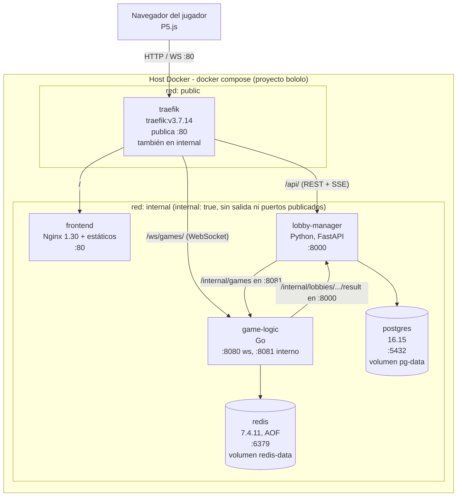

# Bololó - Despliegue e integración (DevOps)

| | |
|---|---|
| Componentes | API Gateway (Traefik), Presentación (Nginx), PostgreSQL, Redis; integración de Lobby Manager y Game Logic |
| Tecnología | Docker Compose, Traefik v3.7, Nginx 1.30, PostgreSQL 16, Redis 7.4 |
| Vistas cubiertas | Despliegue |
| Estado | Esqueleto funcional con rellenos para Go y Python, versión 0.1 (octubre 2026) |
| Rama | `feature/devops` |

## Contenido

1. [Propósito y alcance](#1-propósito-y-alcance)
2. [Vista de despliegue](#2-vista-de-despliegue)
3. [Redes y puertos](#3-redes-y-puertos)
4. [Contrato de rutas](#4-contrato-de-rutas)
5. [API Gateway (Traefik)](#5-api-gateway-traefik)
6. [Presentación (Nginx)](#6-presentación-nginx)
7. [Datos: Redis y PostgreSQL](#7-datos-redis-y-postgresql)
8. [Variables de entorno y secretos](#8-variables-de-entorno-y-secretos)
9. [Healthchecks y orden de arranque](#9-healthchecks-y-orden-de-arranque)
10. [Cómo ejecutar (Prototype)](#10-cómo-ejecutar-prototype)
11. [Verificación realizada](#11-verificación-realizada)
12. [Pendientes para los otros componentes](#12-pendientes-para-los-otros-componentes)
13. [Decisiones y diferencias con el diseño](#13-decisiones-y-diferencias-con-el-diseño)
14. [Plan y estado](#14-plan-y-estado)
15. [Riesgos](#15-riesgos)

---

## 1. Propósito y alcance

Este documento registra cómo se despliega Bololó con contenedores (RNF-11) y qué necesita cada componente para integrarse. Parte de la vista de despliegue de [game-logic-design.md §9](game-logic-design.md#9-deployment-view) y documenta lo que se implementó realmente.

Incluido:

- `docker-compose.yml` con los 6 contenedores, redes `public` e `internal`, volúmenes y healthchecks.
- Configuración de Traefik: enrutamiento, timeouts para WebSocket y SSE, logs sin el token.
- Imagen de Nginx para los estáticos de la presentación.
- Redis con persistencia AOF y contraseña; PostgreSQL con credenciales fuera del repositorio.
- `.env.example` con todas las variables del sistema.

Fuera de alcance (lo hacen otras piezas):

| Tema | Responsable |
|---|---|
| Servidor WebSocket, REST interno y `/healthz` de Go | Game Logic |
| API REST, SSE, JWT y esquema de PostgreSQL | Lobby Manager |
| Pantallas y llamadas a la API | Presentación |

Mientras Go y Python no tienen servidor, `lobby-manager` y `game-logic` usan la imagen `traefik/whoami` como **relleno**. Escucha en el mismo puerto que usará el servicio real y responde con los datos de la petición, así que rutas, redes y orden de arranque se pueden validar desde ya.

## 2. Vista de despliegue



| Servicio | Imagen | Redes | Puertos | Volúmenes | Espera a (healthy) | Healthcheck |
|---|---|---|---|---|---|---|
| `traefik` | `traefik:v3.7.14` | public, internal | 80 publicado | socket de Docker (ro), `traefik.yml` (ro) | ninguno | `traefik healthcheck --ping` |
| `frontend` | build de `presentation/` (base `nginx:1.30.5-alpine`) | internal | 80 | ninguno | ninguno | `wget --spider http://127.0.0.1/healthz` |
| `lobby-manager` | relleno `traefik/whoami:v1.12.0` | internal | 8000 | ninguno | `postgres` | pendiente (§12.2) |
| `game-logic` | relleno `traefik/whoami:v1.12.0` | internal | 8080 (8081 cuando exista) | ninguno | `redis` | pendiente (§12.1) |
| `postgres` | `postgres:16.15-alpine` | internal | 5432 | `pg-data` | ninguno | `pg_isready` |
| `redis` | `redis:7.4.11-alpine` | internal | 6379 | `redis-data` | ninguno | `redis-cli ping` |

Todos los servicios usan `restart: unless-stopped`.

## 3. Redes y puertos

- `public`: solo Traefik. Es el único contenedor con `ports:` y el único punto de entrada desde fuera.
- `internal`: todos los servicios, incluido Traefik. Tiene `internal: true`, así que Docker le quita la salida a internet y nada en ella se puede publicar en el host.
- Dentro de `internal`, los servicios se encuentran por nombre: `postgres:5432`, `redis:6379`, `game-logic:8081`, `lobby-manager:8000`.
- Traefik tiene `providers.docker.network: bololo_internal`. Como está en dos redes, sin esto podría intentar llegar a un servicio por la red equivocada y responder `504`.

Puertos que **no** se publican ni se enrutan: `8081` de Go, `/internal/*`, `5432` y `6379`.

## 4. Contrato de rutas

Las rutas públicas las define el gateway. Todo entra por el puerto 80.

| Ruta pública | Destino | Router Traefik | Implementa |
|---|---|---|---|
| `/` (prioridad mínima) | `frontend:80` | `web` | Presentación |
| `/api/...` (REST y SSE) | `lobby-manager:8000` | `lobby` | Lobby Manager |
| `/ws/games/{gameId}?token=<JWT>` | `game-logic:8080` | `game-ws` | Game Logic |
| `/internal/*`, `:8081`, bases de datos | no se enrutan | ninguno | solo red `internal` |

Reglas del contrato:

1. **Traefik no recorta el prefijo.** Python recibe `/api/lobbies` completo y Go recibe `/ws/games/{id}` completo. Cada servicio declara sus rutas con el prefijo incluido.
2. **El prefijo del lobby es `/api/`**, no `/api/lobbies`, para que Python pueda añadir rutas (por ejemplo el ingreso con nombre, RF-01) sin tocar el gateway. Se usa `/api/` con barra final porque `PathPrefix(`/api`)` también atraparía `/apiloquesea`.
3. **El frontend usa rutas relativas**: `fetch("/api/...")`, `new EventSource("/api/...")` y `new WebSocket("ws://" + location.host + "/ws/games/...")`.
4. Los `/healthz` de cada servicio se consultan dentro del contenedor y no se publican.

## 5. API Gateway (Traefik)

Archivos: [`api-gateway/traefik.yml`](../api-gateway/traefik.yml) (configuración estática) y labels en `docker-compose.yml` (rutas).

| Aspecto | Configuración | Por qué |
|---|---|---|
| Entrada | `entryPoints.web` en `:80` | Solo HTTP para el prototipo (§13) |
| Descubrimiento | Provider Docker con `exposedByDefault: false` | Solo se publica lo que tenga `traefik.enable=true`; las bases nunca quedan expuestas por accidente |
| WebSocket y SSE | `respondingTimeouts.readTimeout: 0`, `writeTimeout: 0` | En v3 `readTimeout` vale 60 s por defecto y cortaría una partida; `writeTimeout` distinto de 0 cortaría el stream SSE |
| Conexiones inactivas | `idleTimeout: 180s` | Valor por defecto; solo afecta keep-alive entre peticiones, no a un WebSocket abierto |
| SSE sin compresión | No se aplica el middleware `compress` al router `lobby` | La compresión acumula los eventos en un buffer y llegan tarde o todos juntos |
| Token fuera de los logs | `accessLog` en JSON con `RequestPath: drop` y headers en `drop` | El JWT va en el query string de `/ws/games`; `RouterName` sigue indicando a qué ruta fue cada petición |
| Nivel de log | `INFO` | En `DEBUG` Traefik imprime URLs completas con el token |
| Healthcheck | `ping: {}` | Crea el entrypoint interno `traefik` en `:8080` (no publicado) con `/ping` |
| Puerto destino | `traefik.http.services.<x>.loadbalancer.server.port` en cada servicio | Sin él, Traefik adivina por el `EXPOSE` de la imagen y puede dar `502` |

El *upgrade* a WebSocket no necesita configuración extra: Traefik lo reenvía de forma nativa.

## 6. Presentación (Nginx)

Archivos: [`presentation/Dockerfile`](../presentation/Dockerfile) y [`presentation/nginx.conf`](../presentation/nginx.conf).

- La imagen copia **solo** `libraries/`, `menu/` e `ingame/`. Así `Dockerfile`, `nginx.conf` y `jsconfig.json` no se sirven al público. Si se crea otra carpeta de pantallas, hay que añadir su `COPY`.
- `/` redirige con `302` a `/menu/`, porque no existe `index.html` en la raíz.
- `absolute_redirect off`: las redirecciones usan `Location` relativa y no exponen el host o puerto interno del contenedor.
- `/healthz` responde `200 ok` sin tocar disco y sin escribir en el log.
- `gzip` para CSS, JS y SVG: `p5.min.js` baja de 1,04 MB a 300 KB. Aquí sí se comprime porque son archivos completos, no streams.
- `Cache-Control: no-cache`: el navegador revalida en cada carga (barato, con ETag) y no muestra versiones viejas tras un cambio.
- `listen [::]:80` además de `listen 80`, porque en Alpine `localhost` puede resolverse a IPv6.
- `server_tokens off`: no muestra la versión de Nginx.

Después de cambiar algo en `presentation/` hay que reconstruir: `docker compose up -d --build frontend`.

## 7. Datos: Redis y PostgreSQL

### 7.1 Redis

| Opción | Valor | Efecto |
|---|---|---|
| `--appendonly` | `yes` | Cada escritura se registra en disco y se reproduce al reiniciar ([§8.4 del diseño](game-logic-design.md#84-service-restart-mid-match)) |
| `--appendfsync` | `everysec` | Se fuerza a disco cada segundo; ante una caída se pierde como máximo ~1 s ([§8.2](game-logic-design.md#82-when-data-is-written)) |
| `--requirepass` | `${REDIS_PASSWORD}` | Sin contraseña cualquier contenedor de `internal` podría leer o borrar partidas |
| `REDISCLI_AUTH` | `${REDIS_PASSWORD}` | `redis-cli` toma la contraseña de aquí; el healthcheck no la escribe en la línea de comandos |

Los datos viven en el volumen `redis-data` (`/data/appendonlydir/`, formato AOF multiparte de Redis 7: `base.rdb`, `incr.aof` y `manifest`).

### 7.2 PostgreSQL

- Usuario, contraseña y base salen de `.env` (`POSTGRES_USER`, `POSTGRES_PASSWORD`, `POSTGRES_DB`).
- Los datos viven en el volumen `pg-data` (`/var/lib/postgresql/data`). Se eligió la 16 porque es la del diseño; la 18 cambia la ruta de datos.
- **Las variables `POSTGRES_*` solo se aplican cuando el volumen está vacío.** Cambiar la contraseña en `.env` no cambia la de una base existente. En desarrollo, sin datos que conservar:
  ```bash
  docker compose rm -sf postgres
  docker volume rm bololo_pg-data
  docker compose up -d postgres
  ```
- El `pg_hba.conf` de la imagen confía (`trust`) en conexiones locales y por `127.0.0.1` dentro del contenedor. La contraseña solo se exige a conexiones que vienen de otros contenedores, que es el caso de Python. Para probar credenciales hay que hacerlo desde otro contenedor de la red `internal`.

## 8. Variables de entorno y secretos

Compose lee `.env` (junto a `docker-compose.yml`) y reemplaza las `${...}`. `.env` está en `.gitignore`; `.env.example` sí se versiona y tiene las mismas claves.

| Variable | Usada por | Ejemplo | Nota |
|---|---|---|---|
| `REDIS_PASSWORD` | redis, game-logic | hex aleatorio | Solo `0-9a-f`: va dentro de `REDIS_URL` y caracteres como `@ / :` la romperían |
| `POSTGRES_USER` | postgres, lobby-manager | `bololo` | |
| `POSTGRES_DB` | postgres, lobby-manager | `bololo` | |
| `POSTGRES_PASSWORD` | postgres, lobby-manager | hex aleatorio | Solo se aplica con volumen vacío (§7.2) |
| `JWT_SECRET` | lobby-manager (firma), game-logic (verifica) | hex aleatorio | Debe ser el mismo en ambos |
| `SERVICE_SECRET` | lobby-manager, game-logic | hex aleatorio | Header `X-Service-Token` del REST interno, en ambas direcciones |
| `ALLOWED_ORIGINS` | game-logic | `http://localhost` | `Origin` aceptado en el upgrade WebSocket |

Las variables obligatorias se escriben como `${VAR:?mensaje}`: si faltan, Compose no arranca y muestra el mensaje, en lugar de arrancar con un valor vacío.

Regla: quien añada una variable a `.env` actualiza también `.env.example`.

## 9. Healthchecks y orden de arranque

| Servicio | Comando | Intervalo | Timeout | Reintentos | `start_period` |
|---|---|---|---|---|---|
| `traefik` | `traefik healthcheck --ping` | 10 s | 3 s | 5 | 10 s |
| `frontend` | `wget -q --spider http://127.0.0.1/healthz` | 10 s | 3 s | 5 | 10 s |
| `postgres` | `pg_isready -U $${POSTGRES_USER} -d $${POSTGRES_DB}` | 10 s | 3 s | 5 | 20 s |
| `redis` | `redis-cli ping \| grep -q PONG` | 10 s | 3 s | 5 | 10 s |
| `lobby-manager` | pendiente (§12.2) | | | | |
| `game-logic` | pendiente (§12.1) | | | | |

- Durante `start_period` se comprueba cada 2 s (`start_interval`), así los servicios quedan `healthy` en segundos.
- `$$` hace que la variable la expanda el shell **dentro** del contenedor y no Compose.
- Las imágenes de Alpine traen `wget` pero no `curl`. Las imágenes distroless (Go) y `traefik/whoami` no tienen shell ni herramientas: el healthcheck debe hacerlo el propio binario.
- `depends_on` con `condition: service_healthy`: `lobby-manager` arranca cuando `postgres` está `healthy` y `game-logic` cuando `redis` lo está. Esto solo aplica al arranque; si una base se cae después, el servicio debe reintentar la conexión por su cuenta.

## 10. Cómo ejecutar el proyecto

### 10.1 Requisitos

- Docker Desktop con Docker Compose en Windows o macOS; Docker Engine y el complemento Docker Compose en Linux.
- Una conexión a Internet durante la primera construcción para descargar las imágenes y dependencias que no estén en caché. La mesa también carga p5.js desde un CDN, por lo que necesita Internet al abrirse.
- El puerto 80 disponible en la máquina.

En Windows o macOS, iniciar Docker Desktop y esperar a que indique que Docker está activo. En Linux, comprobar que el servicio de Docker esté iniciado.

### 10.2 Descomprimir y configurar

1. Descomprimir el ZIP con la herramienta del sistema o cualquier descompresor:
   - **Windows:** clic derecho en el ZIP → **Extraer todo…**
   - **macOS:** doble clic en el ZIP.
   - **Linux:** usar el gestor de archivos o la herramienta de archivos comprimidos de la distribución.
2. Abrir una terminal en la carpeta extraída que contiene `docker-compose.yml` y `.env.example`. No ejecutar los comandos desde una subcarpeta.
3. Crear `.env` a partir de `.env.example`:

   En PowerShell:
   ```powershell
   Copy-Item .env.example .env
   ```

   En macOS o Linux:
   ```bash
   cp .env.example .env
   ```

4. Editar `.env` y reemplazar cada valor `change-me` por un secreto local propio. No compartir ni subir este archivo.

### 10.3 Iniciar y comprobar

Desde la carpeta raíz del proyecto:

```bash
docker compose up -d --build --wait
docker compose ps
```

`up` crea e inicia todos los servicios del archivo Compose; `-d` los deja ejecutándose en segundo plano; `--build` construye las imágenes del proyecto; `--wait` espera a que los servicios estén en estado `running` o `healthy`. En `docker compose ps`, los servicios con healthcheck deben aparecer como `healthy`.

Abrir `http://localhost` en el navegador. La dirección redirige al menú de ingreso. Para una partida se necesitan cuatro jugadores, cada uno en una pestaña o navegador distinto y con un nombre diferente.

Para jugar desde otro equipo de la misma red, abrir `http://<IP-de-la-máquina-que-ejecuta-Docker>` en lugar de `localhost`. Permitir el puerto 80 en el firewall de esa máquina si es necesario.

Para detener los servicios sin borrar los datos:

```bash
docker compose down
```

La prueba de extremo a extremo es opcional y requiere un entorno con Bash (Linux, macOS, WSL o Git Bash):

```bash
./scripts/e2e.sh
```

| Acción | Comando |
|---|---|
| Ver logs de un servicio | `docker compose logs -f <servicio>` |
| Reconstruir tras cambios de código | `docker compose up -d --build --wait` |
| Detener, conservando datos | `docker compose down` |
| Detener y borrar datos (Postgres y Redis) | `docker compose down -v` |
| Validar el compose sin arrancar | `docker compose config --quiet` |
| Prueba de extremo a extremo | `./scripts/e2e.sh` |

## 11. Verificación realizada

Pruebas manuales hechas el 11 de octubre de 2026 sobre la rama `feature/devops`:

| Prueba | Resultado |
|---|---|
| `docker compose config --quiet` | Válido |
| `GET /` | `302`, `Location: /menu/` |
| `GET /menu/`, `/ingame/`, `/libraries/p5.min.js` | `200` |
| `GET /nginx.conf`, `/Dockerfile` | `404` |
| `GET /api/lobbies` | Llega al relleno de `lobby-manager` con la ruta completa |
| `GET /ws/games/g1?token=SECRETO` | Llega al relleno de `game-logic` |
| `GET /internal/x` | `404` del frontend; nunca llega a Go |
| `SECRETO` en `docker compose logs traefik` | 0 apariciones |
| Redis sin contraseña | `NOAUTH Authentication required` |
| Redis `CONFIG GET appendonly` / `appendfsync` | `yes` / `everysec` |
| Redis: `SET`, reinicio del contenedor, `GET` | El valor sobrevive |
| Postgres con la contraseña de `.env` desde la red `internal` | Conecta |
| Postgres con una contraseña antigua desde la red `internal` | `password authentication failed` |
| `docker compose up -d` desde cero | `postgres` y `redis` pasan a `Healthy` antes de que arranquen `lobby-manager` y `game-logic` |
| `docker compose ps` | `traefik`, `frontend`, `postgres` y `redis` en `(healthy)` |

### 11.1 Prueba de extremo a extremo (`scripts/e2e.sh`)

El script levanta el stack con `docker compose up --build --wait` y comprueba el despliegue completo a través de Traefik. Termina con código 0 solo si no hay fallas, así que sirve también en CI.

| Sección | Qué comprueba |
|---|---|
| Requisitos | `docker`, `curl`, `openssl`; `.env` existe y tiene las mismas claves que `.env.example` |
| Arranque | Todos los servicios con healthcheck en `healthy`; solo `traefik` publica puertos |
| Presentación | `GET /` → `302 /menu/`; `/menu/` y `/ingame/` → `200`; `/internal/games` → `404`; p5.js con gzip |
| Lobby manager | 4 sesiones (`201`), `401` sin sesión, crear sala, `409` al iniciar con 1 jugador, 3 ingresos por código, `409` al quinto, SSE con `text/event-stream`, sin compresión y con el evento `lobby` |
| API Gateway | `/ws/games/` llega a `game-logic`; un token en `?token=` no aparece en los logs de Traefik ni del lobby |
| Inicio de la partida | Con Go real: `200`, `gameId` y Go conoce la partida. Con el relleno: `502`, la sala sigue en `WAITING` y se borra al salir los 4 |
| WebSocket (solo Go real) | `101` con token válido; `401` con token inválido o con el de sesión; el token no queda en los logs |
| Fin de la partida (solo Go real) | Simulación hasta el final, sala `CLOSED`, resultado una sola vez en PostgreSQL, partida fuera de `games:active` |
| Datos | Redis exige contraseña, AOF `yes` / `everysec`; Postgres acepta la contraseña de `.env` y rechaza otra |

El script detecta si `game-logic` es el servicio real consultando `GET http://game-logic:8081/healthz` desde la red interna. Con el relleno, las pruebas de WebSocket y de fin de partida se marcan como **omitidas**; cuando Go reemplace al relleno se ejecutan sin cambiar el script.

Resultado el 12 de octubre de 2026 sobre `main` (`d026fb8`), con `game-logic` como relleno: **44 OK, 0 fallas, 3 omitidas**.

Variables opcionales: `BASE_URL` (por defecto `http://localhost`), `WAIT_TIMEOUT` (300 s) y `P5_PATH` (`/libraries/p5.min.js`; cambia cuando se separen los frontends).

## 12. Pendientes para los otros componentes

Lo que el despliegue necesita de cada equipo para reemplazar los rellenos. Cuando esté listo, avisar a DevOps para ajustar `docker-compose.yml`.

### 12.1 Game Logic (Go)

| # | Pendiente | Detalle |
|---|---|---|
| G1 | Ejecutable `cmd/server` | El `Dockerfile` ya acepta `--build-arg APP=server`; Compose lo construirá así |
| G2 | Escuchar en `0.0.0.0` | WebSocket en `WS_PORT` (8080) e interno en `INTERNAL_PORT` (8081). Si escucha en `127.0.0.1`, Traefik no lo alcanza y responde `502` |
| G3 | Ruta `/ws/games/{gameId}` con el prefijo completo | Traefik no recorta el prefijo (§4) |
| G4 | `GET /healthz` en 8081 | `200 {"status":"ok","redis":"ok"}` o `503` si Redis no responde ([diseño §7.2](game-logic-design.md#72-internal-rest-api-go)) |
| G5 | Flag `-healthcheck` en el binario | La imagen distroless no tiene shell ni `curl`. `/app -healthcheck` hace `GET http://127.0.0.1:8081/healthz` y sale con 0 o 1. Compose usará `test: ["CMD", "/app", "-healthcheck"]` |
| G6 | Leer configuración del entorno | `WS_PORT`, `INTERNAL_PORT`, `REDIS_URL` (`redis://:${REDIS_PASSWORD}@redis:6379/0`), `JWT_SECRET`, `SERVICE_SECRET`, `LOBBY_CALLBACK_URL` (`http://lobby-manager:8000`), `ALLOWED_ORIGINS` (`http://localhost`) |
| G7 | No registrar la URL con el token | El JWT viaja en `?token=`; no imprimir la URL completa en los logs propios |
| G8 | Reintentar la conexión a Redis | `depends_on` solo garantiza Redis al arrancar |

### 12.2 Lobby Manager (Python)

| # | Pendiente | Detalle |
|---|---|---|
| L1 | `lobby-manager/Dockerfile` | Base `python:3.12-slim`; arrancar con `uvicorn ... --host 0.0.0.0 --port 8000 --proxy-headers` |
| L2 | Rutas públicas bajo `/api/` con el prefijo completo | Por ejemplo `/api/lobbies`, `/api/lobbies/{id}/events` (SSE). Traefik no recorta el prefijo |
| L3 | `GET /healthz` en 8000, fuera de `/api/` | No se publica; solo lo usa Docker |
| L4 | Healthcheck sin `curl` | `python:3.12-slim` no trae `curl`. Compose usará `python -c "import urllib.request; urllib.request.urlopen('http://127.0.0.1:8000/healthz')"` |
| L5 | SSE | `Content-Type: text/event-stream`, `Cache-Control: no-cache` y un comentario de keep-alive (`: ping`) cada ~15 s. No comprimir la respuesta |
| L6 | Un solo worker de uvicorn | Si el estado de las salas y las suscripciones SSE viven en memoria, con varios workers un evento no llega a todos los clientes |
| L7 | Configuración desde el entorno | `POSTGRES_USER`, `POSTGRES_PASSWORD`, `POSTGRES_DB`, host `postgres`, puerto `5432`; `JWT_SECRET`, `SERVICE_SECRET`; `GAME_LOGIC_URL` (`http://game-logic:8081`). Confirmar si prefieren una sola `DATABASE_URL` |
| L8 | Esquema de la base | Decidir: scripts `.sql` en `lobby-manager/` montados en `/docker-entrypoint-initdb.d` (solo se ejecutan con el volumen vacío) o creación desde la aplicación (SQLAlchemy / Alembic) |
| L9 | Reintentar la conexión a PostgreSQL | `depends_on` solo garantiza Postgres al arrancar |
| L10 | Callback idempotente | `POST /internal/lobbies/{lobbyId}/result` con `X-Service-Token`, idempotente por `gameId` (RNF-04, [diseño §7.6](game-logic-design.md#76-result-callback-go--python)) |

### 12.3 Presentación (p5.js)

| # | Pendiente | Detalle |
|---|---|---|
| P1 | Quitar URLs absolutas | `presentation/ingame/action.js:2` usa `http://localhost:3000/score`; debe ser una ruta relativa bajo `/api/` |
| P2 | URL del WebSocket | `` `ws://${location.host}/ws/games/${gameId}?token=${token}` `` |
| P3 | SSE | `new EventSource("/api/lobbies/<id>/events")` (ruta exacta según L2) |
| P4 | Carpetas nuevas | Añadir su `COPY` en `presentation/Dockerfile` |

### 12.4 Todos

- No versionar `.env`; actualizar `.env.example` al añadir variables.
- Escuchar en `0.0.0.0` dentro del contenedor.
- Tras cambiar código: `docker compose up -d --build <servicio>`.

## 13. Decisiones y diferencias con el diseño

| Tema | Diseño (§9) | Implementado | Motivo |
|---|---|---|---|
| Protocolo | HTTPS/WSS, puertos 80 y 443 | Solo HTTP en 80 | Demo local; los certificados autofirmados generan avisos en el navegador. En producción se añadiría TLS en Traefik |
| Ruta del lobby | `/api/lobbies` | `/api/` | Permite más rutas del lobby sin cambiar el gateway |
| Versiones | `traefik:v3.x`, `postgres:16`, `redis:7`, `nginx:alpine` | `v3.7.14`, `16.15-alpine`, `7.4.11-alpine`, `1.30.5-alpine` | Tags exactos verificados en Docker Hub para que la demo no cambie sola |
| Configuración de Redis | `appendonly`, `appendfsync everysec`, `requirepass` | Igual, como argumentos de `redis-server` | Un `redis.conf` no puede leer variables de entorno |
| Healthcheck de Traefik | No especificado | `ping` | Permite saber si el gateway responde |

## 14. Plan y estado

| Paso | Actividades | Entregable | Estado |
|---|---|---|---|
| 1. Esqueleto | 6 servicios, redes, volúmenes, rellenos | `docker-compose.yml` | Hecho |
| 2. Gateway | Configuración estática, rutas, timeouts, logs sin token | `api-gateway/traefik.yml`, labels | Hecho |
| 3. Presentación | Imagen Nginx con estáticos | `presentation/Dockerfile`, `presentation/nginx.conf` | Hecho |
| 4. Datos | Redis con AOF y contraseña; PostgreSQL con credenciales en `.env` | `docker-compose.yml`, `.gitignore` | Hecho |
| 5. Variables | Plantilla de variables | `.env.example` | Hecho |
| 6. Salud y arranque | Healthchecks, `depends_on`, `restart` | `docker-compose.yml` | Hecho |
| 7. Prueba extremo a extremo | Levantar, esperar `healthy`, probar `/`, `/api/`, SSE y WebSocket | `scripts/e2e.sh` | Hecho (las pruebas que necesitan Go se activan solas cuando reemplace al relleno) |
| 8. Integración | Reemplazar rellenos por las imágenes reales (§12) | `docker-compose.yml` | Pendiente, depende de Go y Python |
| 9. Documentación de entrega | Vista de despliegue y comandos para el PDF | Este documento | En curso |

## 15. Riesgos

| Riesgo | Mitigación |
|---|---|
| Traefik monta el socket de Docker, que da control sobre el host | Montaje `:ro` y uso local. En producción: proxy del socket con permisos mínimos o provider de archivo |
| `readTimeout: 0` deja el gateway expuesto a clientes lentos (slowloris) | Aceptable en el prototipo local; en producción, un valor alto pero finito |
| La contraseña de Redis aparece en `docker inspect` (va en `command`) | Aceptable en el prototipo; en producción, Docker secrets |
| Las imágenes distroless y slim no tienen `curl`, así que no hay healthcheck sin cambios en el código | Pendientes G5 y L4 |
| Cambiar `POSTGRES_PASSWORD` no afecta a una base ya creada | Documentado en §7.2 |
| Copiar archivos YAML desde la terminal cortó líneas largas y produjo errores o, peor, valores truncados válidos | Pegar en un editor y revisar con `docker compose config` y `awk 'length>60' docker-compose.yml` |
| Las rutas acordadas pueden no coincidir con lo que implementen Go y Python | Contrato de rutas de §4, comunicado al equipo |
