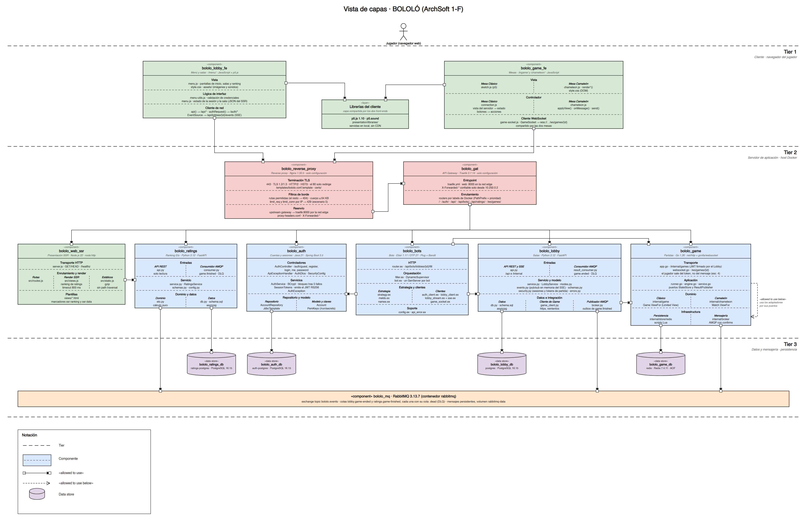

# Vista de capas (Layered View) · Bololó

Prototipo 3 · Equipo 1F. Diagrama editable: [`layered-view.drawio`](layered-view.drawio). Imagen: [`layered-view.png`](layered-view.png).

## 1. Qué muestra esta vista

La estructura en capas agrupa las piezas del sistema que ofrecen un conjunto cohesivo de servicios, y las relaciona con *allowed-to-use*, que va en un solo sentido (diapositivas *Layered and Decomposition Structures*). Tiene tres tipos de elementos:

| Elemento | Qué es en Bololó | Cómo se dibuja |
|---|---|---|
| **Tier** | Separación **física**: dónde corre el código. Cliente, servidor de aplicación y datos | Franja entre dos líneas punteadas horizontales, con «Tier N» a la derecha |
| **Layer** | Separación **lógica dentro de un componente**: su subarquitectura (por ejemplo, controladores → servicios → repositorios) | Fila dentro de la caja del componente. Las capas van apiladas y separadas por una línea punteada horizontal |
| **Layer segment** | Partición de una capa por función, cuando hay piezas del mismo nivel | División punteada vertical dentro de la fila, como *Repos ┆ Modelos* |
| **Data store** | La capa de persistencia de cada servicio | Cilindro en el Tier 3 |

Relaciones:

- **`«allowed to use»`**: el origen puede usar al destino. Dentro de un componente es implícita: cada capa usa la que tiene debajo, por eso no se dibujan flechas entre capas. Entre componentes es una flecha que sale de un **puerto** (cuadrado en el borde) y llega a otro. Va hacia abajo o hacia otro componente del mismo tier.
- **`«allowed to use below»`**: salta una capa intermedia. Es una flecha punteada. En Bololó hay un caso, dentro de `bololo_game` (§3.8).

Restricciones del estilo:

- Cada pieza de software está en una sola capa.
- Hay al menos dos capas.
- Ninguna relación va hacia arriba, así que no hay ciclos.

En §5 está cómo se cumple cada una.

La notación sigue los apuntes de la clase *Layered and Decomposition*. El jugador va arriba, los tiers se leen de arriba hacia abajo, y cada componente es una caja con sus capas adentro. Los componentes llevan los nombres de la vista C&C (`bololo_*`) y los colores de la vista de despliegue:

| Color | Tipo de componente |
|---|---|
| Verde | Presentación |
| Rojo | Proxy y gateway |
| Azul | Lógica |
| Naranja | Broker |
| Morado | Datos |

## 2. Tiers

| Tier | Qué contiene | Por qué es un tier aparte |
|---|---|---|
| **T1 · Cliente** | `bololo_lobby_fe`, `bololo_game_fe` y las librerías del cliente | Corre en el navegador del jugador. `bololo_web_ssr` solo le entrega los archivos |
| **T2 · Servidor de aplicación** | `bololo_reverse_proxy`, `bololo_gat`, `bololo_web_ssr`, `bololo_auth`, `bololo_ratings`, `bololo_bots`, `bololo_lobby`, `bololo_game` | Contenedores de Compose sin estado propio: todo el estado está en el T3. Arriba el borde (proxy y gateway), abajo los servicios |
| **T3 · Datos y mensajería** | `bololo_auth_db`, `bololo_lobby_db`, `bololo_ratings_db` (PostgreSQL), `bololo_game_db` (Redis) y `bololo_mq` (RabbitMQ) | Servidores con volumen propio. Sobreviven a reinicios y a reemplazos del T2 |

**RabbitMQ va en el T3.** Es infraestructura durable: tiene volumen y los mensajes son persistentes. Los servicios del T2 lo usan, y él no usa nada de arriba. En la vista de despliegue también está junto a los datos. Quienes publican y consumen eventos son código de cada servicio, así que están en el T2, en su capa de entradas o de integración.

Todo el T2 y el T3 corren hoy en un solo host Docker. La separación entre ellos la imponen las redes (escenarios 2 y 3), y la vista de despliegue muestra en qué contenedor queda cada elemento.

## 3. Capas de cada componente

### 3.1 `bololo_lobby_fe` (T1, JavaScript + p5.js)

| Capa | Piezas | Responsabilidad |
|---|---|---|
| Vista | `menu.js`, sección de pantallas (inicio, salas, ranking); `style.css`; `assets/` | Dibujar y capturar la interacción |
| Lógica de interfaz | `menu-utils.js` (validación de credenciales); `menu.js`, estado de sesión y sala | Reglas de la pantalla. Reutiliza el JSON que inyecta el SSR |
| Cliente de red | `menu.js`: `api()` → `/api/*` (`menu.js:162`), `authRequest()` → `/auth/*` (`menu.js:177`), `EventSource` de la sala (`menu.js:409`) | Hablar con el servidor |

Vista → Lógica de interfaz → Cliente de red. La Vista además usa las **Librerías del cliente** (`presentation/libraries/`: p5 y p5.sound, servidas en local y sin CDN). Es una capa compartida por los dos componentes del T1.

### 3.2 `bololo_game_fe` (T1)

| Capa | Segmentos | Piezas |
|---|---|---|
| Vista | Mesa Clásico · Mesa Camaleón | `sketch.js` (p5) · `chameleon.js` (`render*()`) y `style.css` |
| Controlador | Mesa Clásico · Mesa Camaleón | `connection.js` (traduce la vista del servidor al estado y los botones a acciones) · `chameleon.js` (`applyView()`, `onMessage()`, `send()`) |
| Cliente WebSocket | — | `game-socket.js` (`GameSocket`), compartido. Camaleón lo importa en `chameleon.js:9` y Clásico en `connection.js:5` |

Es un cliente delgado: las reglas las decide `bololo_game`.

### 3.3 `bololo_reverse_proxy` (T2, Nginx)

No tiene código propio, solo configuración. Las capas son las etapas por las que pasa cada petición.

| Capa | Piezas |
|---|---|
| Terminación TLS | `templates/bololo.conf.template`: 443 con TLS 1.2/1.3, HTTP/2 y HSTS. El 80 solo redirige |
| Filtros de borde | Lista de rutas permitidas (el resto recibe `404`), cuerpo de 64 KB como máximo (`nginx.conf`), límite de tasa por IP con `limit_req` y `limit_conn` (escenario 5) |
| Reenvío | `upstream gateway` → `traefik:8000` por la red `edge`; `proxy-headers.conf` |

### 3.4 `bololo_gat` (T2, Traefik)

| Capa | Piezas |
|---|---|
| Entrypoint | `api-gateway/traefik.yml`: `web :8000`; confía en `X-Forwarded-*` solo desde `10.250.0.2` |
| Enrutamiento | Routers por labels de Docker en `docker-compose.yml` (`PathPrefix` y prioridad) |

### 3.5 `bololo_web_ssr` (T2, Node.js)

| Capa | Segmentos | Piezas |
|---|---|---|
| Transporte HTTP | — | `server.js` |
| Enrutamiento y render | Rutas · Render SSR · Estáticos | `src/routes.js` · `src/views.js` (pide el ranking a `bololo_ratings`, `views.js:16-18`, con *timeout* de 800 ms) · `src/static.js` (gzip, sin *path traversal*) |
| Plantillas | — | `views/*.html` con los marcadores `ssr:ranking` y `ssr:data` |

### 3.6 `bololo_auth` (T2, Java / Spring Boot)

| Capa | Piezas |
|---|---|
| Controladores | `AuthController` (`/auth/guest`, `register`, `login`, `me`, `password`), `ApiExceptionHandler`, `AuthDtos`, `SecurityConfig` |
| Servicios | `AuthService` (BCrypt, bloqueo tras 5 fallos), `SessionTokens` (emite el JWT RS256), `AuthException` |
| Repositorio y modelo | `AccountRepository` (`JdbcTemplate`), `Account`, `PemKeys` (lee las claves de `/run/secrets`) |

### 3.7 `bololo_ratings` (T2, Python / FastAPI)

| Capa | Segmentos | Piezas |
|---|---|---|
| Entradas | API REST · Consumidor AMQP | `api.py` (solo lectura) · `consumer.py` (`game.finished`, con DLQ) |
| Servicio | — | `service.py` (`RatingsService`), `schemas.py`, `config.py` |
| Dominio y datos | Dominio · Datos | `elo.py` (cálculo puro) · `db.py`, `schema.sql` (asyncpg) |

### 3.8 `bololo_game` (T2, Go)

| Capa | Segmentos | Piezas |
|---|---|---|
| Transporte | — | `internal/server/app.go` (REST `/internal/games`, verifica el JWT de partida) y `websocket.go`. El jugador de cada acción sale del token, no del mensaje (escenario 4) |
| Aplicación | — | `runner.go`, `engine.go`, `service.go`; los puertos `StateStore` (`app.go:34`) y `ResultPublisher` (`app.go:104`) |
| Dominio | Clásico · Camaleón | `internal/game` (`Game.ViewFor`, `view.go:46`: Limited View, cada jugador recibe solo su mano) · `internal/chameleon` (`Match.ViewFor`: las manos son públicas por diseño). No importan ningún otro paquete interno |
| Infraestructura | Persistencia · Mensajería | `internal/store/redis` (scripts Lua) · `internal/broker` (AMQP con *confirms*) |

**Aplicación → Infraestructura es `«allowed to use below»`.** Aplicación usa los adaptadores a través de sus puertos sin pasar por el Dominio, y el Dominio no conoce la infraestructura. `cmd/server/main.go` crea los adaptadores y los inyecta.

`internal/bot` solo lo usa la herramienta `cmd/simulate` (`main.go:14`): no es parte del servidor y no aparece en la vista.

### 3.9 `bololo_bots` (T2, Elixir / OTP)

| Capa | Segmentos | Piezas |
|---|---|---|
| HTTP | — | `router.ex` (`/api/bots/lobbies/{id}/fill`) |
| Orquestación | — | `filler.ex` (`DynamicSupervisor`) y `bot.ex` (un `GenServer` por bot) |
| Estrategia y clientes | Estrategia · Clientes | `strategy.ex`, `melds.ex`, `names.ex` · `auth_client.ex`, `lobby_client.ex`, `lobby_stream.ex` + `sse.ex`, `game_socket.ex` |
| Soporte | — | `config.ex` y `api_error.ex`, usados por las capas de arriba |

Los clientes declaran su contrato con `@callback` (`lobby_client.ex:11-17`, `auth_client.ex:9-12`), y las pruebas los reemplazan por *fakes*.

### 3.10 `bololo_lobby` (T2, Python / FastAPI)

| Capa | Segmentos | Piezas |
|---|---|---|
| Entradas | API REST y SSE · Consumidor AMQP | `api.py` (routers `/api` e `/internal`) · `result_consumer.py` (`game.ended`, con DLQ) |
| Servicio y modelo | — | `service.py` (`LobbyService`), `modes.py`, `events.py` (pub/sub en memoria del SSE), `schemas.py`, `security.py` (verifica sesiones y firma tokens de partida), `errors.py` |
| Datos e integración | Datos · Cliente de Game · Publicador AMQP | `db.py`, `schema.sql` · `game_client.py` (httpx con reintentos) · `broker.py` (*outbox* de `game.finished`) |

`main.py` es la raíz de composición: crea el pool, los clientes y el consumidor, y arranca el bucle que publica el *outbox* (`main.py:63`, `:128`). No pertenece a ninguna capa.

## 4. Relaciones entre componentes

Las flechas entre componentes también son *allowed-to-use*. El diagrama no les pone etiqueta para no saturarlo; el protocolo de cada una está en la vista C&C.

| # | Origen (capa) | Destino | Tipo | Conector C&C |
|---|---|---|---|---|
| 1 | `bololo_lobby_fe` (Cliente de red) | `bololo_reverse_proxy` | T1 → T2 | C1 (REST, SSE + TLS) |
| 2 | `bololo_game_fe` (Cliente WebSocket) | `bololo_reverse_proxy` | T1 → T2 | C3 (WebSocket + TLS) |
| 3 | `bololo_reverse_proxy` (Reenvío) | `bololo_gat` | dentro del T2, del borde al gateway | C21 |
| 4 | `bololo_gat` (Enrutamiento) | `bololo_web_ssr`, `bololo_auth`, `bololo_lobby`, `bololo_game`, `bololo_bots`, `bololo_ratings` | dentro del T2, del borde a los servicios | C2, C5, C6, C8, C7, C4 |
| 5 | `bololo_web_ssr` (Render SSR) | `bololo_ratings` | entre servicios del T2 | C20 |
| 6 | `bololo_bots` (Clientes) | `bololo_auth`, `bololo_lobby`, `bololo_game` | entre servicios del T2 | C9, C10, C11 |
| 7 | `bololo_lobby` (Cliente de Game) | `bololo_game` | entre servicios del T2 | C12 |
| 8 | `bololo_auth` (Repositorio) | `bololo_auth_db` | T2 → T3 | C17 |
| 9 | `bololo_lobby` (Datos) | `bololo_lobby_db` | T2 → T3 | C18 |
| 10 | `bololo_ratings` (Datos) | `bololo_ratings_db` | T2 → T3 | C16 |
| 11 | `bololo_game` (Persistencia) | `bololo_game_db` | T2 → T3 | C19 |
| 12 | `bololo_game` (Mensajería), `bololo_lobby` (Consumidor AMQP y Publicador) y `bololo_ratings` (Consumidor AMQP) | `bololo_mq` | T2 → T3 | C13, C14, C15 |

En AMQP, RabbitMQ entrega los mensajes por *push*, pero la dependencia va del consumidor al broker: el consumidor abre la conexión y declara su cola. La relación también apunta hacia abajo.

Grafo de los servicios del T2: SSR → Ratings; Bots → Auth, Lobby y Game; Lobby → Game. **Es acíclico.** El ciclo Lobby ↔ Game que existía se eliminó en el commit `4fcb57e`: Game publica `game.ended` en RabbitMQ en lugar de llamar al Lobby.

## 5. Restricciones y excepciones

| Restricción | Cómo se cumple | Excepciones conocidas |
|---|---|---|
| Cada pieza en una sola capa | Cada archivo, clase o paquete aparece una vez | `menu.js` y `chameleon.js` mezclan vista, estado y red en un solo archivo. En el diagrama se separan por secciones y queda como deuda del front |
| Al menos dos capas | 3 tiers; cada componente con código tiene 3 o 4 capas | `bololo_gat` tiene 2, porque es solo configuración |
| Sin relaciones hacia arriba | Todas las flechas bajan o van a otro componente del mismo tier | Ninguna |
| Saltar capas solo si se declara | `bololo_game`: Aplicación → Infraestructura, declarada como `«allowed to use below»` | Atajos menores, no dibujados: `AuthController` usa `JdbcTemplate` para `/healthz` (`AuthController.java:57`), saltándose el servicio; `router.ex` usa `ApiError` de Soporte; los puertos de `app.go` usan el tipo `redisstore.Record` del adaptador (`app.go:36`) |

## 6. Patrones arquitectónicos

| Patrón | Dónde |
|---|---|
| **Arquitectura en 3 tiers** | Cliente, servidor de aplicación y datos (§2) |
| **Capas por servicio** (controlador → servicio → repositorio) | `bololo_auth`, `bololo_lobby` y `bololo_ratings`. En `bololo_web_ssr`: transporte → render → plantillas |
| **Ports and Adapters** (parcial) | `bololo_game`: `StateStore` y `ResultPublisher` con adaptadores Redis y AMQP. `bololo_bots`: `@callback` en los clientes. `bololo_lobby`: `ResultBroker` (`Protocol`) |
| **Cliente delgado** | `bololo_game_fe`: el servidor manda la vista y el cliente solo dibuja y envía acciones |
| **Reverse Proxy + API Gateway** en el borde del T2 | `bololo_reverse_proxy` filtra y limita; `bololo_gat` enruta (escenarios 2 y 5) |
| **Publish-Subscribe** hacia el T3 | `bololo_mq`, exchange `bololo.events` |
| **Base de datos por servicio** | Cada almacén del T3 tiene un solo dueño en el T2 |

**Atributos de calidad que favorece esta estructura:**

- **Modificabilidad.** Cambiar la base de datos de un servicio solo toca su última capa.
- **Reemplazo.** El proxy y el gateway se cambian sin tocar los servicios. Así se agregó Nginx en el escenario 2.
- **Seguridad.** Cada almacén del T3 solo se alcanza desde la capa inferior de su dueño (escenario 3).
- **Reparto del trabajo.** Cada componente tiene un responsable y sus capas cambian sin coordinarse con los demás.

## 7. Qué cambió frente a la versión anterior

La vista del Prototipo 2 tenía 5 capas a nivel de sistema: Presentación-cliente, Comunicación, Presentación-servidor, Lógica y Datos. Mezclaba tiers con capas, y no mostraba la estructura interna de ningún componente. Esta versión sigue la definición de la clase:

- Los **tiers** son la separación física.
- Las **capas** son la subarquitectura de cada componente: controladores, servicios, repositorios y modelos.
- Los **segmentos** dividen una capa por función.

Además, incorpora `bololo_reverse_proxy` (escenario 2), el límite de tasa en su capa de filtros (escenario 5) y la Limited View de `bololo_game` (escenario 4).

La notación se redibujó con el estilo de los apuntes de clase. Antes eran paquetes UML anidados y regiones de colores. Ahora son tiers separados por líneas punteadas, componentes con capas apiladas, segmentos con división vertical, puertos en el borde y cilindros para la persistencia.

## 8. Cómo editar el diagrama

- Abrir `docs/layered-view.drawio` en [app.diagrams.net](https://app.diagrams.net) o con la extensión *Draw.io Integration* de VS Code.
- Exportar con **Archivo → Exportar como → PNG** (zoom 100 %, con borde de 10 px) y reemplazar `docs/layered-view.png`.
