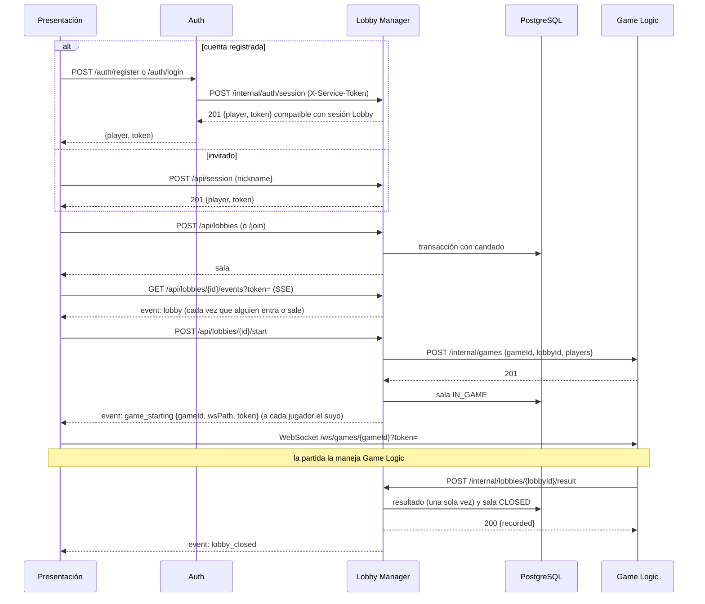

# Bololó - Lobby Manager: contrato de integración

| | |
|---|---|
| Componente | Lobby Manager |
| Tecnología | Python 3.12, FastAPI, PostgreSQL 16 |
| Requisitos | RF-01 a RF-09, RF-36, RNF-04 |
| Estado | Implementado y probado, versión 1.0 (octubre 2026) |

Este documento es lo que necesitan los demás componentes para hablar con el Lobby Manager. El detalle interno está en [lobby-manager/README.md](../lobby-manager/README.md) y la especificación campo por campo en [lobby-manager/docs/openapi.json](../lobby-manager/docs/openapi.json) (o en vivo en `/api/docs`).

## Contenido

1. [Recorrido completo](#1-recorrido-completo)
2. [Para Presentación](#2-para-presentación)
3. [Para Auth](#3-para-auth)
4. [Para Game Logic](#4-para-game-logic)
5. [Para despliegue](#5-para-despliegue)
6. [Diferencias con el diseño inicial](#6-diferencias-con-el-diseño-inicial)

---

## 1. Recorrido completo



## 2. Para Presentación

Las rutas públicas pasan por el gateway: Lobby usa `fetch("/api/...")`; Auth usa `/auth/...`.

Registro y login pasan por `/auth/register` y `/auth/login` hacia Auth. Auth conserva las credenciales y solicita al Lobby, por la red interna, el token de sesión común. El flujo invitado existente sigue usando `POST /api/session`.

### 2.1 Sesión

`POST /api/session` con `{"nickname": "Ana"}` devuelve:

```json
{ "player": { "id": "p_3f9a1c2b7d4e", "nickname": "Ana" }, "token": "<token de sesión>" }
```

El token se envía en **todas** las demás peticiones como `Authorization: Bearer <token>`. Conviene guardarlo en `sessionStorage`, que es por pestaña: así cuatro pestañas son cuatro jugadores. Dura 12 horas.

`GET /api/session` devuelve `{player, lobby}`: sirve para saber, al recargar la página, si el jugador ya estaba en una sala. Si responde `401`, hay que volver a pedir el nombre.

### 2.2 Rutas

| Método y ruta | Cuerpo | Respuesta | Requisito |
|---|---|---|---|
| `POST /api/session` | `{nickname}` | `201` `{player, token}` | RF-01 |
| `POST /auth/register` | `{username, password}` | `201` `{player, token}` | Auth |
| `POST /auth/login` | `{username, password}` | `200` `{player, token}` | Auth |
| `GET /api/session` | | `200` `{player, lobby}` | RF-01 |
| `GET /api/lobbies` | | `200` lista de `{id, code, playerCount, maxPlayers, createdAt}` | RF-04 |
| `POST /api/lobbies` | | `201` sala | RF-02, RF-03 |
| `POST /api/lobbies/{id}/join` | | `200` sala | RF-05, RF-06 |
| `POST /api/lobbies/join` | `{code}` | `200` sala | RF-05, RF-06 |
| `GET /api/lobbies/{id}` | | `200` sala | RF-08 |
| `POST /api/lobbies/{id}/leave` | | `204` | RF-07 |
| `POST /api/lobbies/{id}/start` | | `200` sala con `game` | RF-09 |
| `GET /api/lobbies/{id}/events?token=` | | stream SSE | RF-08 |

Una **sala** tiene esta forma:

```json
{
  "id": "l_0c5d8e1f2a3b",
  "code": "K7QM2X",
  "status": "WAITING",
  "players": [
    { "id": "p_3f9a1c2b7d4e", "nickname": "Ana", "seat": 0 },
    { "id": "p_81c2d3e4f5a6", "nickname": "Beto", "seat": 1 }
  ],
  "playerCount": 2,
  "maxPlayers": 4,
  "createdAt": "2026-10-12T01:34:50.345521Z",
  "game": null
}
```

`status` es `WAITING`, `IN_GAME` o `CLOSED`. `game` solo viene cuando la partida inició y quien pregunta es jugador de la sala:

```json
"game": { "gameId": "g_7f3a9c1e2b4d", "wsPath": "/ws/games/g_7f3a9c1e2b4d", "token": "<token de partida>" }
```

La lista de salas incluye las que están llenas (`playerCount == maxPlayers`), para que la pantalla pueda mostrarlas deshabilitadas. Si la lista viene vacía, la pantalla muestra el mensaje que invita a crear una.

### 2.3 Sala de espera (SSE)

`EventSource` no permite enviar cabeceras, así que aquí el token de sesión va en la URL:

```js
const es = new EventSource(`/api/lobbies/${lobbyId}/events?token=${sessionToken}`);

es.addEventListener("lobby", (e) => pintarSala(JSON.parse(e.data)));

es.addEventListener("game_starting", (e) => {
  const { gameId, wsPath, token } = JSON.parse(e.data);
  es.close();
  // pasar a la mesa de juego y abrir:
  // new WebSocket(`ws://${location.host}${wsPath}?token=${token}`)
});

es.addEventListener("lobby_closed", () => es.close());
```

| Evento | Cuándo | Datos |
|---|---|---|
| `lobby` | Al conectar y cada vez que alguien entra, sale o inicia la partida | La sala completa (con `game: null`) |
| `game_starting` | Al iniciar la partida, y al conectar si ya había iniciado | `{lobbyId, gameId, wsPath, token}`, con el token de **ese** jugador |
| `lobby_closed` | Al registrarse el resultado. Después el servidor cierra el stream | `{lobbyId, gameId, reason, winnerId, winners, endReason}` |

Detalles que conviene conocer:

- Cada `lobby` trae el estado completo, no un cambio: basta con reemplazar lo que se muestra.
- Al reconectar (el navegador lo hace solo) llega de nuevo el estado actual, así que no se pierde nada.
- Solo los jugadores de la sala pueden abrir el stream (`403` para los demás).
- **Cerrar la página cuenta como salir.** Si un jugador se queda 30 s sin conexión SSE en una sala en espera, el servidor lo saca. Recargar la página no lo afecta. Por eso la sala de espera debe mantener el `EventSource` abierto.
- Quien pulsa "iniciar" recibe el `game` en la respuesta del `POST` y además el evento; puede usar cualquiera de los dos.
- Cada ~15 s llega un comentario `: ping` que `EventSource` ignora.

### 2.4 Errores

Todos los errores tienen la misma forma. `message` está en español y se puede mostrar tal cual (RNF-09); `code` es estable y sirve para decidir qué hacer.

```json
{ "code": "lobby_full", "message": "La sala está llena." }
```

| HTTP | `code` | Cuándo |
|---|---|---|
| 401 | `invalid_session` | Falta el token, expiró o el jugador ya no existe. Volver a pedir el nombre |
| 422 | `invalid_nickname` | Nombre vacío o de más de 20 caracteres |
| 422 | `invalid_request` | Cuerpo mal formado |
| 404 | `lobby_not_found` | La sala o el código no existen, o la sala ya se cerró |
| 409 | `lobby_limit_reached` | Ya hay 10 salas (RF-03) |
| 409 | `lobby_full` | La sala ya tiene 4 jugadores (RF-06) |
| 409 | `lobby_started` | La partida ya inició: no se puede entrar ni salir |
| 409 | `already_in_lobby` | El jugador ya está en otra sala |
| 409 | `not_enough_players` | Faltan jugadores; el mensaje dice cuántos (RF-09) |
| 403 | `not_in_lobby` | El jugador no pertenece a esa sala |
| 502 | `game_service_unavailable` | Game Logic no respondió. La sala sigue en espera; se puede reintentar |

## 3. Para Auth

Auth llama `POST /internal/auth/session` en la red privada, con `X-Service-Token: <SERVICE_SECRET>` y cuerpo `{"accountId":"<UUID de cuenta>","nickname":"ana"}`. La operación es idempotente por `accountId`: devuelve el mismo jugador y un nuevo token de sesión compatible con `POST /api/session`. El endpoint nunca debe publicarse a través de Traefik.

## 4. Para Game Logic

Los dos sentidos usan la cabecera `X-Service-Token: <SERVICE_SECRET>` y solo existen en la red interna.

### 3.1 Lo que el Lobby envía: `POST {GAME_LOGIC_URL}/internal/games`

```json
{
  "gameId": "g_7f3a9c1e2b4d",
  "lobbyId": "l_0c5d8e1f2a3b",
  "players": [
    { "id": "p_3f9a1c2b7d4e", "name": "Ana" },
    { "id": "p_81c2d3e4f5a6", "name": "Beto" },
    { "id": "p_a1b2c3d4e5f6", "name": "Caro" },
    { "id": "p_0f1e2d3c4b5a", "name": "Dani" }
  ]
}
```

- Siempre son exactamente 4 jugadores, en **orden de asiento**: es el orden que espera `game.NewMatch`.
- El Lobby toma `200` o `201` como éxito e ignora el cuerpo. La ruta del WebSocket la arma como `/ws/games/{gameId}`.
- Ante un error de red o un `5xx` reintenta **una vez con el mismo `gameId`**, así que la creación debe ser idempotente (responder `200` si el `gameId` ya existe para esa sala). Un `4xx` no se reintenta.
- Espera la respuesta máximo 3 s por intento. Si falla, la sala sigue en espera y el jugador ve un error.

### 3.2 El token de partida

Uno por jugador, firmado con `JWT_SECRET` y algoritmo HS256. Llega al cliente por SSE y este lo pasa en `?token=` al abrir el WebSocket.

```json
{ "gameId": "g_7f3a9c1e2b4d", "playerId": "p_3f9a1c2b7d4e", "iat": 1791379990, "exp": 1791387190 }
```

Vence a las 2 horas. Si el cliente vuelve a pedir la sala, recibe un token nuevo, igual de válido. El token de **sesión** del Lobby usa el mismo secreto pero no trae `gameId` ni `playerId`, así que Go lo rechaza de forma natural al validar esos campos.

### 3.3 Lo que el Lobby espera: `POST /internal/lobbies/{lobbyId}/result`

```json
{
  "gameId": "g_7f3a9c1e2b4d",
  "winnerId": "p_81c2d3e4f5a6",
  "winners": ["p_81c2d3e4f5a6"],
  "endReason": "WIN",
  "standings": [ { "player": "p_81c2d3e4f5a6", "points": 4, "rounds_won": 3, "last_round_points": 0, "rank": 1 } ]
}
```

| Campo | Obligatorio | Notas |
|---|---|---|
| `gameId` | Sí | Debe ser el de esa sala |
| `winnerId` | No | Ganador único |
| `winners` | No | Lista de ganadores, como en `FinalResult.Winners`. Si trae uno solo, se toma como `winnerId`. Con varios (empate persistente) no se guarda ganador único |
| `endReason` | No | Texto libre |
| cualquier otro | No | Se guarda completo en `game_results.payload`. Se puede enviar `FinalResult` tal cual |

| Respuesta | Cuándo |
|---|---|
| `200 {"gameId", "lobbyId", "recorded": true}` | Resultado registrado; la sala se cierra y libera su cupo |
| `200 {..., "recorded": false}` | Ya estaba registrado. **Reintentar es seguro**: nunca se registra dos veces y se conserva el primero (RNF-04) |
| `401` | Falta `X-Service-Token` o es incorrecto |
| `404` | La sala no existe |
| `409` | El `gameId` no es el de esa sala |
| `422` | Falta `gameId`, o un ganador no pertenece a la sala |

Solo conviene reintentar ante errores de red o `5xx`; un `4xx` indica un error en la petición.

### 3.4 Probar sin el otro lado

[`lobby-manager/tools/fake_game_logic.py`](../lobby-manager/tools/fake_game_logic.py) implementa el lado de Go de este contrato con la biblioteca estándar, y `lobby-manager/compose.dev.yaml` levanta el Lobby real en `http://localhost:8000` para probar contra él.

## 5. Para despliegue

Estado de los pendientes de [deployment.md §12.2](deployment.md#122-lobby-manager-python):

| # | Pendiente | Estado |
|---|---|---|
| L1 | `Dockerfile` | Hecho: `python:3.12-slim`, usuario sin privilegios, `uvicorn ... --host 0.0.0.0 --port 8000 --proxy-headers` |
| L2 | Rutas bajo `/api/` con el prefijo completo | Hecho |
| L3 | `GET /healthz` fuera de `/api/` | Hecho: `200 {"status":"ok","postgres":"ok"}` o `503` si PostgreSQL no responde |
| L4 | Healthcheck sin `curl` | Usar el comando de abajo |
| L5 | SSE | Hecho: `text/event-stream`, `Cache-Control: no-cache`, `: ping` cada 15 s, sin compresión |
| L6 | Un solo worker | Hecho; fijo en el `CMD` |
| L7 | Configuración | Lee `POSTGRES_USER`, `POSTGRES_PASSWORD`, `POSTGRES_DB` (host `postgres`, puerto `5432` por defecto), `JWT_SECRET`, `SERVICE_SECRET` y `GAME_LOGIC_URL`. También acepta `DATABASE_URL`, pero no hace falta |
| L8 | Esquema | Lo crea la aplicación al arrancar. No hay que montar nada en `/docker-entrypoint-initdb.d` |
| L9 | Reintentar la conexión | Hecho: reintenta 30 s al arrancar y `/healthz` refleja si la base se cae después |
| L10 | Callback idempotente | Hecho (§3.3) |

Servicio para reemplazar el relleno en `docker-compose.yml` (las `labels` y `depends_on` no cambian):

```yaml
  lobby-manager:
    build: ./lobby-manager
    restart: unless-stopped
    environment:
      POSTGRES_USER: ${POSTGRES_USER}
      POSTGRES_PASSWORD: ${POSTGRES_PASSWORD}
      POSTGRES_DB: ${POSTGRES_DB}
      JWT_SECRET: ${JWT_SECRET:?Falta JWT_SECRET en .env}
      SERVICE_SECRET: ${SERVICE_SECRET:?Falta SERVICE_SECRET en .env}
      GAME_LOGIC_URL: http://game-logic:8081
    networks:
      - internal
    labels:
      - "traefik.enable=true"
      - "traefik.http.routers.lobby.rule=PathPrefix(`/api/`)"
      - "traefik.http.routers.lobby.entrypoints=web"
      - "traefik.http.services.lobby.loadbalancer.server.port=8000"
    depends_on:
      postgres:
        condition: service_healthy
    healthcheck:
      test: ["CMD", "python", "-c", "import urllib.request; urllib.request.urlopen('http://127.0.0.1:8000/healthz')"]
      interval: 10s
      timeout: 3s
      retries: 5
      start_period: 15s
      start_interval: 2s
```

Dos cosas a tener en cuenta en el gateway:

- El token de sesión viaja en `?token=` del SSE, igual que el de partida en el WebSocket. El `accessLog` actual ya descarta `RequestPath`, así que no queda en los logs de Traefik. El contenedor del Lobby arranca con `--no-access-log` por la misma razón.
- `/api/docs` y `/api/openapi.json` quedan publicados por el router `lobby`. Son útiles para la demo; si no se quieren expuestos, se desactivan en `app/main.py`.

## 6. Diferencias con el diseño inicial

Respecto a [game-logic-design.md](game-logic-design.md), que se escribió antes de cambiar el juego:

| Tema | Diseño | Implementado | Motivo |
|---|---|---|---|
| Quién inicia | El anfitrión | Cualquier jugador de la sala | Así lo pide la historia de usuario "Inicio de la partida" |
| Jugadores | 2 o más | Exactamente 4 | Reglamento actual y `game.NewMatch` |
| Después de la partida | "Cerrar o reiniciar" la sala | Siempre se cierra | RF-36: cerrar la sala y liberar su cupo |
| Cuerpo del resultado | `{gameId, winnerId, endReason, rounds, durationMs}` | `gameId` obligatorio; lo demás es opcional y se guarda completo | El motor nuevo produce `FinalResult` con posiciones y puede haber varios ganadores |
| Prefijo público | `/api/lobbies` | `/api/` | Ya acordado en deployment.md §4; permite `/api/session` |
