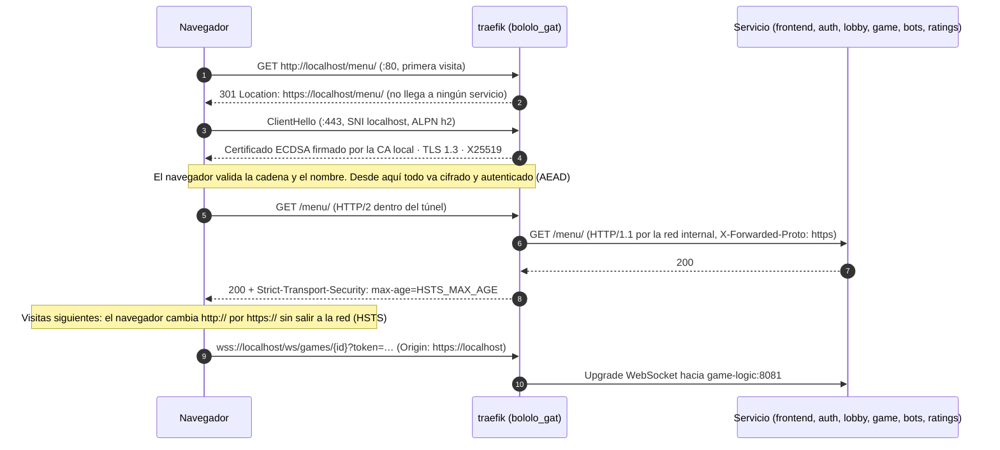

# Escenario 1 · Secure Channel (TLS en el gateway)

| | |
|---|---|
| Atributo de calidad | Seguridad: confidencialidad e integridad de los datos en tránsito |
| Táctica | Resistir ataques → **Cifrar datos** (principal), Autenticar actores (el servidor se identifica con un certificado), Limitar la exposición (el puerto 80 deja de servir contenido) |
| Patrón | **Secure Channel**, con terminación TLS en el único punto de entrada (Traefik) y HTTP Strict Transport Security (HSTS) |
| Rama | `feature/p3-esc1` (desde `main` @ `fbf1c10`) |
| Responsable | ______________________ |
| Evidencia | [`docs/p3/evidencia/esc1/`](evidencia/esc1/) |

> **Actualización (escenario 2).** Desde [`feature/p3-esc2`](esc2.md), la terminación TLS ya no está en Traefik sino en el proxy inverso (`reverse-proxy`, Nginx), que pasa a ser el único punto de entrada. La política no cambia: TLS 1.2/1.3 con ECDHE + AEAD, HTTP/2, HSTS con `HSTS_MAX_AGE`, el 80 solo redirige (`301`/`308`) y sin certificado no arranca. La configuración pasó de `api-gateway/dynamic/secure-channel.yml` (eliminado) a [`reverse-proxy/templates/bololo.conf.template`](../../reverse-proxy/templates/bololo.conf.template); el certificado sigue en `api-gateway/certs/`. Las comprobaciones TLS de `scripts/e2e.sh` siguen pasando sin cambios, y `sniff-channel.sh` y `esc1-evidence.sh` ahora miden en `reverse-proxy`. Este documento y su evidencia describen el estado del escenario 1, cuando el borde era Traefik.

## Contenido

1. [Estado antes del cambio](#1-estado-antes-del-cambio)
2. [Amenazas identificadas antes de implementar](#2-amenazas-identificadas-antes-de-implementar)
3. [Escenario de calidad](#3-escenario-de-calidad)
4. [Opciones evaluadas y decisión](#4-opciones-evaluadas-y-decisión)
5. [Implementación](#5-implementación)
6. [Qué cambia en la arquitectura](#6-qué-cambia-en-la-arquitectura)
7. [Evidencia: antes y después](#7-evidencia-antes-y-después)
8. [Compromisos](#8-compromisos)
9. [Riesgos residuales y trabajo futuro](#9-riesgos-residuales-y-trabajo-futuro)
10. [Cómo usarlo (equipo)](#10-cómo-usarlo-equipo)
11. [Guion de la demo (3 a 4 minutos)](#11-guion-de-la-demo-3-a-4-minutos)
12. [Referencias](#12-referencias)

---

## 1. Estado antes del cambio

Medido sobre `main` (`fbf1c10`) el 14 de noviembre de 2026, con el stack completo arriba. La evidencia está en [`evidencia/esc1/antes/`](evidencia/esc1/antes/).

- Traefik publica solo el puerto **80, en HTTP**. El 443 no responde (`connect: errno=0`, [03-tls.txt](evidencia/esc1/antes/03-tls.txt)).
- Todo lo que el navegador envía y recibe viaja en claro: HTML y JavaScript de `/menu/`, `/ingame/` y `/chameleon/`; REST de `/auth/` y `/api/`; el stream SSE de la sala; el WebSocket de la partida.
- Los secretos que cruzan ese tramo son:

| Secreto | Dónde viaja | Vida útil | Qué permite a quien lo copie |
|---|---|---|---|
| Contraseña de la cuenta | Cuerpo JSON de `POST /auth/register`, `/auth/login` y `/auth/password` | Hasta que el usuario la cambie | Entrar a la cuenta. Si el jugador la reutiliza, también a otros sitios |
| JWT de sesión (cuenta o invitado) | Cabecera `Authorization: Bearer` y, en el SSE, la URL `?token=` (EventSource no admite cabeceras) | 12 h (`session_ttl_s`) | Actuar como el jugador: crear, unirse o salir de salas, iniciar partidas, llenar con bots |
| JWT de partida | URL del WebSocket `/ws/games/{id}?token=` (el navegador no deja poner cabeceras en el *handshake*) | 2 h (`game_token_ttl_s`) | Conectarse a la mesa como ese jugador, ver su mano y jugar por él |
| Mano del jugador y jugadas | Frames del WebSocket | La partida | Hacer trampa: ver las cartas ajenas aunque `Match.ViewFor` solo envíe a cada uno su propia mano |

**Prueba de captura** ([01-sniff.txt](evidencia/esc1/antes/01-sniff.txt)). [`scripts/sniff-channel.sh`](../../scripts/sniff-channel.sh) pone `tcpdump` en la interfaz de red de `traefik` (puertos 80 y 443), que es lo mismo que ve alguien en la Wi-Fi del jugador. Mientras captura, hace el recorrido de un jugador y luego busca los secretos en la captura:

| Secreto | Veces legible en la captura |
|---|---|
| Contraseña de la cuenta | **1** (`{"username":"sniff_611cd205","password":"Secreto-611cd205-33df603a"}`) |
| JWT de sesión de la cuenta | **4** |
| JWT de sesión de invitado | **2** |
| JWT de partida | **2** |
| Peticiones HTTP legibles | **8 de 8**, incluidas `GET /ws/games/g_…?token=eyJ…` y `GET /api/lobbies/l_…/events?token=eyJ…` |

Lo que ya había y se conserva: Traefik no escribe la ruta ni las cabeceras en su log (`RequestPath: drop`), así que los tokens de la URL no quedan en disco; `game-logic` compara el `Origin` del WebSocket con `ALLOWED_ORIGINS` (un origen ajeno recibe `403`, [04-websocket.txt](evidencia/esc1/antes/04-websocket.txt)); las contraseñas se guardan con BCrypt y el login se bloquea tras 5 fallos. Nada de eso protege el tramo navegador ↔ gateway.

## 2. Amenazas identificadas antes de implementar

Modelo de atacante: alguien en la **misma red que un jugador** (la Wi-Fi del salón, una red de una cafetería, un punto de acceso falso con el mismo nombre). Puede escuchar (pasivo) o interceptar y modificar (activo, por ejemplo con ARP spoofing o un AP falso). No tiene acceso al host Docker.

Clasificación STRIDE. La columna "¿Lo cubre?" indica si este escenario la mitiga.

| ID | Amenaza (STRIDE) | Cómo ocurriría en Bololó | Impacto | ¿Lo cubre? |
|---|---|---|---|---|
| T1 | **Escucha de credenciales** (Information disclosure) | Wireshark en la Wi-Fi lee el cuerpo de `POST /auth/login` o `/auth/register` | Robo de la cuenta; la contraseña puede servir en otros sitios | Sí: TLS cifra el cuerpo |
| T2 | **Robo y reuso de tokens** (Spoofing) | Se copia el JWT de la cabecera `Authorization` o de `?token=` en el SSE o el WebSocket y se reusa durante 12 h o 2 h | Suplantar al jugador en salas y partidas | Sí: TLS cifra cabeceras y URL completas (la ruta y el *query string* van dentro del túnel) |
| T3 | **Trampa por lectura de la mesa** (Information disclosure) | Un rival en la misma Wi-Fi lee los frames del WebSocket de otro jugador y ve su mano | Rompe la vista limitada del escenario 4: el servidor oculta las manos, pero la red las muestra | Sí |
| T4 | **Manipulación en tránsito** (Tampering) | Un MITM activo modifica `/menu/menu.js` al servirlo por HTTP e inyecta un script que envía `sessionStorage` y la contraseña a un tercero. También puede cambiar o inyectar frames del WebSocket (jugadas) | Compromiso total del cliente y de la partida | Sí: TLS da integridad (AEAD); un byte alterado corta la conexión |
| T5 | **SSL stripping** (Spoofing / Tampering). Aparece apenas existe HTTPS con solo una redirección | El atacante intercepta la primera visita `http://`, habla HTTPS con el servidor y mantiene al jugador en HTTP | Vuelve a T1–T4 | Sí, con HSTS: después de la primera visita el navegador ya no intenta HTTP. Residual en la primera visita (ver §4) |
| T6 | **Degradación de protocolo o cifrado** (Tampering / Information disclosure) | Forzar TLS 1.0/1.1 o suites sin secreto hacia adelante o en modo CBC (BEAST, POODLE, Lucky13, Sweet32). Sin ECDHE, quien guarde la captura la descifra si algún día obtiene la clave | Pérdida de confidencialidad | Sí: mínimo TLS 1.2 y solo suites ECDHE + AEAD |
| T7 | **Suplantación del servidor** (Spoofing) | El MITM presenta su propio certificado autofirmado. Si el equipo se acostumbró a pulsar "Aceptar el riesgo" con un certificado autofirmado, también acepta el del atacante | Vuelve a T1–T4 | Sí: el certificado lo firma una CA confiada en el equipo, así que el navegador no advierte nada; una advertencia indica un ataque. Con HSTS el navegador ni siquiera ofrece el botón de continuar |
| T8 | **Robo de la clave privada o de la CA** (Information disclosure) | La clave se sube a Git, se copia en una imagen, o se filtra la clave de una CA local tipo mkcert, que puede firmar cualquier dominio | Suplantar el gateway. Con una CA sin restricciones, interceptar **todo** el HTTPS del equipo que la confía (bancos incluidos) | Sí: claves fuera de Git, la clave de la CA no entra al contenedor y la CA solo puede firmar nombres que no existen en Internet |
| T9 | **Página HTTP que abre el WebSocket** (Spoofing) | Una página servida por `http://` (por ejemplo, en un host de la LAN) usa un token robado para abrir el WebSocket desde el navegador de la víctima | Jugar por la víctima | Sí: `ALLOWED_ORIGINS` pasa a aceptar solo `https://` |
| T10 | **Configuración que falla abierta** (Elevation by misconfiguration) | Si faltan los certificados, Traefik arranca con su certificado autofirmado de ejemplo (`TRAEFIK DEFAULT CERT`) y el navegador advierte | Se vuelve a T7 sin que nadie lo note | Sí: Traefik no arranca sin el certificado |
| T11 | **Router nuevo expuesto en HTTP** (Information disclosure) | Otro escenario agrega un router con `entrypoints=web` o sin `entrypoints` y queda servido en claro | Un servicio vuelve a HTTP | Sí: `:80` solo redirige y `websecure` es el entrypoint por defecto |
| T12 | Tokens en los logs (Information disclosure) | La URL con `?token=` queda en el access log | Robo de tokens desde disco | Ya mitigado (`RequestPath: drop`); se verifica que siga igual en HTTPS |
| T13 | Tramo interno en claro (Information disclosure) | Alguien con acceso al host o a la red `internal` escucha traefik → servicios, servicios → PostgreSQL, Redis o RabbitMQ | Ver tokens y datos | **No.** Esa red no tiene puertos publicados; la cubre el escenario 3 (Network Segmentation). TLS interno queda como trabajo futuro (§10) |
| T14 | Agotar CPU con *handshakes* TLS (Denial of service) | Abrir miles de conexiones TLS | Gateway lento | **No.** Lo cubre el escenario 5 (Rate Limiting) |

Riesgo antes del cambio: T1–T4 se pueden ejecutar hoy con herramientas gratuitas y sin conocimientos especiales, y la prueba de captura lo confirma. Son de **alta probabilidad e impacto alto** en una red compartida, como la del salón donde se hace la demo.

## 3. Escenario de calidad

| | |
|---|---|
| **Fuente** | Atacante en la misma red Wi-Fi o LAN que un jugador, con un capturador de tráfico (Wireshark, tcpdump) o en posición de MITM activo (ARP spoofing, punto de acceso falso) |
| **Estímulo** | Captura el tráfico entre el navegador y Bololó para leer contraseñas, JWT y manos; o intenta modificarlo o degradarlo (mantener al jugador en HTTP, negociar TLS viejo, presentar un certificado falso) |
| **Artefacto** | Canal navegador ↔ API Gateway (conectores C1 `bololo_lobby_fe` → `bololo_gat`, REST y SSE, y C3 `bololo_game_fe` → `bololo_gat`, WebSocket, de la vista C&C): `/auth/*`, `/api/*`, `/api/lobbies/{id}/events?token=`, `/ws/games/{id}?token=` y las páginas `/menu/`, `/ingame/` y `/chameleon/` |
| **Entorno** | Operación normal: jugadores en una red compartida no confiable, con salas y partidas en curso |
| **Respuesta** | Todo el tráfico de la aplicación viaja cifrado y autenticado con TLS 1.2 o 1.3 (ECDHE + AEAD). El puerto 80 no sirve contenido: responde una redirección `308` a `https://`. El navegador recuerda usar solo HTTPS (HSTS). Se rechazan TLS 1.0, TLS 1.1 y las suites sin secreto hacia adelante o en modo CBC. El navegador valida el certificado sin advertencias. El WebSocket solo acepta orígenes `https://`. Sin certificado, el gateway no arranca |
| **Medida** | En la captura del tramo navegador ↔ gateway, el número de veces que aparecen la contraseña y los 3 JWT baja de 1 / 4 / 2 / 2 a **0 / 0 / 0 / 0**, y las peticiones legibles con credenciales bajan de 8 de 8 a **0**. Las 5 negociaciones débiles (TLS 1.0, TLS 1.1 y 3 suites débiles) son rechazadas. Las 18 comprobaciones nuevas de `scripts/e2e.sh` pasan. El sobrecosto de latencia queda medido |
| **Táctica** | Resistir ataques: cifrar datos; autenticar actores (certificado X.509 del servidor); limitar la exposición (HTTP plano y TLS viejo deshabilitados) |
| **Patrón** | Secure Channel con terminación TLS en el único punto de entrada, que en este escenario es el API Gateway (Traefik), más HSTS. Traefik no es un Reverse Proxy en esta arquitectura: ese patrón lo implementa Nginx en el [escenario 2](esc2.md), que hereda esta misma política TLS |
| **Implementación** | Entrypoint `websecure` (:443) con TLS 1.2/1.3, ECDHE + AEAD y HTTP/2. `:80` solo redirige. HSTS en todas las respuestas HTTPS. Certificado ECDSA P-256 firmado por una CA local con restricción de nombres. Traefik no arranca sin certificado. Los 6 routers pasan a `websecure`. `ALLOWED_ORIGINS=https://localhost`. Detalle en §5 |
| **Evidencia** | Captura con `tcpdump`: secretos legibles 1 / 4 / 2 / 2 → 0 / 0 / 0 / 0. `openssl s_client`: TLS 1.3 y certificado válido; TLS 1.0, TLS 1.1 y 3 suites débiles rechazadas. `curl`: `301`/`308` a `https://` y HSTS. `scripts/e2e.sh`: 96 → 114 OK, sin fallas nuevas. Detalle en §7 |
| **Compromisos** | Se gana confidencialidad, integridad, autenticación del servidor y HTTP/2. Cuesta unos 7 ms de *handshake* por conexión nueva y unos 0,2 ms por petición en una conexión abierta; además, generar y confiar el certificado en cada equipo y renovarlo cada 397 días. El tramo interno sigue en HTTP. Detalle en §8 |

## 4. Opciones evaluadas y decisión

La guía propone TLS en Traefik con un certificado de **mkcert** u **openssl autofirmado**. Se compararon esas dos y otras alternativas según lo que importa en este proyecto: que no haya advertencias en el navegador (T7), el daño si se filtra una clave (T8), lo que exige instalar a cada integrante, y que funcione en `localhost` y por IP de la LAN el día de la demo.

### 4.1 Dónde termina TLS

| Opción | A favor | En contra | Decisión |
|---|---|---|---|
| **A. Terminación TLS en Traefik** (patrón de la guía) | Un solo certificado y un solo lugar de configuración. Traefik ya es el único contenedor con puertos publicados y sigue enrutando por ruta (`PathPrefix`). Ningún servicio cambia: el cliente ya elige `wss://` cuando la página es `https:` | El tramo traefik → servicios sigue en HTTP dentro de la red `internal` | **Elegida** |
| B. TLS de extremo a extremo (passthrough TCP o TLS en cada servicio) | Cifra también el tramo interno | 6 servicios HTTP en 5 lenguajes, cada uno con su certificado y su configuración. Con passthrough, Traefik ya no ve la ruta y no puede enrutar `/api/` y `/ws/games/` al mismo host:puerto | Descartada para este escenario. El tramo interno lo protege el escenario 3; mTLS interno queda como trabajo futuro |
| C. HTTP/3 (QUIC) además de HTTP/2 | Menos latencia en redes con pérdida | Publicar UDP 443 (más superficie) y soporte irregular en Docker Desktop. No mejora la seguridad | Descartada |

### 4.2 De dónde sale el certificado

| Opción | A favor | En contra | Decisión |
|---|---|---|---|
| D. Autofirmado con `openssl req -x509` (guía) | Simple, sin dependencias | El navegador advierte en cada equipo. Eso entrena a aceptar advertencias, que es justo lo que necesita el atacante de T7. Con HSTS activo, el navegador ni siquiera deja continuar | Descartada |
| E. mkcert (guía) | Sin advertencias; instala su CA sola | Hay que instalar un binario más en cada equipo. Su CA puede firmar **cualquier** dominio y su clave queda en el perfil del usuario: si se filtra, sirve para interceptar todo el HTTPS de ese equipo (T8) | Descartada; se toma su idea (una CA local) sin sus riesgos |
| **F. CA local propia con restricción de nombres** (script `openssl`) | Sin advertencias una vez que se confía la CA. La CA lleva la extensión X.509 *Name Constraints*: solo puede firmar `localhost`, `*.test`, `*.local`, `*.home.arpa` e IPs privadas o de loopback, así que su clave robada no sirve contra sitios reales. No agrega dependencias (`scripts/e2e.sh` ya exige `openssl`). La clave de la CA no entra al contenedor | Confiar la CA es un paso por equipo (`./scripts/gen-certs.sh --trust`). Hay que renovar la hoja cada 397 días | **Elegida** |
| G. Let's Encrypt (ACME en Traefik) | Certificado público y renovación automática. Es lo correcto en producción | Necesita un dominio público y los puertos 80/443 alcanzables desde Internet. No sirve para `localhost` ni para una IP de la LAN en clase | Para producción. Solo cambia `api-gateway/dynamic/`; el resto queda igual |

### 4.3 Qué se agrega sobre la guía, y por qué

| Agregado | Amenaza | Motivo |
|---|---|---|
| HSTS (`Strict-Transport-Security`) | T5 | La redirección de 80 a 443 sola no basta: un MITM puede quedarse con la primera visita en HTTP (sslstrip). Con HSTS, el navegador reescribe `http://` a `https://` antes de enviar nada |
| Política TLS: mínimo 1.2, solo ECDHE + AEAD | T6 | Traefik acepta por defecto más suites de las necesarias. Se sigue el perfil *Intermediate* de Mozilla |
| Certificado ECDSA P-256 | Rendimiento | Firma más rápida y certificado más pequeño que RSA 2048, con seguridad equivalente o mayor |
| Traefik no arranca sin certificado | T10 | Fallar cerrado en lugar de servir el certificado de ejemplo |
| `websecure` como entrypoint por defecto y `:80` solo redirige | T11 | Un router que agregue otro escenario no puede quedar en HTTP por descuido |
| `ALLOWED_ORIGINS` solo `https://` | T9 | Una página servida en claro no puede abrir el WebSocket |
| Timeouts de SSE y WebSocket copiados a `websecure` | Disponibilidad | Sin esto, el `readTimeout` de 60 s de Traefik v3 cortaría las partidas en HTTPS. `:80` vuelve a los valores por defecto, que son finitos, porque solo redirige |
| `e2e.sh` valida el certificado (`--cacert`), sin `-k` | Verificación | Las pruebas prueban la cadena y el nombre igual que el navegador, en lugar de ignorarlos |
| Captura reproducible con `tcpdump` | Evidencia | La medida del escenario sale de un número repetible y no solo de una captura de pantalla de Wireshark |

## 5. Implementación

### 5.1 Flujo del canal



### 5.2 Archivos

| Archivo | Cambio |
|---|---|
| [`api-gateway/traefik.yml`](../../api-gateway/traefik.yml) | `web` (:80) solo redirige a `websecure` (`permanent: true`: `301` para GET, `308` para el resto de métodos, que conserva método y cuerpo) y vuelve a los timeouts por defecto, que son finitos. Nuevo `websecure` (:443): `asDefault: true`, timeouts `0/0/180 s` para SSE y WebSocket, `http.tls: {}` y el middleware `hsts@file` para todos sus routers. Nuevo `providers.file` sobre `/etc/traefik/dynamic` con `watch: true` |
| [`api-gateway/dynamic/secure-channel.yml`](../../api-gateway/dynamic/secure-channel.yml) (nuevo) | Certificado por defecto del *store* (`/certs/bololo.crt`). Política TLS `default`: mínimo TLS 1.2, 6 suites ECDHE + AEAD, `sniStrict: false` para poder entrar por IP. Middleware `hsts` con `stsSeconds` tomado de `HSTS_MAX_AGE` |
| `docker-compose.yml`, servicio `traefik` | Publica `443:443` además de `80:80`. Monta `api-gateway/dynamic/` y `api-gateway/certs/` en solo lectura. Variable `HSTS_MAX_AGE`. Un `entrypoint` que comprueba que existan `bololo.crt` y `bololo.key` antes de `exec traefik` |
| `docker-compose.yml`, 6 routers | `entrypoints=websecure` y `tls=true` en `web` (frontend), `auth`, `lobby`, `game-ws`, `bots` y `ratings` |
| `docker-compose.yml`, `game-logic` | `ALLOWED_ORIGINS` por defecto `https://localhost` |
| `docker-compose.yml`, `lobby-manager` y `ratings-service` | `FORWARDED_ALLOW_IPS: "*"` (ver §5.4) |
| [`scripts/gen-certs.sh`](../../scripts/gen-certs.sh) (nuevo) | CA local con *Name Constraints* y certificado del gateway. `--trust` instala la CA en el almacén del usuario. Acepta hosts extra para la LAN |
| [`api-gateway/certs/README.md`](../../api-gateway/certs/README.md) (nuevo) y `.gitignore` | La carpeta existe en Git; los certificados, las claves, la CA y las capturas `.pcap` no |
| `.env.example` | `ALLOWED_ORIGINS=https://localhost` y `HSTS_MAX_AGE=300` |
| [`scripts/e2e.sh`](../../scripts/e2e.sh) | `BASE_URL` por defecto `https://localhost`. Todas las llamadas validan el certificado con `--cacert`, sin `-k`. Sección nueva "Canal seguro" con 16 comprobaciones, más una en WebSocket (`Origin: http://` rechazado) y una en requisitos (certificados generados). En Git Bash traduce `/dev/null` a `nul`: antes `curl` salía con código 23 sin avisar y `-w '%{redirect_url}'` quedaba vacío |
| [`scripts/sniff-channel.sh`](../../scripts/sniff-channel.sh), [`scripts/latency.sh`](../../scripts/latency.sh), [`scripts/esc1-evidence.sh`](../../scripts/esc1-evidence.sh) (nuevos) | Captura de tráfico, medición de latencia y regeneración de la evidencia (§7) |

Ningún servicio cambió su código. El cliente ya elegía `wss://` cuando la página es `https:` (`presentation/game/client/ingame/connection.js:112` y `presentation/chameleon/chameleon.js:176`) y usa rutas relativas en `fetch` y `EventSource`, así que no hay contenido mixto. El único recurso externo (p5.js en `presentation/game/index.html`) ya se cargaba por `https://`.

### 5.3 Certificado

| | CA local (`api-gateway/ca/bololo-dev-ca.crt`) | Certificado del gateway (`api-gateway/certs/bololo.crt`) |
|---|---|---|
| Clave | ECDSA P-256, permisos 600, **no se monta** en ningún contenedor | ECDSA P-256, permisos 600, montada en solo lectura solo en `traefik` |
| Vigencia | 825 días | 397 días (el máximo que aceptan los navegadores en certificados públicos) |
| Extensiones | `CA:TRUE, pathlen:0`; `keyCertSign, cRLSign`; **Name Constraints** críticas: `localhost`, `test`, `local`, `home.arpa`, `127/8`, `10/8`, `172.16/12`, `192.168/16`, `::1` | `CA:FALSE`; `digitalSignature`; `serverAuth`; SAN `localhost`, `127.0.0.1`, `::1` y los hosts extra que se pidan |
| Nombre | `Bololo Dev CA - <equipo>`: cada integrante sabe de quién es la CA que está confiando | `CN=localhost` |

Los nombres permitidos son de uso especial (RFC 6761, RFC 6762, RFC 8375) o direcciones privadas, así que no existen en Internet. El script rechaza cualquier otro: `./scripts/gen-certs.sh google.com` termina con error.

### 5.4 Hallazgo durante la implementación: redirecciones a `http://`

Con TLS ya activo, `GET https://localhost/api/lobbies/` respondía `307 Location: http://localhost/api/lobbies`. FastAPI redirige la barra final con una URL absoluta, y Uvicorn, aunque arranca con `--proxy-headers`, solo confía en `X-Forwarded-Proto` si llega desde `127.0.0.1`. Por eso creía que la petición había entrado por HTTP. El navegador habría bloqueado ese `fetch` por contenido mixto o, en una navegación, habría dado un salto en claro. En `ratings-service` pasaba lo mismo.

Se corrigió con `FORWARDED_ALLOW_IPS: "*"` en los dos servicios; ahora responden `307 Location: https://localhost/api/lobbies`. Confiar en cualquier IP es aceptable aquí porque los servicios solo se alcanzan por la red `internal` y Traefik reescribe `X-Forwarded-*` en cada petición que llega de fuera (no confía en las que trae el cliente). Cuando el escenario 3 fije las subredes, se puede limitar a la IP de Traefik. También se revisaron las demás rutas con y sin barra final (`/`, `/auth/`, `/api/docs/`, `/api/session/`, `/api/bots/`…): ninguna redirige a `http://`.

## 6. Qué cambia en la arquitectura

### 6.1 Antes y después

| Aspecto | Antes (`main`) | Después (`feature/p3-esc1`) |
|---|---|---|
| Puertos publicados | `80` (HTTP) | `443` (HTTPS) y `80` (solo redirección `301`/`308`) |
| Protocolo navegador ↔ gateway | HTTP/1.1 y WebSocket en claro | TLS 1.3 (o 1.2) con HTTP/2 por ALPN; `wss://` para la partida |
| Secretos legibles en la red | Contraseña, JWT de sesión y de partida, manos | Ninguno |
| Autenticación del servidor | Ninguna: cualquiera en la red podía hacerse pasar por el gateway | Certificado X.509 que valida el navegador |
| Política TLS | No aplica | Mínimo TLS 1.2; solo ECDHE + AEAD; X25519 |
| HSTS | No | `Strict-Transport-Security: max-age=$HSTS_MAX_AGE` |
| `Origin` aceptado en el WebSocket | `http://localhost` | `https://localhost` |
| Si falta el certificado | No aplica | Traefik no arranca |
| Tramo traefik → servicios | HTTP en la red `internal` | Sin cambio |

### 6.2 Cambios para las vistas

Aviso para quien mantiene las vistas. Este escenario no edita `docs/deployment-view.md` ni `docs/deployment-view.drawio`.

**Vista C&C**

La etiqueta de cada conector lleva solo el protocolo.

- **C1** (`bololo_lobby_fe` → `bololo_gat`): de "REST, SSE" a **"REST, SSE + TLS"**.
- **C3** (`bololo_game_fe` → `bololo_gat`): de "WebSocket" a **"WebSocket + TLS"**.
- `bololo_gat` suma dos responsabilidades: **terminación TLS** y **HSTS**. Los conectores del gateway hacia adentro (C2 y C4–C8) no cambian: HTTP en la red `internal`.
- Desde el [escenario 2](esc2.md), C1 y C3 terminan en `bololo_reverse_proxy` y no en `bololo_gat`.

**Vista de despliegue** (`docs/deployment-view.md`)

| Sección | Cambio |
|---|---|
| §1, diagrama | Zona `PUB`: "only published port: host 80" → "published ports: 443 (HTTPS) and 80 (redirect only)". Nodo `traefik`: `:80` → `:443 · :80→443`. C1 y C3: `HTTP/1.1 :80` → `HTTPS :443` y `WSS :443` |
| §2.1, red `public` y tabla de contenedores | `traefik`: puertos `80 (redirect)`, `443 (websecure)`, `8080 (ping)`; montajes nuevos `api-gateway/dynamic/` y `api-gateway/certs/` (ro) |
| §2.1, artefactos nuevos | «artifact» `bololo.crt` + `bololo.key`, desplegado en `traefik`. «artifact» `bololo-dev-ca.crt`, instalado como raíz confiable en el navegador del jugador |
| §4, catálogo de conectores | Columna Seguridad de C1 y C3: "No TLS" → "TLS 1.2+ (ECDHE + AEAD), HSTS; el `?token=` viaja cifrado dentro del túnel". C8: `Origin` contra `ALLOWED_ORIGINS=https://localhost` |
| §6, puertos | Nueva fila `443/tcp`: host `0.0.0.0:443` → `traefik:443`, alcanzable desde la zona de usuario. Fila `80/tcp`: "solo redirige a 443" |
| §8, variabilidad | La línea de TLS queda resuelta. Agregar `HSTS_MAX_AGE` y los hosts extra de `gen-certs.sh` |
| §10, hallazgos | El hallazgo 5 ("No TLS") queda resuelto |

## 7. Evidencia: antes y después

Todo se regenera con `./scripts/esc1-evidence.sh antes` (stack de `main`) y `./scripts/esc1-evidence.sh despues` (stack de esta rama). Cada archivo muestra el comando exacto seguido de su salida.

| Prueba | Antes | Después | Archivos |
|---|---|---|---|
| Captura del tramo navegador ↔ gateway: contraseña / JWT de cuenta / JWT de invitado / JWT de partida | **1 / 4 / 2 / 2** veces legibles | **0 / 0 / 0 / 0** | [antes/01-sniff.txt](evidencia/esc1/antes/01-sniff.txt), [despues/01-sniff.txt](evidencia/esc1/despues/01-sniff.txt) |
| Peticiones HTTP legibles en la captura | 8 de 8, con los tokens en la URL y la contraseña en el cuerpo | 1: el `GET /` de la primera visita escrita como `http://`, que recibe un `301` y no lleva credenciales | ídem |
| Paquetes en :80 / :443 | 90 / 0 | 10 / 122 | ídem |
| `GET http://localhost/` | `302 /menu/`; la página se sirve en claro | `301 Location: https://localhost/` | [antes/02-http.txt](evidencia/esc1/antes/02-http.txt), [despues/02-redireccion-hsts.txt](evidencia/esc1/despues/02-redireccion-hsts.txt) |
| `POST http://localhost/api/session` | `201` con el JWT en la respuesta | `308`, cuerpo `Permanent Redirect`; no llega al servicio | ídem |
| HSTS | No hay cabecera | `Strict-Transport-Security: max-age=300` | ídem |
| Puerto 443 | Conexión rechazada | TLS 1.3, `TLS_AES_128_GCM_SHA256`, X25519, ALPN `h2`, `Verify return code: 0 (ok)` | [antes/03-tls.txt](evidencia/esc1/antes/03-tls.txt), [despues/03-tls.txt](evidencia/esc1/despues/03-tls.txt) |
| Acceso por IP, sin SNI | No aplica | Certificado válido para `127.0.0.1` | despues/03-tls.txt |
| TLS 1.0 y TLS 1.1 | No aplica | `alert protocol version` en ambos | ídem |
| `AES128-SHA`, `ECDHE-ECDSA-AES128-SHA` y `ECDHE-ECDSA-AES256-SHA384` en TLS 1.2 | No aplica | `alert handshake failure` en las 3 | ídem |
| Certificado | No aplica | ECDSA P-256, 397 días, SAN `localhost`, `127.0.0.1`, `::1`; `openssl verify`: OK | [despues/04-certificado.txt](evidencia/esc1/despues/04-certificado.txt) |
| Certificado falso para `www.google.com` firmado con la clave de la CA local | No aplica | `permitted subtree violation`: la clave robada no sirve contra un sitio real | ídem |
| WebSocket con el `Origin` de la página | `101` con `http://localhost` | `101` con `https://localhost` | [antes/04-websocket.txt](evidencia/esc1/antes/04-websocket.txt), [despues/05-websocket.txt](evidencia/esc1/despues/05-websocket.txt) |
| WebSocket desde una página `http://` | `101` (era el origen permitido) | `403` | ídem |
| `ws://` en claro | `101` | `301` a `https://`, sin *upgrade* | ídem |
| Puertos publicados | Solo `traefik`: `80` | Solo `traefik`: `80` y `443` | [antes/05-puertos.txt](evidencia/esc1/antes/05-puertos.txt), [despues/06-puertos.txt](evidencia/esc1/despues/06-puertos.txt) |
| Sin certificado | No aplica | `traefik` en `Restarting (1)`, log `ERROR: falta el certificado TLS…`; nada responde en 80 ni en 443 | [despues/08-falla-cerrado.txt](evidencia/esc1/despues/08-falla-cerrado.txt) |
| `scripts/e2e.sh` | 96 OK, 1 falla, 1 omitida | 114 OK, 1 falla, 1 omitida | [antes/07-e2e.txt](evidencia/esc1/antes/07-e2e.txt), [despues/09-e2e.txt](evidencia/esc1/despues/09-e2e.txt) |

La falla de `e2e.sh` es la misma antes y después y no tiene relación con este escenario: el `.env` local tiene las claves `BOT_*`, que no están en `.env.example`. La prueba omitida es la simulación del fin de la partida, que solo existe con `DEMO_MODE`.

**Wireshark (opcional, para la demo).** `./scripts/sniff-channel.sh http://localhost /ruta/fuera/del/repo` guarda `captura.pcap`. Con el filtro `http` se ven `POST /auth/register` con la contraseña y `GET /ws/games/…?token=eyJ…`. En la captura del después (`https://localhost`), el filtro `http` solo muestra el `GET /` y su `301`, y el filtro `tls` muestra *Client Hello*, *Server Hello* y después solo *Application Data*. La captura del antes contiene secretos reales: no se sube a Git (`*.pcap` está en `.gitignore`).

## 8. Compromisos

### 8.1 Rendimiento

Medido con [`scripts/latency.sh`](../../scripts/latency.sh): 200 peticiones `GET /api/ratings/leaderboard?mode=CLASSIC&limit=1` por el gateway; se reporta la mediana. Hay dos clientes ([antes/06-latencia.txt](evidencia/esc1/antes/06-latencia.txt), [despues/07-latencia.txt](evidencia/esc1/despues/07-latencia.txt)):

| Caso | Cliente A: curl + OpenSSL en un contenedor de la red `public` (antes → después) | Cliente B: curl de Windows con Schannel, por el puerto publicado (antes → después) |
|---|---|---|
| Protocolo | HTTP/1.1 → **HTTP/2** | HTTP/1.1 → HTTP/1.1 (este curl no trae HTTP/2) |
| Conexión nueva: TCP + TLS | 0,69 → 7,85 ms | 1,18 → 21,86 ms |
| Conexión nueva: petición completa | 3,23 → **10,26 ms** (+7,0 ms) | 4,87 → 52,99 ms |
| Conexión ya abierta: petición completa | 1,35 → **1,55 ms** (+0,20 ms) | 1,65 → 2,07 ms (+0,42 ms) |

- El cliente A aísla el costo del gateway. El *handshake* TLS suma unos **7 ms, una vez por conexión**. Cada petición sobre una conexión abierta suma unos **0,2 ms** de cifrado y descifrado.
- El cliente B agrega costos propios de Schannel: la verificación de la cadena contra `--cacert` con un motor aparte (unos 10 ms) y el procesamiento de los *tickets* de sesión de TLS 1.3 después del *handshake* (unos 30 ms). Con `--tls-max 1.2` la conexión nueva baja a unos 25 ms. Los navegadores no usan Schannel (Chrome y Edge usan BoringSSL; Firefox, NSS), así que el cliente A representa mejor lo que vive un jugador.
- Una página abre una conexión HTTP/2 y la reutiliza. El WebSocket de la partida y el SSE de la sala son conexiones largas: pagan el *handshake* una vez y luego solo el cifrado de cada mensaje. En un juego donde los tiempos de reacción son de cientos de milisegundos, 0,2 ms por mensaje no se notan.
- **Ganancia: HTTP/2.** Los navegadores solo usan HTTP/2 sobre TLS. En HTTP/1.1 un navegador abre como máximo 6 conexiones por host y cada sala de espera abierta ocupa una con su `EventSource` ([MDN](https://developer.mozilla.org/en-US/docs/Web/API/EventSource)). Con cuatro pestañas de prueba en el mismo navegador, que es como se juega en local, quedaban 2 conexiones para todo lo demás. Con HTTP/2 todo va multiplexado en una sola conexión.

### 8.2 Resumen

| Se gana | Cuesta |
|---|---|
| Confidencialidad: T1, T2 y T3 dejan de ser posibles desde la red | Unos 7 ms por conexión nueva y unos 0,2 ms por petición (cliente A); CPU de TLS en Traefik |
| Integridad: un MITM no puede inyectar JavaScript ni alterar jugadas (T4) | Generar el certificado y **confiar la CA en cada equipo** que juegue; en los equipos de la LAN, importarla a mano |
| Autenticación del servidor y resistencia a la degradación (T5, T6, T7) | Renovar el certificado cada 397 días (`./scripts/gen-certs.sh` y `docker compose restart traefik`) y la CA cada 825 |
| La CA no sirve contra sitios reales (T8); falla cerrado (T10); los routers nuevos quedan en HTTPS (T11) | Más configuración en el gateway: un archivo dinámico y un `entrypoint` propio en Compose. Los escenarios 2 y 5 deben poner sus middlewares en `api-gateway/dynamic/` o en `websecure` |
| HTTP/2: desaparece el límite de 6 conexiones del SSE | HSTS en `localhost` afecta a **todos los puertos** de `localhost` en ese navegador; por eso el valor local es 300 s (§10) |
| Ningún servicio cambió su código | El tramo traefik → servicios sigue en HTTP (T13) |

## 9. Riesgos residuales y trabajo futuro

| Riesgo o pendiente | Situación | Siguiente paso |
|---|---|---|
| Primera visita antes de HSTS | La primera vez que alguien escribe `http://` hay una petición en claro (el `GET /` de la captura) que un MITM podría interceptar. Después, HSTS protege mientras dure `max-age`. Los navegadores ignoran HSTS en direcciones IP (RFC 6797 §8.1), así que en la LAN por IP solo protege la redirección | En producción: dominio propio con `HSTS_MAX_AGE=31536000`, `includeSubDomains` y la lista de *preload* de los navegadores |
| Tokens en la URL (`?token=`) | Ahora viajan cifrados y Traefik no los registra, pero siguen en la URL por la limitación de `EventSource` y del WebSocket del navegador | Cambiarlos por un *ticket* de un solo uso que dure pocos segundos, o por una cookie `Secure; HttpOnly; SameSite=Strict` |
| Tramo interno en claro (T13) | traefik → servicios y servicios → PostgreSQL, Redis y RabbitMQ van sin TLS dentro de la red `internal` | Escenario 3 (Network Segmentation). Después: `sslmode=verify-full` en PostgreSQL, `amqps://` en RabbitMQ, TLS en Redis o mTLS entre servicios |
| Restricción de nombres de la CA | Verificada con OpenSSL. Que cada navegador la aplique a una raíz instalada a mano depende de su verificador | Tratar igual la clave de la CA como secreta: permisos 600, fuera de Git y fuera del contenedor |
| `FORWARDED_ALLOW_IPS: "*"` | Un contenedor comprometido de la red `internal` podría falsear `X-Forwarded-For` hacia `lobby-manager` y `ratings-service` | Limitarlo a la IP de Traefik cuando el escenario 3 fije las subredes |
| Avisos de Traefik al arrancar (`aliasHeadersStrategy`, caracteres codificados en la ruta) y el socket de Docker | Ya existían; no son del canal | Escenario 2: Reverse Proxy (Nginx) delante de Traefik, que deja de estar expuesto |
| Certificado público | La CA local sirve para `localhost` y la LAN | En producción, `certificatesResolvers` con ACME (Let's Encrypt): cambia `api-gateway/dynamic/` y se agrega `tls.certresolver` a los routers |

## 10. Cómo usarlo (equipo)

1. Traer la rama y generar el certificado, una vez por máquina (Git Bash en Windows, o la terminal en macOS y Linux):
   ```bash
   ./scripts/gen-certs.sh --trust    # --trust: confía en la CA (Windows pide confirmar)
   ```
2. En `.env`, cambiar `ALLOWED_ORIGINS=http://localhost` por `ALLOWED_ORIGINS=https://localhost` y agregar `HSTS_MAX_AGE=300` (ver `.env.example`).
3. **Abrir una terminal nueva.** `.vscode/settings.json` tiene `python.terminal.useEnvFile: true`, que copia el `.env` en las variables de cada terminal al abrirla, y Docker Compose da prioridad a esas variables sobre el archivo `.env`. En una terminal abierta antes del cambio, `game-logic` seguiría recibiendo `http://localhost` y el WebSocket respondería `403`. Para comprobarlo: `docker compose config game-logic | grep ALLOWED_ORIGINS`.
4. Levantar el stack y abrir **https://localhost**:
   ```bash
   docker compose up -d --build --wait
   ./scripts/e2e.sh   # opcional
   ```

| Situación | Qué hacer |
|---|---|
| Jugar desde otro equipo de la LAN | `./scripts/gen-certs.sh 192.168.1.20` (la IP de la máquina con Docker), `ALLOWED_ORIGINS=https://localhost,https://192.168.1.20` y `docker compose up -d`. En el otro equipo, importar `api-gateway/ca/bololo-dev-ca.crt` como autoridad raíz (en Windows: doble clic → Instalar certificado → Usuario actual → "Entidades de certificación raíz de confianza"). Abrir `https://192.168.1.20` y permitir el puerto 443 en el firewall |
| `traefik` aparece en `Restarting` | Faltan los certificados: `./scripts/gen-certs.sh` |
| El navegador advierte del certificado | La CA no está confiada en ese equipo o navegador: `./scripts/gen-certs.sh --trust`, o importarla a mano. En Firefox, si no toma el almacén de Windows: `security.enterprise_roots.enabled = true` |
| El WebSocket responde `403` | `ALLOWED_ORIGINS` no coincide con la URL de la página. Revisar el paso 3 |
| Un `http://localhost:PUERTO` de desarrollo ahora abre en `https://` | Es HSTS. Esperar `HSTS_MAX_AGE` segundos, o borrar `localhost` en `chrome://net-internals/#hsts` (en Firefox, "Olvidar este sitio") |
| Renovar el certificado | `./scripts/gen-certs.sh` y `docker compose restart traefik` |
| Quitar la CA del equipo | Windows: `certutil -user -delstore Root "Bololo Dev CA - <equipo>"`. macOS: borrarla en Acceso a Llaveros |

`scripts/sniff-channel.sh` y `scripts/esc1-evidence.sh` crean salas de prueba que quedan en `IN_GAME` hasta 3 horas, y el Lobby admite 10 salas activas. No conviene ejecutarlos en bucle antes de la demo.

## 11. Guion de la demo (3 a 4 minutos)

Preparación, antes de la clase: los scripts solo existen en esta rama, así que `main` se levanta desde otra carpeta con `git worktree add ../bololo-main main` y una copia del `.env`. Las dos carpetas comparten el nombre de proyecto de Compose (`bololo-integrado`): levantar una reemplaza los contenedores de la otra, sin tocar los volúmenes.

| Tiempo | Paso | Qué se muestra |
|---|---|---|
| 0:00 | Contexto | El atacante está en la misma Wi-Fi que el jugador. Tabla de §1 con los secretos que viajan |
| 0:30 | **Sin la defensa.** En `../bololo-main`: `ALLOWED_ORIGINS=http://localhost docker compose up -d --wait`. En esta rama: `./scripts/sniff-channel.sh http://localhost` | Contraseña y JWT legibles (`contraseña 1`, `token de partida 2`), la línea `"password":"Secreto-…"` y `GET /ws/games/…?token=eyJ…`. Si hay tiempo, la misma captura en Wireshark con el filtro `http` |
| 1:30 | **Con la defensa.** En esta rama: `docker compose up -d --wait` y `./scripts/sniff-channel.sh` | Todo en `0`. La única petición legible es el `GET /` que recibe el `301` |
| 2:15 | Navegador en `http://localhost` | Termina en `https://localhost` con candado. En DevTools → Red, la segunda visita muestra `307 Internal Redirect` (HSTS: no sale a la red). La partida conecta por `wss://` |
| 2:45 | `openssl s_client -connect localhost:443 -tls1_1 -cipher 'DEFAULT:@SECLEVEL=0'` | `alert protocol version`: el servidor no acepta TLS viejo |
| 3:15 | Cierre | Medida cumplida (0 secretos legibles; 5 de 5 negociaciones débiles rechazadas) y costo medido (+7 ms por conexión nueva, +0,2 ms por petición) |

## 12. Referencias

- L. Bass, P. Clements y R. Kazman, *Software Architecture in Practice*, 4.ª ed., Addison-Wesley, 2021, cap. 11 (tácticas de seguridad: resistir ataques, cifrar datos).
- M. Schumacher et al., *Security Patterns: Integrating Security and Systems Engineering*, Wiley, 2006 (patrón Secure Channels).
- RFC 8446 (TLS 1.3); RFC 6797 (HTTP Strict Transport Security); RFC 5280 §4.2.1.10 (Name Constraints); RFC 6761 (nombres de uso especial); RFC 6762 (`.local`); RFC 8375 (`home.arpa`).
- Mozilla, [SSL Configuration Generator](https://ssl-config.mozilla.org/), perfil *Intermediate*.
- Traefik, [EntryPoints](https://doc.traefik.io/traefik/reference/install-configuration/entrypoints/) (redirecciones, `asDefault`, middlewares por entrypoint) y [File provider](https://doc.traefik.io/traefik/reference/install-configuration/providers/others/file/) (plantillas Go).
- MDN, [Strict-Transport-Security](https://developer.mozilla.org/en-US/docs/Web/HTTP/Reference/Headers/Strict-Transport-Security) y [EventSource](https://developer.mozilla.org/en-US/docs/Web/API/EventSource) (límite de 6 conexiones sin HTTP/2).
