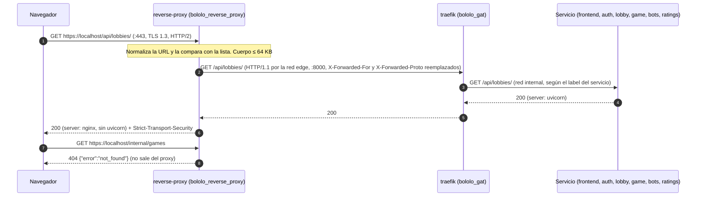

# Escenario 2 · Reverse Proxy (Nginx delante del gateway)

| | |
|---|---|
| Atributo de calidad | Seguridad: confidencialidad e integridad de los servicios internos, y disponibilidad del punto de entrada |
| Táctica | Resistir ataques → **Limitar el acceso** (principal, la táctica que la clase asocia al patrón) y **Limitar la exposición** |
| Patrón | **Reverse Proxy**: un componente sin privilegios es el único expuesto a Internet y reenvía al API Gateway solo las rutas públicas |
| Rama | `feature/p3-esc2` (desde `main` @ `878cec4`) |
| Responsable | ______________________ |
| Evidencia | [`docs/p3/evidencia/esc2/`](evidencia/esc2/) |

## Contenido

1. [Estado antes del cambio](#1-estado-antes-del-cambio)
2. [Amenazas identificadas antes de implementar](#2-amenazas-identificadas-antes-de-implementar)
3. [Escenario de calidad](#3-escenario-de-calidad)
4. [Opciones evaluadas y decisión](#4-opciones-evaluadas-y-decisión)
5. [Implementación](#5-implementación)
6. [Qué cambia en la arquitectura](#6-qué-cambia-en-la-arquitectura)
7. [Evidencia: antes y después](#7-evidencia-antes-y-después)
8. [Compromisos](#8-compromisos)
9. [Riesgos residuales y trabajo futuro](#9-riesgos-residuales-y-trabajo-futuro)
10. [Cómo usarlo (equipo)](#10-cómo-usarlo-equipo)
11. [Guion de la demo (3 a 4 minutos)](#11-guion-de-la-demo-3-a-4-minutos)
12. [Referencias](#12-referencias)

---

## 1. Estado antes del cambio

Medido sobre `main` (`878cec4`, con el escenario 1 ya integrado) el 15 de noviembre de 2026, con el stack completo arriba. La evidencia está en [`evidencia/esc2/antes/`](evidencia/esc2/antes/).

Traefik cumplía dos papeles a la vez: era la puerta de Internet (terminaba el TLS del escenario 1) y era el API Gateway (enrutaba a los servicios). Todo lo que le hacía falta para el segundo papel quedaba expuesto por el primero.

| Hecho | Por qué importa | Evidencia |
|---|---|---|
| El único contenedor con puertos publicados (80 y 443) es `traefik` | Es el que recibe todo lo que llega de Internet | [01-borde.txt](evidencia/esc2/antes/01-borde.txt) |
| Ese contenedor monta `/var/run/docker.sock` | Quien controla el socket controla Docker, y eso equivale a root en el host | 01-borde.txt |
| Está en las redes `public` e `internal`: desde él responden `lobby-manager` (`{"status":"ok","postgres":"ok"}`) y `auth`, y PostgreSQL acepta la conexión TCP | Si se compromete, el atacante ya está al lado de los servicios y las bases de datos | 01-borde.txt |
| Disco escribible, todas las *capabilities* por defecto y sin `no-new-privileges` | Nada limita lo que hace un proceso comprometido dentro del contenedor | 01-borde.txt |
| El router `/` (prioridad mínima) atrapa todo: `/internal/games`, `/dashboard/`, `/metrics`, `/apiloquesea` y `/api/../internal/games` llegan al contenedor `frontend`, que responde `Not Found` | Cualquier ruta, aunque no exista, entra hasta un servicio. Un endpoint interno nuevo quedaría público sin que nadie lo decida | [02-rutas.txt](evidencia/esc2/antes/02-rutas.txt) |
| Las respuestas de la API dicen `server: uvicorn` | Revela la tecnología del servicio y con ella sus vulnerabilidades conocidas | 02-rutas.txt |
| Un cuerpo de 100 KB llega hasta `auth`, que lo lee, lo parsea y responde `400` | El servicio gasta CPU y memoria en peticiones que nunca debieron entrar | 02-rutas.txt |

Lo que ya había y se conserva: el canal seguro del escenario 1 (TLS 1.2/1.3, HSTS, el 80 solo redirige), el log de acceso sin la ruta ni las cabeceras, y `ALLOWED_ORIGINS` en el WebSocket.

## 2. Amenazas identificadas antes de implementar

Modelo de atacante: alguien **en Internet, sin credenciales**, que puede enviar cualquier petición HTTP al puerto 443. No tiene acceso al host Docker ni a la red del jugador (eso lo cubre el escenario 1).

Clasificación STRIDE. La columna "¿Lo cubre?" indica si este escenario la mitiga.

| ID | Amenaza (STRIDE) | Cómo ocurriría en Bololó | Impacto | ¿Lo cubre? |
|---|---|---|---|---|
| T1 | **Compromiso del componente expuesto** (Elevation of privilege) | Una vulnerabilidad de Traefik se explota desde Internet y, con el socket de Docker, el atacante crea contenedores privilegiados en el host | Control total del host y de todos los datos | Sí: el expuesto ahora es Nginx, sin socket, sin claves, con disco de solo lectura y sin *capabilities* de más |
| T2 | **Movimiento lateral desde el borde** (Information disclosure) | Desde el contenedor expuesto se llama directo a `lobby-manager:8000`, `auth:8080` o PostgreSQL, saltándose el enrutamiento y la autenticación del gateway | Lectura y escritura de salas, cuentas y ratings | Sí: el proxy no está en `internal` y ni siquiera resuelve esos nombres |
| T3 | **Exposición accidental de rutas** (Information disclosure) | Un servicio agrega un endpoint interno o de administración y el *catch-all* `/` de Traefik, o un label nuevo, lo deja público | Datos o acciones internas al alcance de cualquiera | Sí: solo pasan las rutas de una lista explícita. Todo lo demás recibe `404` en el proxy |
| T4 | **Rutas manipuladas** (Tampering) | `/api/../internal/...` o `/api/%2e%2e/internal/...` para salir del prefijo permitido | Igual que T3, burlando la lista | Sí: Nginx decodifica y normaliza la URL antes de compararla con la lista |
| T5 | **Peticiones sobredimensionadas o lentas** (Denial of service) | Cuerpos grandes que el servicio tiene que leer y parsear, o clientes que envían las cabeceras byte a byte (Slowloris) | Servicios lentos o caídos para todos los jugadores | Parcial: `413` sobre 64 KB y 10 s para recibir cabeceras y cuerpo, en el borde. Sin límite de tasa (§9) |
| T6 | **Reconocimiento** (Information disclosure) | `server: uvicorn` indica la tecnología del servicio | Facilita elegir el *exploit* | Sí: el proxy no reenvía la cabecera `Server` de los servicios y la suya no lleva versión |
| T7 | **IP o esquema falsos** (Spoofing) | El cliente envía su propio `X-Forwarded-For` o `X-Forwarded-Proto` | Logs falsos, evasión de futuros límites por IP, redirecciones a `http://` | Sí: el proxy los reemplaza siempre, y Traefik solo los acepta si vienen de `10.250.0.2` |
| T8 | **Contrabando por `Upgrade`** (Tampering) | `Upgrade: h2c` en una ruta REST para abrir un túnel que salte los controles del proxy | Peticiones que llegan a los servicios sin pasar por la lista | Sí: `Upgrade` solo se reenvía en `/ws/games/` |
| T9 | Tokens en los logs del proxy (Information disclosure) | El log de acceso o el de errores guarda la URL con `?token=` | Robo de tokens desde disco | Sí: el log de acceso guarda la ruta sin *query string* y el de errores está en `crit` |
| T10 | Tramo proxy → gateway en claro (Information disclosure) | Alguien dentro de la red `edge` escucha C21 | Ver tokens y datos | **No.** En `edge` solo están los dos contenedores. Lo cubre el escenario 3 o TLS interno (§9) |
| T11 | Inundación de peticiones válidas (Denial of service) | Miles de peticiones por segundo a rutas permitidas | Saturar `ratings-service`, que es el cuello de botella medido en el Lab 6 | **No.** Candidato a escenario 4 o 5 (*rate limiting*) |
| T12 | **Clickjacking y fuga por `Referer`** (Tampering / Information disclosure) | Una página ajena carga Bololó en un `iframe` invisible y engaña al jugador para que haga clic; o un enlace saliente envía en `Referer` la URL con `?token=`. Además, un navegador que adivina el tipo de un archivo puede ejecutar como script algo que no lo era | Acciones hechas sin querer; robo del token | Sí: `X-Frame-Options: DENY`, `Referrer-Policy: no-referrer` y `X-Content-Type-Options: nosniff` en todas las respuestas |

Riesgo antes del cambio: T1 y T2 dependen de que aparezca una vulnerabilidad en Traefik, pero su impacto es el máximo posible (root en el host). T3 a T6 se pueden ejecutar hoy con `curl` y sin conocimientos especiales, como muestra [02-rutas.txt](evidencia/esc2/antes/02-rutas.txt).

## 3. Escenario de calidad

| | |
|---|---|
| **Fuente** | Atacante externo, desde Internet y sin credenciales |
| **Estímulo** | Explora rutas no publicadas (`/internal/…`, paneles, métricas, rutas con `../`), envía peticiones sobredimensionadas o intenta explotar el componente expuesto para llegar más adentro |
| **Artefacto** | Punto de entrada del sistema (conectores C1 y C3 de la vista C&C) y servicios internos detrás del gateway |
| **Entorno** | Operación normal, con salas y partidas en curso |
| **Respuesta** | Solo el proxy inverso recibe tráfico de Internet. Reenvía al gateway únicamente las rutas públicas conocidas, dentro de límites de tamaño y de tiempo, y responde sin revelar el software interno. El contenedor expuesto no tiene privilegios ni ve los servicios |
| **Medida** | 0 puertos publicados fuera del proxy. El 100 % de las rutas fuera de la lista (5 probadas más 1 con `../`) recibe `404` del proxy sin llegar al gateway. Cuerpo de 100 KB: `413` en el borde. `Server` de las respuestas: `nginx`, sin versión ni `uvicorn`. `nosniff`, `X-Frame-Options: DENY` y `Referrer-Policy: no-referrer` en el 100 % de las respuestas probadas. Desde el contenedor expuesto: 0 servicios y 0 bases de datos alcanzables, sin socket de Docker y con disco de solo lectura |
| **Táctica** | Resistir ataques: limitar el acceso (lista de rutas, red `edge`) y limitar la exposición (contenedor sin privilegios, cabeceras ocultas, límites) |
| **Patrón** | Reverse Proxy (Nginx) delante del API Gateway (Traefik) |
| **Implementación** | Servicio `reverse-proxy` (`nginx:1.30.5-alpine`) en las redes `public` y `edge`, con `read_only`, `cap_drop: ALL` más 5 y `no-new-privileges`. Lista de rutas en `reverse-proxy/templates/bololo.conf.template`. Traefik pierde los puertos, el TLS y la red `public`, y solo escucha en `:8000` dentro de `edge`. Detalle en §5 |
| **Evidencia** | `docker inspect`, `wget` desde el contenedor expuesto y `curl` contra las rutas, antes y después. `scripts/e2e.sh`: 122 → 156 OK, 0 fallas. Detalle en §7 |
| **Compromisos** | Se gana aislamiento del componente privilegiado y control explícito de lo que se publica. Cuesta un contenedor y un salto de red más (+1,7 ms por conexión nueva y +0,6 ms por petición, dentro del ruido, §8) y declarar cada ruta pública dos veces. C21 sigue en claro dentro de `edge` |

## 4. Opciones evaluadas y decisión

Las diapositivas del curso (*Architectural Patterns for Security*) presentan el Reverse Proxy con la táctica **Limit Access** y tres usos: balanceo de carga, aceleración web, y seguridad y anonimato. Las opciones se compararon según lo que importa aquí: que lo expuesto no tenga privilegios (T1), que no vea los servicios (T2), que publicar sea una decisión explícita (T3, T4) y que no se rompa el escenario 1.

### 4.1 Dónde va el proxy

| Opción | A favor | En contra | Decisión |
|---|---|---|---|
| **A. Nginx como proxy inverso delante de Traefik** | Separa lo expuesto (sin privilegios) de lo privilegiado (el gateway con el socket). Cada componente tiene una sola responsabilidad: el proxy filtra y no conoce los servicios; el gateway enruta y no está expuesto. Prepara la segmentación del escenario 3 (redes `public`, `edge`, `internal`) | Un contenedor y un salto más. Cada ruta pública se declara en dos sitios | **Elegida** |
| B. Endurecer Traefik con middlewares y presentarlo como Reverse Proxy | Sin componentes nuevos | Un mismo componente cumpliría dos patrones (gateway y proxy), y el socket de Docker seguiría en el contenedor expuesto (T1 sin resolver) | Descartada |
| C. Nginx solo delante del frontend SSR | Cambio pequeño | La API y los WebSocket seguirían entrando directo al gateway. El proxy no protegería lo más sensible | Descartada |
| D. Proxy en modo TLS *passthrough* (capa 4) | No toca el TLS del escenario 1 | Sin descifrar no ve el HTTP: no puede filtrar rutas (T3, T4), ni limitar cuerpos (T5), ni ocultar cabeceras (T6) | Descartada |

### 4.2 Qué software

| Opción | A favor | En contra | Decisión |
|---|---|---|---|
| **Nginx** | La imagen oficial ya se usa en el repo (`presentation/Dockerfile`). Configuración declarativa y fácil de revisar. Trae TLS, HTTP/2, WebSocket y límites sin módulos extra. Corre sin el socket de Docker | Configuración estática: una ruta nueva exige editar la plantilla | **Elegida** |
| Otro Traefik | El equipo ya lo conoce | Se configura sobre todo con el proveedor Docker, que es justo lo que se quiere sacar del borde. Sin él, su configuración por archivo es más larga que la de Nginx | Descartada |
| HAProxy | Muy eficiente como balanceador | Para este caso no aporta nada que Nginx no tenga, y sería una tecnología más en el repo | Descartada |

### 4.3 Qué se agrega sobre un proxy inverso básico, y por qué

| Agregado | Amenaza | Motivo |
|---|---|---|
| Lista explícita de rutas y `404` JSON para el resto | T3, T4 | Un proxy básico con `location /` reenviaría todo y no cambiaría nada frente a Traefik |
| Red `edge` propia (`10.250.0.0/28`, `internal: true`) con IPs fijas | T2, T7 | El proxy solo ve al gateway. La IP fija permite que Traefik confíe en `X-Forwarded-*` solo si vienen del proxy |
| Contenedor `read_only`, `cap_drop: ALL` más 5 y `no-new-privileges` | T1 | Si el proxy se compromete, el atacante no puede escribir en disco, escalar privilegios ni usar *capabilities* que no necesita |
| Límites de cuerpo (64 KB) y de tiempo (10 s) | T5 | Rechazar en el borde, antes de que el servicio gaste recursos |
| `server_tokens off` y `proxy_hide_header` | T6 | Ni la versión de Nginx ni la tecnología de los servicios salen en las respuestas |
| Cabeceras seguras: `X-Content-Type-Options: nosniff`, `X-Frame-Options: DENY`, `Referrer-Policy: no-referrer` | T12 | En todas las respuestas del 443, también en los `404` y `413` del proxy. Ningún servicio tiene que acordarse de enviarlas |
| `X-Forwarded-For` y `X-Forwarded-Proto` reemplazados, no agregados | T7 | Un cliente no puede inventar su IP ni su esquema |
| `Upgrade` solo en `/ws/games/` | T8 | Evita túneles h2c en rutas REST |
| Log de acceso sin *query string* y de errores en `crit` | T9 | El `?token=` del SSE y del WebSocket nunca queda en disco |
| El TLS del escenario 1 se mueve aquí sin cambiar la política | Escenario 1 | TLS 1.2/1.3, ECDHE + AEAD, HTTP/2, HSTS, el 80 solo redirige y sin certificado no arranca. Las comprobaciones TLS de `e2e.sh` siguen pasando |
| `/healthz` solo en `127.0.0.1:8080` | Exposición | El healthcheck de Compose funciona sin publicar otro puerto |

De los tres usos que menciona la clase, este escenario implementa **seguridad y anonimato**. El balanceo de carga no aplica todavía (hay una sola instancia del gateway) y la aceleración se limita a HTTP/2 y conexiones *keep-alive* hacia el gateway.

## 5. Implementación

### 5.1 Flujo de una petición



### 5.2 Archivos

| Archivo | Cambio |
|---|---|
| [`reverse-proxy/nginx.conf`](../../reverse-proxy/nginx.conf) (nuevo) | `worker_connections 4096` y `worker_rlimit_nofile 16384` (§9). Límites de tamaño y de tiempo, `server_tokens off`, log de acceso JSON sin *query string*, `error_log` en `crit` |
| [`reverse-proxy/templates/bololo.conf.template`](../../reverse-proxy/templates/bololo.conf.template) (nuevo) | `reuseport` en los dos puertos. Servidor del 80 (solo `301`/`308` a https), servidor del 443 (política TLS del escenario 1, HSTS y cabeceras seguras), lista de rutas, WebSocket solo en `/ws/games/`, `404` JSON para el resto y `/healthz` en loopback |
| [`reverse-proxy/proxy-headers.conf`](../../reverse-proxy/proxy-headers.conf) (nuevo) | `Host` y `X-Forwarded-*` reemplazados; se incluye en cada `location` |
| [`reverse-proxy/README.md`](../../reverse-proxy/README.md) (nuevo) | Rutas permitidas, límites, aislamiento y logs |
| `docker-compose.yml`, servicio `reverse-proxy` (nuevo) | `nginx:1.30.5-alpine`, `read_only` con `tmpfs`, `cap_drop: ALL` más `CHOWN`, `DAC_OVERRIDE`, `NET_BIND_SERVICE`, `SETGID` y `SETUID`, `no-new-privileges`, `ulimits.nofile` 16384, puertos 80 y 443, redes `public` y `edge` (`10.250.0.2`), certificado de `api-gateway/certs/` en solo lectura |
| `docker-compose.yml`, servicio `traefik` | Pierde los puertos, el certificado, `api-gateway/dynamic/` y la red `public`. Queda en `edge` (`10.250.0.3`) e `internal` |
| `docker-compose.yml`, red `edge` (nueva) | `internal: true`, subred `10.250.0.0/28` |
| `docker-compose.yml`, labels de los 6 routers | De `websecure` con `tls=true` a `web` |
| [`api-gateway/traefik.yml`](../../api-gateway/traefik.yml) | Un solo entrypoint `web` en `:8000`, `forwardedHeaders.trustedIPs: 10.250.0.2/32`. Sin TLS ni HSTS |
| `api-gateway/dynamic/secure-channel.yml` | Eliminado: el TLS pasó al proxy |
| [`scripts/e2e.sh`](../../scripts/e2e.sh) | Sección nueva "Reverse Proxy (escenario 2)" con 22 comprobaciones; las del canal seguro y de los logs ahora miran `reverse-proxy` |
| [`scripts/esc2-evidence.sh`](../../scripts/esc2-evidence.sh) (nuevo) | Regenera la evidencia de §7. Detecta solo cuál es el contenedor expuesto, así que sirve igual en las dos fases |
| `scripts/latency.sh`, `esc1-evidence.sh`, `sniff-channel.sh`, `gen-certs.sh` | Apuntan a `reverse-proxy` en lugar de `traefik` |
| [`docs/deployment-view.md`](../deployment-view.md), [`docs/p3/esc1.md`](esc1.md) | Vista de despliegue actualizada y nota de que el TLS ya no termina en Traefik |

Ningún servicio cambió su código.

### 5.3 Hallazgos durante la implementación

- **`proxy_set_header` no se hereda.** En Nginx, si una `location` define una sola cabecera propia (por ejemplo `Connection` o `Upgrade`), pierde todas las del bloque `server`. Por eso las cabeceras viven en `proxy-headers.conf` y cada `location` lo incluye.
- **Redirecciones a `http://`.** En el escenario 1, FastAPI ya redirigía bien porque Traefik enviaba `X-Forwarded-Proto: https`. Con el proxy delante, Traefik recibe HTTP en `:8000` y habría enviado `http`. Se resolvió con el proxy forzando `X-Forwarded-Proto https` y Traefik confiando en esa cabecera solo desde `10.250.0.2`. `e2e.sh` lo comprueba ("el lobby redirige a https").
- **`latency.sh` imprimía ceros** con el sistema en español, porque `printf` esperaba coma decimal. Ahora fuerza `LC_ALL=C`.
- **Errores con el token.** En los niveles de error inferiores a `crit`, Nginx copia la línea de la petición completa, con el `?token=`. Por eso el log de errores está en `crit`.

## 6. Qué cambia en la arquitectura

### 6.1 Antes y después

| Aspecto | Antes (`main`) | Después (`feature/p3-esc2`) |
|---|---|---|
| Contenedor expuesto a Internet | `traefik` (gateway) | `reverse-proxy` (Nginx) |
| Socket de Docker en el contenedor expuesto | Sí | No: sigue en `traefik`, que ya no está expuesto |
| Redes del contenedor expuesto | `public`, `internal` | `public`, `edge` |
| Qué rutas entran | Todas (el router `/` atrapa lo que sobra) | Solo `/`, `/menu/`, `/ingame/`, `/chameleon/`, `/libraries/`, `/auth/`, `/api/`, `/ws/games/` |
| Dónde termina el TLS | `traefik` | `reverse-proxy` (misma política) |
| Tamaño máximo de cuerpo | Sin límite en el borde | 64 KB |
| `Server` en las respuestas | `uvicorn` en la API | `nginx`, sin versión |
| Contenedor expuesto | Disco escribible, *capabilities* por defecto | Solo lectura, `ALL` quitadas salvo 5, `no-new-privileges` |
| Tramo gateway → servicios | HTTP en la red `internal` | Sin cambio |

### 6.2 Cambios para las vistas

**Vista C&C** (`cyc_niveles_p3.png`, ya actualizada). La etiqueta de cada conector lleva solo el protocolo.

- Nuevo componente `bololo_reverse_proxy` en el nivel 5. Los clientes del navegador (`bololo_lobby_fe` y `bololo_game_fe`) suben al nivel 6.
- **C1** (`REST, SSE + TLS`) y **C3** (`WebSocket + TLS`) terminan en `bololo_reverse_proxy`, no en `bololo_gat`.
- Nuevo conector **C21** (`HTTP, WebSocket`) de `bololo_reverse_proxy` a `bololo_gat`.
- Del gateway hacia adentro (C2, C4–C20) no cambia nada.

**Estilos y patrones.** El sistema sigue siendo cliente-servidor por capas en el borde. El patrón Reverse Proxy se suma al API Gateway: son dos componentes con responsabilidades distintas.

**Vista de despliegue** ([`docs/deployment-view.md`](../deployment-view.md), ya actualizada en esta rama; `docs/deployment-view.drawio` sigue desactualizado).

| Sección | Cambio |
|---|---|
| Diagrama | Contenedor nuevo `reverse-proxy`, red nueva `edge`. `traefik` sale de `public` |
| Redes | `public`: solo `reverse-proxy`. `edge`: `reverse-proxy` (`10.250.0.2`) y `traefik` (`10.250.0.3`). `internal`: sin cambio, sin el proxy |
| Contenedores | `reverse-proxy`: 443 y 80. `traefik`: 8000 (solo desde `edge`) y 8080 (ping) |
| Catálogo de conectores | C1 y C3 terminan en `reverse-proxy`. Fila nueva C21 |
| Puertos | 443 y 80 del host apuntan a `reverse-proxy`. 8000 de `traefik` solo en `edge` |

## 7. Evidencia: antes y después

Todo se regenera con `./scripts/esc2-evidence.sh antes` (stack de `main`) y `./scripts/esc2-evidence.sh despues` (stack de esta rama). Cada archivo muestra el comando exacto seguido de su salida.

| Prueba | Antes | Después | Archivos |
|---|---|---|---|
| Contenedor con puertos publicados | `traefik`: 80 y 443 | `reverse-proxy`: 80 y 443 | [antes/01-borde.txt](evidencia/esc2/antes/01-borde.txt), [despues/01-borde.txt](evidencia/esc2/despues/01-borde.txt) |
| Redes del contenedor expuesto | `internal`, `public` | `edge`, `public` | ídem |
| Montajes del contenedor expuesto | Incluye `/var/run/docker.sock` | Solo la configuración de Nginx y el certificado | ídem |
| `ReadonlyRootfs`, `CapDrop`, `SecurityOpt` | `false`, `[]`, `[]` | `true`, `[ALL]`, `[no-new-privileges:true]` | ídem |
| `wget http://lobby-manager:8000/healthz` desde el expuesto | `{"status":"ok","postgres":"ok"}` | `bad address 'lobby-manager:8000'` | ídem |
| `wget http://auth:8080/healthz` desde el expuesto | `{"status":"ok"}` | `bad address 'auth:8080'` | ídem |
| Conexión a `postgres:5432` desde el expuesto | Conecta (`wget` falla después, porque PostgreSQL no habla HTTP) | `bad address 'postgres:5432'` | ídem |
| `/internal/games`, `/dashboard/`, `/metrics`, `/apiloquesea` | `404` del frontend (`Not Found`): la petición llegó a un servicio | `404` `{"error":"not_found"}` del proxy, sin llegar al gateway | [antes/02-rutas.txt](evidencia/esc2/antes/02-rutas.txt), [despues/02-rutas.txt](evidencia/esc2/despues/02-rutas.txt) |
| `--path-as-is /api/../internal/games` | `404` del frontend | `404` del proxy | ídem |
| `/api/rawdata` (dentro del prefijo permitido `/api/`) | `404` con `server: uvicorn` | `404` del servicio, pero con `server: nginx` | ídem |
| Cuerpo de 100 KB a `/auth/login` | `400`: llegó a `auth` y lo parseó | `413` en el borde | ídem |
| Cabecera `Server` de `/menu/` | Ninguna | `nginx` (sin versión) | ídem |
| Cabeceras seguras en `/menu/` | Solo HSTS | HSTS, `x-content-type-options: nosniff`, `x-frame-options: DENY`, `referrer-policy: no-referrer` | ídem |
| Respuestas que nombran a Traefik | 0 | 0 | ídem |
| `scripts/e2e.sh` | 122 OK, 0 fallas | **156 OK, 0 fallas**, 1 omitida (34 comprobaciones nuevas, 9 de ellas de cabeceras seguras en `/menu/`, `/api/no-existe` y `/internal/games`) | [despues/04-e2e.txt](evidencia/esc2/despues/04-e2e.txt) |

La prueba omitida es la simulación del fin de la partida, que solo existe con `DEMO_MODE`. `e2e.sh` además comprueba `/ws/otra`, `/healthz` y `/api/%2e%2e/internal` (los tres con `404` del proxy), que el proxy no tiene las claves de los JWT y que Traefik no publica puertos ni está en `public`.

`/api/rawdata` muestra el límite del filtro: la lista trabaja por prefijo, así que lo que cuelga de `/api/` pasa al gateway y es el servicio quien responde `404`. Ver §9.

## 8. Compromisos

### 8.1 Rendimiento

**Latencia, antes y después en la misma sesión** ([`evidencia/esc2/latencia-pareada/`](evidencia/esc2/latencia-pareada/)). El 21 de noviembre se alternaron los dos stacks cuatro veces: antes, después, antes, después. `main` se levantó desde un `git worktree`. En cada fase hubo 30 peticiones de calentamiento y 3 corridas de [`scripts/latency.sh`](../../scripts/latency.sh), cada una con 200 peticiones `GET /api/ratings/leaderboard?mode=CLASSIC&limit=1` (curl y OpenSSL desde el host, HTTP/2). La tabla promedia las medianas de las 6 corridas de cada fase; entre paréntesis, la menor y la mayor.

| Caso | Antes (solo Traefik) | Después (Nginx + Traefik) | Diferencia |
|---|---|---|---|
| Conexión nueva: TCP + TLS | 10,22 ms (8,34–12,27) | 10,87 ms (8,82–13,14) | +0,65 ms |
| Conexión nueva: petición completa | 19,91 ms (16,90–23,47) | 21,58 ms (18,64–24,53) | **+1,67 ms** (+8 %) |
| Conexión reutilizada: petición completa | 7,95 ms (6,53–11,14) | 8,55 ms (7,09–10,04) | **+0,60 ms** (+8 %) |

- **Costo del proxy:** unos 1,7 ms en una conexión nueva y 0,6 ms por petición en una conexión abierta. Es lo esperable de un salto más dentro del mismo host.
- **Está dentro del ruido.** Solo el antes varió 6,6 ms entre corridas (16,90 a 23,47), cuatro veces más que la diferencia. Los rangos de antes y después se solapan casi por completo.
- **El *handshake* TLS cuesta lo mismo**: solo cambió de contenedor (+0,65 ms, también dentro del ruido).
- Una página abre una conexión HTTP/2 y la reutiliza, y el WebSocket y el SSE son conexiones largas. En la práctica el jugador paga los 0,6 ms por petición, que no se notan en un juego por turnos.
- Las mediciones sueltas de `antes/03-latencia.txt` (15 de noviembre) y `despues/03-latencia.txt` (21 de noviembre) son de días distintos y **no se deben comparar**: el estado de la máquina cambia más que el costo del proxy.
- **Bajo carga** (Lab 6, k6 contra este mismo stack con el proxy): la rodilla está entre 200 y 300 usuarios virtuales y la capacidad máxima ronda 337 peticiones por segundo. El cuello de botella es `ratings-service`, no el proxy. Con 2000 usuarios virtuales Nginx agotó sus `worker_connections 1024` y falló el 17,25 % de las peticiones; ya se subió el límite (§9).

### 8.2 Resumen

| Se gana | Cuesta |
|---|---|
| El componente expuesto no tiene privilegios ni el socket de Docker (T1) | Un contenedor más y un salto de red: +1,7 ms por conexión nueva y +0,6 ms por petición, dentro del ruido (§8.1); unos MB de memoria |
| Desde el borde no se alcanzan servicios ni bases de datos (T2) | **Cada ruta pública se declara dos veces**: el label en Traefik y la `location` en el proxy. Es intencional, porque publicar pasa a ser una decisión explícita. Si se olvida, `e2e.sh` lo detecta: la ruta nueva responde `404` |
| Publicar es una decisión explícita; las rutas manipuladas no escapan (T3, T4) | Límite de 64 KB por cuerpo: si un servicio necesita recibir archivos, hay que subirlo solo en esa `location` |
| Peticiones grandes o lentas se cortan en el borde (T5, parcial) | Log de errores en `crit`: evita escribir tokens, pero oculta mensajes de diagnóstico. Las fallas hacia el gateway se siguen viendo en el log de acceso (`upstream_status`) |
| Las respuestas no revelan la tecnología interna (T6); `X-Forwarded-*` confiables (T7); sin túneles h2c (T8); sin tokens en logs (T9) | Las páginas de error propias de Nginx (`301`, `413`) dicen "nginx", sin versión |
| Ningún servicio cambió su código; el escenario 1 sigue igual | C21 viaja en HTTP dentro de `edge` (T10) |

## 9. Riesgos residuales y trabajo futuro

| Riesgo o pendiente | Situación | Siguiente paso |
|---|---|---|
| C21 en claro (T10) | Proxy → gateway va en HTTP dentro de `edge`, donde solo hay dos contenedores | Escenario 3 (Network Segmentation), o TLS interno entre proxy y gateway |
| Sin límite de tasa (T11) | El proxy limita tamaño y tiempo, pero no peticiones por IP | Escenario 4 o 5: `limit_req` y `limit_conn` en este mismo componente, o un WAF |
| Conexiones del proxy bajo carga | Con 2000 usuarios virtuales del Lab 6, Nginx agotó `worker_connections 1024` (`1024 worker_connections are not enough`) y falló el 17,25 % de las peticiones. Cada petición en espera ocupa dos conexiones (cliente y gateway), y sin `reuseport` un worker aceptaba más que los otros. **Ajustado:** `worker_connections 4096`, `worker_rlimit_nofile 16384`, `ulimits.nofile` 16384 en Compose y `reuseport` en los puertos 80 y 443. Esto evita que el proxy falle primero, pero no sube la capacidad: la pone `ratings-service` | Repetir el barrido de 2000 usuarios virtuales con `run_sweep.sh` para confirmarlo. Para subir la capacidad: más workers en `ratings-service` o micro-caché del *leaderboard* |
| Filtro por prefijo | Todo lo que cuelga de `/api/` y `/auth/` pasa al gateway. Un endpoint interno bajo esos prefijos quedaría público | Mantener los endpoints internos fuera de `/api/` (como `/internal/games`), o listar subrutas exactas |
| Traefik conserva el socket de Docker | Ya no está expuesto, pero sigue siendo un camino privilegiado | Un *socket proxy* de solo lectura, o el proveedor de archivos de Traefik |
| `FORWARDED_ALLOW_IPS: "*"` en `lobby-manager` y `ratings-service` | Viene del escenario 1. Un contenedor comprometido de `internal` podría falsear `X-Forwarded-For` hacia ellos | Limitarlo a la IP de Traefik cuando el escenario 3 fije las subredes |
| El certificado sigue en `api-gateway/certs/` | Se dejó ahí para no invalidar la CA ya confiada en cada equipo. Lo monta el proxy, no Traefik | Moverlo a `reverse-proxy/certs/` cuando el equipo regenere certificados |

## 10. Cómo usarlo (equipo)

1. Traer la rama. No hay pasos nuevos frente al escenario 1:
   ```bash
   ./scripts/gen-certs.sh --trust    # solo si no se hizo en el escenario 1
   ./scripts/gen-jwt-keys.sh         # solo si no existen secrets/jwt
   docker compose up -d --build --wait
   ./scripts/e2e.sh                  # opcional
   ```
2. Si el stack estaba arriba desde `main`, el `up` recrea `traefik` sin puertos y crea `reverse-proxy`.
3. Abrir **https://localhost**, igual que antes.

| Situación | Qué hacer |
|---|---|
| Publicar una ruta nueva | El label de Traefik en el servicio y una `location` en `reverse-proxy/templates/bololo.conf.template`. Luego `docker compose up -d reverse-proxy` |
| Una ruta que funcionaba ahora da `404` `{"error":"not_found"}` | Falta su `location` en la plantilla del proxy |
| `502 Bad Gateway` | `traefik` no está sano: `docker compose ps traefik` y `docker compose logs traefik` |
| `reverse-proxy` en `Restarting` | Faltan los certificados (`./scripts/gen-certs.sh`) o hay un error en la plantilla (`docker compose logs reverse-proxy`) |
| `413 Request Entity Too Large` | El cuerpo pasa de 64 KB. Subir `client_max_body_size` solo en la `location` que lo necesite |
| El WebSocket responde `403` | `ALLOWED_ORIGINS` no coincide con la URL de la página (ver escenario 1, §10) |
| Ver qué entra | `docker compose logs -f reverse-proxy`: una línea JSON por petición, sin *query string* |

## 11. Guion de la demo (3 a 4 minutos)

Preparación, antes de la clase: `main` se levanta desde otra carpeta con `git worktree add ../bololo-main main` y una copia del `.env`, `secrets/` y `api-gateway/certs/`. Las dos carpetas comparten el nombre de proyecto de Compose (`bololo-integrado`): levantar una reemplaza los contenedores de la otra, sin tocar los volúmenes.

| Tiempo | Paso | Qué se muestra |
|---|---|---|
| 0:00 | Contexto | El atacante está en Internet, sin credenciales. Tabla de §1: Traefik era la puerta y además tenía el socket de Docker |
| 0:30 | **Sin la defensa.** En `../bololo-main`: `docker compose up -d --wait` y `docker compose exec traefik wget -qO- http://lobby-manager:8000/healthz` | Desde el contenedor expuesto se llega al lobby. `curl https://localhost/internal/games` entra hasta el frontend; `/api/rawdata` dice `server: uvicorn` |
| 1:15 | **Con la defensa.** En esta rama: `docker compose up -d --wait` y `docker compose ps` | Solo `reverse-proxy` publica puertos |
| 1:45 | `curl https://localhost/internal/games` y `curl --path-as-is https://localhost/api/../internal/games` | `404` `{"error":"not_found"}` del proxy, con `server: nginx` |
| 2:15 | Cuerpo de 100 KB a `/auth/login` | `413` en el borde |
| 2:35 | `docker compose exec reverse-proxy wget -qO- http://lobby-manager:8000/healthz` | `bad address`: el proxy no ve los servicios |
| 2:55 | Navegador en `https://localhost`: crear una sala y jugar | El juego funciona igual, con candado |
| 3:20 | Cierre con el C&C | El proxy en el nivel 5, C21 hacia el gateway. Medida cumplida y costo medido: +1,7 ms por conexión nueva, +0,6 ms por petición |

## 12. Referencias

- L. Bass, P. Clements y R. Kazman, *Software Architecture in Practice*, 4.ª ed., Addison-Wesley, 2021, cap. 11 (tácticas de seguridad: resistir ataques, limitar el acceso, limitar la exposición).
- J. A. Vergara Vargas, *Architectural Tactics for Security* y *Architectural Patterns for Security*, Arquitectura de Software 2026-II, UNAL (patrón Reverse Proxy, táctica Limit Access).
- M. Schumacher et al., *Security Patterns: Integrating Security and Systems Engineering*, Wiley, 2006 (patrón Protection Reverse Proxy).
- Nginx, documentación de [`ngx_http_proxy_module`](https://nginx.org/en/docs/http/ngx_http_proxy_module.html) y [`ngx_http_core_module`](https://nginx.org/en/docs/http/ngx_http_core_module.html).
- Docker, [Compose: `read_only`, `cap_drop`, `security_opt`](https://docs.docker.com/reference/compose-file/services/) y [redes `internal`](https://docs.docker.com/reference/compose-file/networks/).
