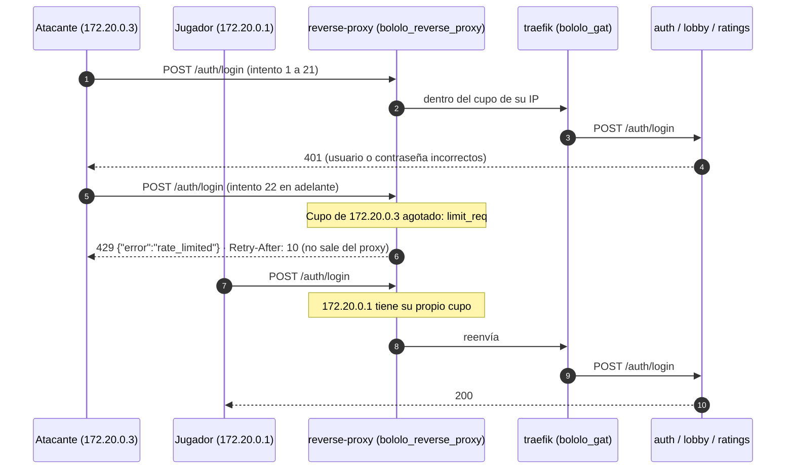

# Escenario 5 · Rate Limiting (límite de tasa por IP en el proxy inverso)

| | |
|---|---|
| Atributo de calidad | Seguridad: disponibilidad del sistema frente a clientes abusivos, y resistencia a la adivinación de contraseñas |
| Táctica | Detectar ataques → **Detectar denegación de servicio**. Resistir ataques → **Limitar el acceso** |
| Patrón | **Rate Limiting / Throttling**: el único punto de entrada cuenta las peticiones de cada cliente y rechaza en el borde las que pasan el umbral |
| Rama | `feature/p3-esc5` (desde `main` @ `eaae0db`) |
| Responsable | ______________________ |
| Evidencia | [`docs/p3/evidencia/esc5/`](evidencia/esc5/) |

## Contenido

1. [Estado antes del cambio](#1-estado-antes-del-cambio)
2. [Amenazas identificadas antes de implementar](#2-amenazas-identificadas-antes-de-implementar)
3. [Escenario de calidad](#3-escenario-de-calidad)
4. [Opciones evaluadas y decisión](#4-opciones-evaluadas-y-decisión)
5. [Implementación](#5-implementación)
6. [Qué cambia en la arquitectura](#6-qué-cambia-en-la-arquitectura)
7. [Evidencia: antes y después](#7-evidencia-antes-y-después)
8. [Compromisos](#8-compromisos)
9. [Riesgos residuales y trabajo futuro](#9-riesgos-residuales-y-trabajo-futuro)
10. [Cómo usarlo (equipo)](#10-cómo-usarlo-equipo)
11. [Guion de la demo (3 a 4 minutos)](#11-guion-de-la-demo-3-a-4-minutos)
12. [Referencias](#12-referencias)

---

## 1. Estado antes del cambio

Medido sobre `main` (`eaae0db`, con los escenarios 1 y 2) el 22 de noviembre de 2026, con el stack completo arriba. La evidencia está en [`evidencia/esc5/antes/`](evidencia/esc5/antes/).

El atacante es un contenedor conectado a la red `public`. Llega al proxy igual que un cliente de Internet, pero con su propia IP. El usuario legítimo es el navegador del host.

| Hecho | Por qué importa | Evidencia |
|---|---|---|
| 100 logins seguidos con 100 usuarios distintos: los 100 llegan a `auth` y reciben `401` | `auth` bloquea **una cuenta** tras 5 fallos, pero quien prueba una contraseña común contra muchos usuarios (*credential stuffing* o *password spraying*) nunca dispara ese bloqueo. Cada intento le cuesta a `auth` un BCrypt de coste 12 | [01-fuerza-bruta.txt](evidencia/esc5/antes/01-fuerza-bruta.txt) |
| Un solo cliente envía 10 000 peticiones a `GET /api/ratings/leaderboard` en 20 s (500 por segundo) y todas llegan a `ratings-service` | Nada en el camino limita cuánto pide un cliente. `ratings-service` es el cuello de botella medido en el Lab 6 | [02-inundacion-api.txt](evidencia/esc5/antes/02-inundacion-api.txt) |
| Mientras dura esa inundación, el p95 del usuario legítimo pasa de **52,5 ms a 210,8 ms** (×4) y su mediana de 39 ms a 118 ms | Un solo cliente degrada el servicio de todos los demás | [03-usuario-legitimo.txt](evidencia/esc5/antes/03-usuario-legitimo.txt) |
| El proxy no tiene `limit_req` ni `limit_conn` | Los límites del escenario 2 son de tamaño (64 KB) y de tiempo (10 s), no de cantidad. El riesgo T11 de `esc2.md` quedó abierto | [04-respuesta-429.txt](evidencia/esc5/antes/04-respuesta-429.txt) |
| El proxy ve al navegador del host con `172.20.0.1` (el gateway de la red `public`) y al contenedor atacante con `172.20.0.3` | Con Docker Desktop, todo lo que entra por el puerto publicado llega con la misma IP. Define cómo se prueba (§9) | 04-respuesta-429.txt |

Lo que ya había y se conserva: el bloqueo por cuenta de `auth` (5 fallos, 1 min, `429 too_many_attempts`), el canal seguro (escenario 1) y el proxy inverso con su lista de rutas y sus límites de tamaño (escenario 2).

## 2. Amenazas identificadas antes de implementar

Modelo de atacante: un **cliente automatizado en Internet** (un script, o una botnet pequeña con pocas IP) que puede enviar peticiones válidas a las rutas públicas. Puede tener una sesión de invitado, porque cualquiera la obtiene. No tiene acceso a la red interna.

| ID | Amenaza (STRIDE) | Cómo ocurriría en Bololó | Impacto | ¿Lo cubre? |
|---|---|---|---|---|
| R1 | **Relleno de credenciales** (Spoofing) | Un script prueba una lista de usuarios con contraseñas comunes contra `/auth/login`. Cada usuario recibe menos de 5 intentos, así que el bloqueo por cuenta no salta | Cuentas robadas; CPU de `auth` gastada en BCrypt | Sí: 10 intentos por minuto por IP en `/auth/login`, `/auth/register` y `/auth/password`, con ráfaga de 20 |
| R2 | **Creación masiva de cuentas o sesiones** (Denial of service) | Bucle sobre `/auth/register` o `/auth/guest` | La base de `auth` y la de jugadores del Lobby crecen sin control | Sí: los mismos límites estrictos para `register` y 30 por minuto para `guest` |
| R3 | **Inundación de la API** (Denial of service) | Miles de peticiones por segundo a rutas válidas de `/api/` (por ejemplo, el ranking) | `ratings-service` y `lobby-manager` se saturan y todos los jugadores esperan (T11 de `esc2.md`) | Sí: 20 por segundo por IP, con ráfaga de 40 |
| R4 | **Agotar conexiones** (Denial of service) | Abrir cientos de SSE o WebSocket desde una IP y dejarlos abiertos. Cada stream es una sola petición, así que `limit_req` no lo ve | Se agotan las `worker_connections` del proxy (hallazgo del Lab 6) | Sí: 100 conexiones simultáneas por IP en `/api/` y `/ws/games/` |
| R5 | **Bloquear la cuenta de otro** (Denial of service) | 5 contraseñas malas contra el usuario de un rival lo bloquean 1 minuto | La víctima no puede entrar | Parcial: el límite por IP frena hacerlo en masa, pero 5 intentos caben en la ráfaga (§9) |
| R6 | **Ataque distribuido** (Denial of service) | Cientos de IP distintas, cada una por debajo del umbral | Igual que R3 | **No.** Un límite por IP no lo detecta (§9) |
| R7 | **Inundación de páginas** (Denial of service) | Miles de `GET /menu/`, que renderiza en el servidor y consulta el ranking | Carga sobre `frontend` y `ratings-service` | **No.** Las páginas no se limitan, porque cada una carga una decena de archivos (§9) |

## 3. Escenario de calidad

| | |
|---|---|
| **Fuente** | Cliente automatizado (script o botnet pequeña) desde Internet, con o sin sesión de invitado |
| **Estímulo** | Envía cientos de peticiones por minuto al login con usuarios distintos, o miles por segundo a la API |
| **Artefacto** | Punto de entrada `bololo_reverse_proxy` (conectores C1 y C3 de la vista C&C) y, detrás de él, `bololo_auth` (C5), `bololo_lobby` (C6) y `bololo_ratings` (C4) |
| **Entorno** | Operación normal, con jugadores usando el sistema al mismo tiempo |
| **Respuesta** | El proxy cuenta las peticiones de cada IP. Mientras están dentro del límite las deja pasar; las que lo exceden las rechaza en el borde con `429`, `Retry-After` y un mensaje legible, sin reenviarlas al gateway, y las deja registradas en el log de acceso. Los demás clientes siguen igual |
| **Medida** | Login: de 100 intentos, **22 llegan a `auth` y 78 reciben `429`** (antes llegaban los 100). Inundación de la API: de 88 000 peticiones, **430 llegan a `ratings`** (casi exactamente 20 por segundo durante 20 s más la ráfaga de 40, es decir 440) y el 99,5 % recibe `429` en el borde. **100 % del excedente rechazado sin llegar al gateway** (`upstream_status` vacío). p95 del usuario legítimo durante el ataque: **67,3 ms** frente a 64,2 ms sin ataque (antes: 210,8 ms frente a 52,5 ms). `e2e.sh`: 171 OK, 0 fallas |
| **Táctica** | Detectar ataques: detectar denegación de servicio (tráfico de un origen por encima del umbral). Resistir ataques: limitar el acceso (`429` en el borde) |
| **Patrón** | Rate Limiting / Throttling en el Reverse Proxy |
| **Implementación** | `limit_req` y `limit_conn` de Nginx por IP en `reverse-proxy/templates/bololo.conf.template`, con 3 zonas (`auth_cred`, `auth`, `api`), 1 límite de conexiones y una respuesta `429` propia. Interruptor `RATE_LIMIT` para las pruebas de carga. Detalle en §5 |
| **Evidencia** | Atacante en contenedor y usuario legítimo en el host, antes y después; `e2e.sh` con 14 comprobaciones nuevas. Detalle en §7 |
| **Compromisos** | Se gana protección de los servicios y del login sin tocar su código. Cuesta: con NAT o con Docker Desktop varios usuarios comparten el cupo; las pruebas de carga desde una IP deben apagarlo; no detiene ataques distribuidos. Detalle en §8 |

## 4. Opciones evaluadas y decisión

### 4.1 Dónde se limita

| Opción | A favor | En contra | Decisión |
|---|---|---|---|
| **A. En el proxy inverso (Nginx `limit_req` y `limit_conn`)** | Es el único componente que ve la IP real del cliente. Rechaza antes del gateway y de los servicios, así que lo excedente no consume nada detrás. Usa módulos que trae Nginx. Ya es donde viven los demás límites (escenario 2) | Configuración estática. Contadores en memoria de un solo proceso (no sirve tal cual con varias réplicas del proxy) | **Elegida** |
| B. Middleware `rateLimit` de Traefik | Se declara por labels, junto a cada ruta | Traefik solo ve la IP del proxy (`10.250.0.2`). Habría que tomarla de `X-Forwarded-For` con `ipStrategy.depth`. Lo rechazado ya cruzó el proxy y la red `edge`. Repartiría los límites entre dos componentes | Descartada |
| C. En cada servicio (por ejemplo bucket4j en `auth` o slowapi en FastAPI) | Puede limitar por cuenta además de por IP | Cinco lenguajes y cinco librerías. La petición ya llegó al servicio. Los servicios ven la IP por `X-Forwarded-For`, que hay que volver a validar en cada uno | Descartada como principal. El bloqueo por cuenta de `auth` se conserva como segunda capa |
| D. WAF o CDN externo (Cloudflare, AWS WAF) | Frena ataques distribuidos y absorbe volumen antes de llegar al host | Fuera del alcance de un despliegue local con Compose; costo y dependencia externa | Descartada para el prototipo (§9) |
| E. fail2ban sobre los logs del host | Bloquea IP a nivel de firewall | Reacciona después del daño, necesita acceso al host y no aplica a Docker Desktop | Descartada |

### 4.2 Algoritmo y valores

`limit_req` implementa un *leaky bucket*. Cada IP tiene un balde que se vacía a la tasa configurada; la `burst` es cuántas peticiones de más caben en un pico. Con `nodelay`, lo que cabe en el balde se atiende sin esperar, y lo que no cabe recibe `429` de inmediato. Así un jugador normal nunca percibe el límite y un script lo choca enseguida.

| Zona | Rutas | Tasa | Ráfaga | Uso normal que debe caber |
|---|---|---|---|---|
| `auth_cred` | `/auth/login`, `/auth/register`, `/auth/password` | 10 por minuto | 20 | Un jugador hace de 1 a 3 por sesión. `e2e.sh` hace 12 seguidos. Con el bloqueo por cuenta, un atacante pasa de intentos ilimitados a 600 por hora por IP |
| `auth` | Resto de `/auth/` (`guest`, `me`) | 30 por minuto | 30 | Una sesión de invitado por pestaña. `e2e.sh` crea 10 |
| `api` | `/api/` | 20 por segundo | 40 | Un jugador hace menos de 2 por segundo. El SSE es una sola petición. Cuatro jugadores tras un mismo NAT siguen muy por debajo |
| `perip` (`limit_conn`) | `/api/` y `/ws/games/` | 100 conexiones simultáneas | — | Cada pestaña mantiene un SSE o un WebSocket |

No se limitan las páginas ni los archivos estáticos (`/menu/`, `/ingame/`, `/chameleon/`, `/libraries/`): cada página carga una decena de archivos y el límite molestaría al jugador sin proteger nada sensible.

### 4.3 Qué se agrega sobre un `limit_req` básico, y por qué

| Agregado | Motivo |
|---|---|
| `429` propio con `{"error":"rate_limited","message":"…"}` | El menú muestra `message` sin cambiar el front. El código distingue este `429` del `too_many_attempts` de `auth` (bloqueo de una cuenta) |
| `Retry-After: 10` | RFC 6585: el cliente sabe cuándo reintentar |
| Cabeceras seguras también en el `429` | En Nginx, una `location` con `add_header` propio pierde los del `server`. Las cuatro cabeceras pasaron a `security-headers.conf` y se incluyen en los dos sitios |
| `limit_conn` además de `limit_req` | R4: un SSE o un WebSocket es una sola petición y `limit_req` no lo ve |
| `/auth/` separado de las páginas | Antes compartían una `location`. Sin separarlo, el límite estricto frenaría la carga de `/menu/` |
| Interruptor `RATE_LIMIT=on\|off` | k6 sale de una sola IP: con el límite, el análisis de rendimiento mediría el `429`, no el sistema. No se agrega a `.env.example`, para no romper la comprobación de claves de `e2e.sh` en las máquinas del equipo |
| Contadores por `$binary_remote_addr` (4 bytes en IPv4) | Una zona de 10 MB guarda unas 160 000 IP |

## 5. Implementación

### 5.1 Flujo



### 5.2 Archivos

| Archivo | Cambio |
|---|---|
| [`reverse-proxy/templates/bololo.conf.template`](../../reverse-proxy/templates/bololo.conf.template) | `map` de `RATE_LIMIT` a la clave `$rl_key`; 3 `limit_req_zone` y 1 `limit_conn_zone`; `limit_req_status` y `limit_conn_status` en 429. `/auth/login`, `/auth/register` y `/auth/password` en una `location` propia con `auth_cred`; el resto de `/auth/` con `auth`; `/api/` con `api` y `perip`; `/ws/games/` con `perip`. `error_page 429 = @rate_limited`, que responde JSON con `Retry-After`. Las cabeceras seguras pasan a un `include` |
| [`reverse-proxy/security-headers.conf`](../../reverse-proxy/security-headers.conf) (nuevo) | HSTS, `nosniff`, `X-Frame-Options` y `Referrer-Policy`, antes escritas en el `server` |
| `docker-compose.yml`, servicio `reverse-proxy` | `RATE_LIMIT: ${RATE_LIMIT:-on}`, `NGINX_ENVSUBST_FILTER` con `RATE_LIMIT` y el montaje de `security-headers.conf`. No se tocó el bloque `networks:` (escenario 3) |
| [`reverse-proxy/README.md`](../../reverse-proxy/README.md) | Sección "Límite de tasa por IP" |
| [`scripts/e2e.sh`](../../scripts/e2e.sh) | Sección "Rate Limiting (escenario 5)" con 14 comprobaciones, al final para no gastar cupos antes de las demás pruebas |
| [`scripts/esc5-evidence.sh`](../../scripts/esc5-evidence.sh) (nuevo) | Regenera la evidencia de §7 en las dos fases |
| [`docs/p3/esc2.md`](esc2.md) | T11 y su riesgo residual remiten a este escenario |

Ningún servicio cambió su código.

### 5.3 Hallazgos durante la implementación

- **Con Docker Desktop, el proxy ve una sola IP.** Todo lo que entra por el puerto publicado (el navegador del host, la LAN y `e2e.sh`) llega con `172.20.0.1`, el gateway de la red `public`. En desarrollo, el límite es por máquina. Para probar que un cliente abusivo no afecta a los demás, el atacante corre en un contenedor de la red `public`, que tiene IP propia. En un host Linux con IP pública, Nginx ve la IP real de cada cliente.
- **`add_header` no se hereda.** La `location` del `429` agrega `Retry-After` y con eso perdía HSTS y las demás cabeceras del `server`. Se resolvió con `security-headers.conf` incluido en los dos sitios. `HSTS_MAX_AGE` llega al archivo por una variable `$hsts_max_age` de la plantilla, porque `envsubst` solo procesa `templates/`.
- **El `413` no gasta cupo.** Nginx rechaza un cuerpo mayor de 64 KB al elegir la `location`, antes de la fase de `limit_req`. La prueba de 100 KB de `e2e.sh` sigue dando `413`.
- **Los contadores sobreviven entre pruebas.** Si un contenedor atacante nuevo recibe la misma IP que uno anterior, empieza con el cupo gastado. `esc5-evidence.sh` reinicia el proxy antes de medir.
- **`e2e.sh` puede seguir corriéndose seguido.** El host gasta 12 de los 21 intentos de `auth_cred` por corrida y una corrida dura más de un minuto, así que el cupo se recupera. Se comprobó con 3 corridas consecutivas.

## 6. Qué cambia en la arquitectura

### 6.1 Antes y después

| Aspecto | Antes (`main`) | Después (`feature/p3-esc5`) |
|---|---|---|
| Peticiones por cliente | Sin límite | 10/min (credenciales), 30/min (resto de `/auth/`), 20/s (`/api/`), 100 conexiones simultáneas |
| Dónde se rechaza el exceso | En ningún lado; solo el bloqueo por cuenta en `auth` | En `reverse-proxy`, sin llegar al gateway |
| Respuesta al exceso | — | `429` JSON con `Retry-After` y cabeceras seguras |
| Ubicación de `/auth/` en el proxy | Junto a las páginas | En sus propias `location` |
| Pruebas de carga | k6 directo | `RATE_LIMIT=off` para medir capacidad; `on` para medir el efecto del límite |

### 6.2 Cambios para las vistas

**Vista C&C.** No hay componentes ni conectores nuevos. El límite es una propiedad de `bololo_reverse_proxy` sobre C1 y C3. Si se quiere dejar a la vista, se puede anotar en la descripción del componente: "limita la tasa por IP y responde 429".

**Vista de despliegue.**

| Sección | Cambio |
|---|---|
| Contenedor `reverse-proxy` | Variable `RATE_LIMIT` (por defecto `on`) y montaje de `reverse-proxy/security-headers.conf` |
| Especificación de despliegue | `bololo.conf.template`, con las zonas de límite |
| Puertos y redes | Sin cambios |

**Vista de capas** ([`docs/layered-view.md`](../layered-view.md)). La capa "Filtros de borde" de `bololo_reverse_proxy` incluye el límite de tasa. Ya está dibujada.

**Estilos y patrones.** El patrón Rate Limiting se suma al Reverse Proxy en el mismo componente. Los dos aplican la táctica de limitar el acceso: uno por qué se pide y el otro por cuánto se pide.

## 7. Evidencia: antes y después

Todo se regenera con `./scripts/esc5-evidence.sh antes` (stack de `main`) y `./scripts/esc5-evidence.sh despues` (stack de esta rama). Cada archivo muestra el comando exacto seguido de su salida.

| Prueba | Antes | Después | Archivos |
|---|---|---|---|
| 100 logins con usuarios distintos desde una IP | 100× `401`: los 100 llegan a `auth` | **22× `401` y 78× `429`**: llegan 1 + 20 (ráfaga) + 1 (recarga) | [antes/01](evidencia/esc5/antes/01-fuerza-bruta.txt), [despues/01](evidencia/esc5/despues/01-fuerza-bruta.txt) |
| Inundación de `/api/ratings/leaderboard` durante 20 s (50 en paralelo) | 10 000× `200`, unas 500 por segundo, todas atendidas por `ratings` | **430× `200` y 87 570× `429`**. El atacante envía 4400 por segundo porque el `429` es barato, pero a `ratings` llegan 20 por segundo más la ráfaga | [antes/02](evidencia/esc5/antes/02-inundacion-api.txt), [despues/02](evidencia/esc5/despues/02-inundacion-api.txt) |
| Usuario legítimo sin ataque (mediana / p95) | 39,2 / 52,5 ms | 41,0 / 64,2 ms | [antes/03](evidencia/esc5/antes/03-usuario-legitimo.txt), [despues/03](evidencia/esc5/despues/03-usuario-legitimo.txt) |
| Usuario legítimo **durante** el ataque (mediana / p95 / máx.) | **117,8 / 210,8 / 604,8 ms**; 59 respuestas en 20 s | **48,9 / 67,3 / 75,0 ms**; 79 respuestas; 0 `429` | ídem |
| Respuesta al exceso | No existe | `HTTP/2 429`, `{"error":"rate_limited",…}`, `retry-after: 10`, HSTS, `nosniff`, `X-Frame-Options`, `Referrer-Policy` | [despues/04](evidencia/esc5/despues/04-respuesta-429.txt) |
| ¿El `429` llega al gateway? | — | No: `"upstream_status":""` y `"duration_s":0.000` en el log | ídem |
| IP que ve el proxy | Host `172.20.0.1`, atacante `172.20.0.3` | Igual | [antes/04](evidencia/esc5/antes/04-respuesta-429.txt), [despues/04](evidencia/esc5/despues/04-respuesta-429.txt) |
| `RATE_LIMIT=off` | — | 40 logins: 40× `401`. Al volver a `on`, el límite regresa | [despues/05](evidencia/esc5/despues/05-interruptor.txt) |
| `scripts/e2e.sh` | 156 OK (escenario 2) | **171 OK, 0 fallas**, 14 comprobaciones nuevas | [despues/06](evidencia/esc5/despues/06-e2e.txt) |

**Las comprobaciones nuevas de `e2e.sh`:**
- 40 logins desde el atacante: todos son `401` o `429`, y entre 1 y 25 llegan a `auth`.
- El `429` es del proxy, trae `Retry-After` y las cuatro cabeceras seguras, y no llega al gateway.
- Una inundación de 300 peticiones recibe `429`.
- 110 SSE abiertos desde una IP a unos 16 por segundo (debajo del límite de tasa): `limit_conn` corta los que pasan de 100 con `429`.
- Con el atacante frenado, el host recibe `200` en la API y crea una sesión.
- El atacante frenado todavía carga `/menu/`.
- `RATE_LIMIT` vale `on`.

En todas las corridas, la única falla es la comprobación de claves de `.env` de la máquina donde se midió (ver el README de la evidencia).

## 8. Compromisos

### 8.1 Rendimiento

- **Costo del límite para el usuario legítimo: no medible.** Sin ataque, la mediana fue de 39,2 ms antes y 41,0 ms después, dentro del ruido. `limit_req` consulta una tabla en memoria compartida por petición.
- **Durante un ataque de una sola IP, el límite protege a los demás.** El p95 del usuario legítimo pasó de 210,8 ms (×4 sobre su línea base) a 67,3 ms (×1,05). Sin el límite, el atacante se llevaba la capacidad de `ratings-service`. Con él, `ratings` atiende 20 de sus peticiones por segundo y el resto se descarta en el proxy en menos de 1 ms.
- **El proxy sigue trabajando.** El atacante pudo enviar 4400 peticiones por segundo porque cada `429` es barato, pero el proxy igual termina TLS y HTTP/2 para todas. Con un ataque mucho mayor, la CPU del proxy sería el límite (§9).
- **Análisis de rendimiento (k6).** k6 sale de una sola IP y con el límite activo mediría el `429`. Para medir capacidad: `RATE_LIMIT=off docker compose up -d reverse-proxy`, y al terminar `docker compose up -d reverse-proxy`. Con el límite activo, la misma prueba muestra cómo se descarta el exceso en el borde, y se puede presentar como comparación antes/después.

### 8.2 Resumen

| Se gana | Cuesta |
|---|---|
| Un cliente no puede adivinar contraseñas sin freno ni crear cuentas o sesiones en masa (R1, R2) | Con NAT compartido (una universidad, una casa) varios usuarios comparten el cupo. Con Docker Desktop, toda la máquina comparte uno |
| Un cliente no satura `ratings` ni `lobby` (R3) ni agota conexiones (R4); los demás no lo notan | Valores fijos en la plantilla. Si el uso real cambia, hay que reajustarlos y volver a medir |
| El exceso se rechaza en el borde: no consume gateway ni servicios | Las pruebas de carga desde una IP deben apagar el límite (`RATE_LIMIT=off`) |
| Ningún servicio cambió su código; el bloqueo por cuenta de `auth` queda como segunda capa | Un `429` más que entender: el del proxy (`rate_limited`) y el de `auth` (`too_many_attempts`) |
| Respuesta clara al cliente (`message`, `Retry-After`) con las cabeceras seguras | `Retry-After` es fijo (10 s), no el tiempo exacto hasta liberar el cupo |

## 9. Riesgos residuales y trabajo futuro

| Riesgo | Situación | Siguiente paso |
|---|---|---|
| Ataque distribuido (R6) | Cien IP, cada una por debajo del umbral, suman lo mismo que una sin límite | Límite global por ruta (una zona con clave constante) como techo, o WAF/CDN delante del host |
| Volumen que satura el propio proxy | El `429` es barato pero no gratis: TLS y HTTP/2 se procesan igual | Protección de red antes del host (proveedor de nube, firewall) |
| Una IP para todos en Docker Desktop | En desarrollo, todos los navegadores del host y de la LAN comparten el cupo | Desplegar en un host Linux con IP pública. Detrás de un balanceador, usar `real_ip_header` con la IP del balanceador como confiable |
| Bloquear la cuenta de otro (R5) | 5 contraseñas malas caben en la ráfaga de `auth_cred` | En `auth`: bloqueo progresivo, CAPTCHA o aviso al dueño |
| Páginas sin límite (R7) | `/menu/` renderiza y consulta el ranking en cada petición | Micro-caché de 1 s del ranking en Nginx (candidato del análisis de rendimiento) |
| Contadores por proceso | Con varias réplicas del proxy, cada una contaría por su lado | Contador compartido (Redis) o balanceo por IP |
| IPv6 | Cada dirección cuenta aparte, y un cliente IPv6 tiene millones | Hoy el `resolver` y Compose usan IPv4. Si se habilita IPv6, contar por prefijo /64 |
| `e2e.sh` sin `DEMO_MODE` deja salas `IN_GAME` | No es de este escenario. Las partidas sin simular quedan abiertas 3 h, y tras 4 o 5 corridas el Lobby alcanza su máximo de 10 salas | Correr con `DEMO_MODE`, o que `e2e.sh` cierre sus salas al terminar |

## 10. Cómo usarlo (equipo)

1. Traer la rama y levantar el proxy. No hay pasos nuevos:
   ```bash
   docker compose up -d --wait
   ./scripts/e2e.sh        # opcional
   ```
2. El límite queda activo por defecto.

| Situación | Qué hacer |
|---|---|
| El menú dice "Demasiadas peticiones…" mientras se prueba | Esperar unos segundos. En Docker Desktop todo el equipo comparte la IP, así que muchos logins seguidos agotan `auth_cred`. Para reiniciar los contadores: `docker compose restart reverse-proxy` |
| Prueba de carga con k6 | `RATE_LIMIT=off docker compose up -d reverse-proxy`, y al terminar `docker compose up -d reverse-proxy`. Anotar en `performance.md` con qué valor se midió |
| Cambiar un límite | `rate` y `burst` en `reverse-proxy/templates/bololo.conf.template`, luego `docker compose up -d --force-recreate reverse-proxy` y `./scripts/e2e.sh` |
| Ruta nueva bajo `/auth/` | Cae en la zona `auth`. Si recibe credenciales, agregarla a la expresión de `auth_cred` |
| Ver quién está siendo limitado | `docker compose logs reverse-proxy \| grep '"status":429'`: cada línea trae la IP en `client` |
| `e2e.sh` falla en "Modo camaleon" con `lobby_limit_reached` | No es del límite de tasa: hay 10 salas `IN_GAME` de corridas anteriores (§9). Se liberan solas a las 3 h, o con `DEMO_MODE` |

## 11. Guion de la demo (3 a 4 minutos)

Preparación: el stack arriba, la imagen del atacante construida (la crea `esc5-evidence.sh`) y dos terminales. En las dos, Git Bash con:

```bash
export MSYS_NO_PATHCONV=1
export C="--cacert api-gateway/ca/bololo-dev-ca.crt --connect-to localhost:443:reverse-proxy:443"
ATK="docker run --rm -i --network bololo-integrado_public -e C -v $(pwd -W):/w -w /w bololo-bench:curl"
```

| Tiempo | Paso | Qué se muestra |
|---|---|---|
| 0:00 | Contexto | El atacante es un script en Internet. `auth` bloquea una cuenta tras 5 fallos, pero no a quien prueba muchas cuentas |
| 0:30 | **Sin la defensa.** `RATE_LIMIT=off docker compose up -d --wait reverse-proxy` y luego el bucle de 100 logins con usuarios distintos desde `$ATK` (comando de `01-fuerza-bruta.txt`) | 100× `401`: todos llegan a `auth` |
| 1:15 | **Con la defensa.** `docker compose up -d --wait reverse-proxy` y el mismo bucle | 22× `401` y 78× `429` |
| 1:45 | `curl -si` del intento siguiente desde `$ATK` | El `429` con JSON, `Retry-After` y cabeceras seguras |
| 2:05 | En la otra terminal, la inundación de `02-inundacion-api.txt`; mientras tanto, jugar en `https://localhost` | El atacante recibe `429` por miles y la partida sigue fluida |
| 2:50 | `docker compose logs reverse-proxy \| grep '"status":429' \| tail -2` | `upstream_status` vacío: el exceso no llegó al gateway |
| 3:10 | Cierre con la tabla de §7 | p95 del jugador durante el ataque: 210,8 ms antes, 67,3 ms después. Riesgo residual: ataque distribuido |

## 12. Referencias

- L. Bass, P. Clements y R. Kazman, *Software Architecture in Practice*, 4.ª ed., Addison-Wesley, 2021, cap. 11 (tácticas de seguridad: detectar denegación de servicio, limitar el acceso).
- J. A. Vergara Vargas, *Architectural Tactics for Security* y *Architectural Patterns for Security*, Arquitectura de Software 2026-II, UNAL.
- M. Nottingham y R. Fielding, [RFC 6585](https://www.rfc-editor.org/rfc/rfc6585), §4: *429 Too Many Requests* y `Retry-After`.
- OWASP, [API4:2023 Unrestricted Resource Consumption](https://owasp.org/API-Security/editions/2023/en/0xa4-unrestricted-resource-consumption/) y [Credential Stuffing Prevention Cheat Sheet](https://cheatsheetseries.owasp.org/cheatsheets/Credential_Stuffing_Prevention_Cheat_Sheet.html).
- Nginx, documentación de [`ngx_http_limit_req_module`](https://nginx.org/en/docs/http/ngx_http_limit_req_module.html) y [`ngx_http_limit_conn_module`](https://nginx.org/en/docs/http/ngx_http_limit_conn_module.html).
