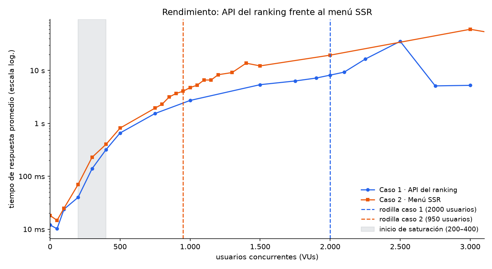
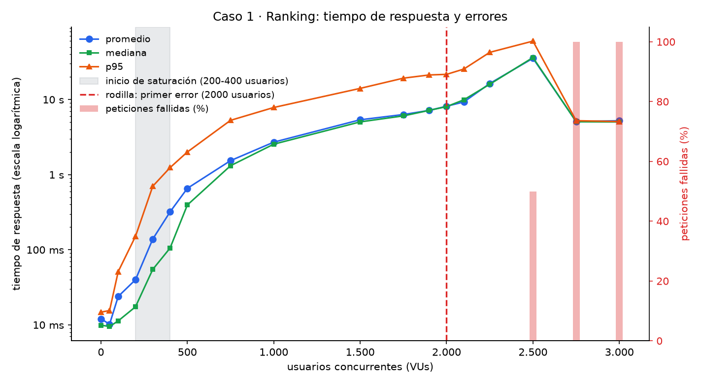
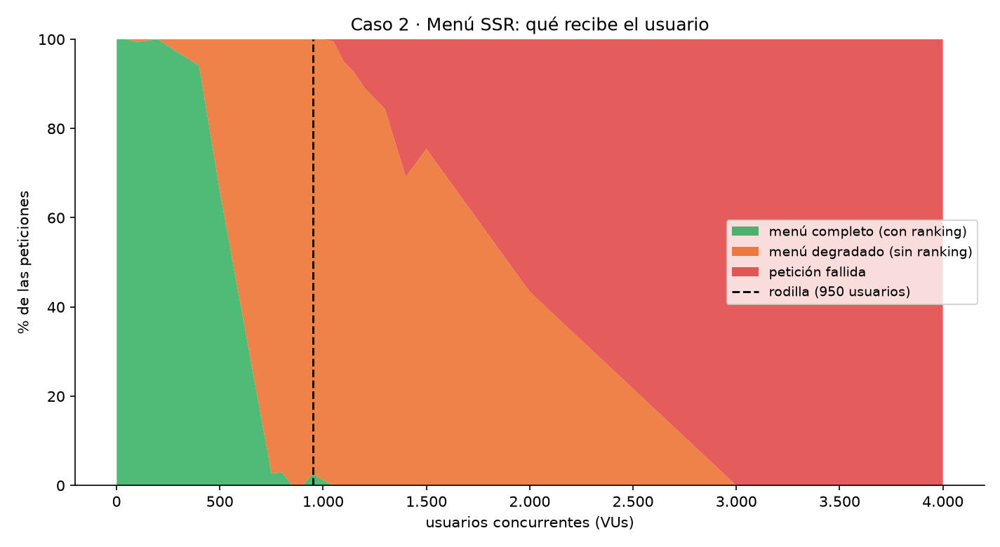
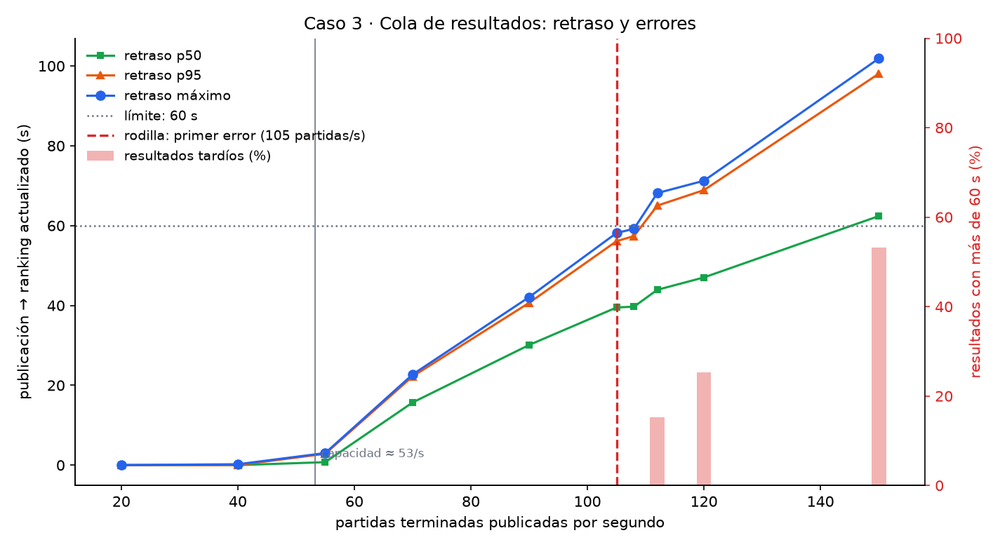

# Rendimiento y escalabilidad

| | |
|---|---|
| Atributo de calidad | Rendimiento (tiempo de respuesta y throughput) y escalabilidad |
| Herramienta | k6 v2.3.0 (casos 1 y 2) y un publicador AMQP propio (caso 3) |
| Criterio de la rodilla | **El nivel de carga más bajo en el que aparece el primer error**, refinado entre el último nivel sin errores y el primero con errores, con 3 corridas en los niveles decisivos |
| Detalle por caso | [Caso 1 · API del ranking](performance/caso1-ranking.md) · [Caso 2 · Menú SSR](performance/caso2-menu.md) · [Caso 3 · Cola de resultados](performance/caso3-cola.md) · [Caso 4 · Autenticación](performance/caso4-auth.md) |
| Scripts y datos crudos | [`perf/`](../../perf/) |

**En una frase:** con un tiempo de respuesta p95 por debajo de 250 ms, Bololó atiende ≈ 200 usuarios concurrentes. Los primeros errores aparecen con **950 usuarios en el menú** y **2000 en la API del ranking**. El primer cuello de botella es un servicio de un solo proceso: `ratings-service` y, para el menú, el `frontend`.

## 1. Entorno

| Elemento | Detalle |
|---|---|
| Hardware | Portátil AMD Ryzen 5 3500U (4 núcleos, 8 hilos), 5,7 GB de RAM, conectado al cargador |
| Sistema bajo prueba | Docker Desktop 29.7.2 con una VM de **4 CPU y 1,4 GB**; los 13 contenedores del `docker-compose.yml` de la rama `feature/p3-esc2` (`e380dd7`) |
| Configuración | **Con TLS** (escenario 1) y **con el reverse proxy** Nginx delante de Traefik (escenario 2), `worker_connections 4096`. **Sin rate limiting** (el escenario 5 no está implementado) |
| Generador de carga | k6 en el host, fuera de la VM, fijado a los hilos 4–7 con `taskset`. El publicador del caso 3 corre dentro de la VM, en el contenedor `lobby-manager` |
| Datos | 5000 jugadores ficticios por modo en `ratings-postgres` (`perf/datos/seed_ratings.sql`), con rating de distribución normal |

Sobre el entorno:
- **El nodo no es independiente.** No había otro computador. La VM de Docker Desktop tiene su propio kernel, RAM y CPU, y k6 usa hilos aparte, pero comparten la máquina física.
- **El entorno pesa en los resultados.** Se descartaron dos barridos completos del caso 1 porque daban la mitad de capacidad: uno con el navegador abierto (carga 15 en 8 hilos y 1,3 GB en swap) y otro funcionando con batería (CPU a 1,8 GHz). Las mediciones válidas se hicieron con el cargador conectado y sin aplicaciones pesadas abiertas.

## 2. Metodología

### 2.1 Casos

Se midieron tres funcionalidades por separado, para que cada curva tenga un solo cuello de botella identificable. Auth no se incluyó porque la mide otro integrante del equipo.

| Caso | Funcionalidad | Camino | Carga | Error |
|---|---|---|---|---|
| 1 | Consultar el ranking (`GET /api/ratings/leaderboard`) | proxy → gateway → `ratings-service` → PostgreSQL | Usuarios concurrentes | Sin respuesta en 60 s, `4xx` o `5xx` |
| 2 | Cargar el menú (`GET /menu/`, SSR) | proxy → gateway → `frontend` → `ratings-service` → PostgreSQL | Usuarios concurrentes | Igual que el caso 1. Un menú sin ranking **no** es error, se cuenta aparte como "degradado" |
| 3 | Procesar el resultado de una partida | RabbitMQ → consumidor de `ratings-service` → PostgreSQL | Partidas terminadas por segundo | Resultado perdido, descartado o que tarda más de 60 s en llegar al ranking |
| 4 | Operaciones de autenticación | proxy → gateway → `auth-service` → PostgreSQL / claves RSA | Usuarios concurrentes | Timeout, estado inesperado o token inválido |

El flujo completo de una partida (sesión, sala, bots, WebSocket) no se estresó porque el lobby admite **como máximo 10 salas activas** (`max_lobbies = 10`, regla del reglamento). Con 40 jugadores el flujo rechaza por regla de negocio, no por falta de capacidad (ver §6).

### 2.2 Cada corrida

- **Casos 1 y 2:** rampa de 15 s hasta N usuarios y 60 s sostenidos. Las métricas se toman solo de la fase sostenida. Cada usuario hace una petición, la valida y espera 1 s (`sleep(1)`), así que la carga ideal es N peticiones/s.
- **Caso 3:** publicación a una tasa constante durante 60 s. El retraso de cada partida se mide en la base de datos, como `processed_at − finished_at`.
- **En paralelo:** CPU y memoria por contenedor (`docker stats`), estado de salud de los servicios y códigos de estado del log de Nginx.
- **Entre corridas:** se espera a que los servicios vuelvan a reposo (CPU < 5 % y sanos). Sin esa espera, una corrida arrancaba con la cola de la anterior y colapsaba, y se descartó un refinamiento completo por eso.

### 2.3 Búsqueda de la rodilla

1. **Barrido grueso** hasta encontrar errores.
2. **Refinamiento** entre el último nivel sin errores y el primero con errores: por rejilla en los casos 1 y 2, por bisección en el caso 3.
3. **3 corridas** en los niveles decisivos, porque cerca de la rodilla la misma carga a veces falla y a veces no.

Cuando un nivel tiene varias corridas se reporta la **mediana**.

### 2.4 Métricas

| Métrica | Dónde se reporta |
|---|---|
| Latencia promedio, p50, p95 y p99 por funcionalidad | Casos 1 y 2, §4 |
| Throughput (peticiones o partidas atendidas por segundo) | Los tres casos |
| Tasa de errores, por corrida | Los tres casos |
| CPU y memoria por contenedor | Los tres casos |
| Retraso entre el fin de la partida y el ranking actualizado | Caso 3 |
| Menús entregados sin ranking (degradados) | Caso 2 |

## 3. Resultados

### 3.1 Resumen

| | Caso 1 · API del ranking | Caso 2 · Menú SSR | Caso 3 · Cola de resultados |
|---|---|---|---|
| Corridas válidas | 27 | 41 | 15 |
| Throughput máximo | **≈ 302 peticiones/s** (400 usuarios) | **≈ 284 páginas/s** (400 usuarios) | **≈ 53 partidas/s** |
| Inicio de saturación | 200–400 usuarios | 300–400 usuarios | ≈ 55 partidas/s |
| Último nivel sin errores | 1900 usuarios (0 / 0 / 0 %) | 900 usuarios (0 / 0 / 0 %) | 90 partidas/s |
| **Rodilla (primer error)** | **2000 usuarios** (0 / 0,008 / 0 / 0,021 %) | **950 usuarios** (3,5 / 0 / 0 %) | **105 partidas/s** (0 / 7,3 / 0 %) |
| Colapso | 2500 usuarios: 50 %; 2750+: 100 % | 2000: 57 %; 3000+: 100 % | 150 partidas/s: 53 % tardíos |
| Cuello de botella | `ratings-service`, 1 proceso al 100 % de un núcleo | `frontend` (Node), 1 proceso al 100 % de un núcleo | Procesamiento en serie (1 mensaje a la vez); CPU sin saturar |
| Tipo de error en la rodilla | Peticiones en cola más de 60 s (el cliente abandona) | `504` de Nginx a los 30 s; `404` de Traefik cuando saca al `frontend` del enrutamiento | Resultados que llegan tarde; 0 perdidos |

### 3.2 Tabla de resultados (casos 1 y 2)

| Usuarios | Caso 1: p50 | p95 | p99 | Errores | CPU ratings | Caso 2: p50 | p95 | p99 | Errores | Degradados | CPU frontend |
|---|---|---|---|---|---|---|---|---|---|---|---|
| 1 | 10 ms | 15 ms | 64 ms | 0 % | 39 % | 15 ms | 23 ms | 93 ms | 0 % | 0 % | 3 % |
| 50 | 10 ms | 16 ms | 23 ms | 0 % | 25 % | 13 ms | 25 ms | 39 ms | 0 % | 0 % | 32 % |
| 100 | 11 ms | 51 ms | 354 ms | 0 % | 84 % | 14 ms | 52 ms | 127 ms | 0 % | 0,6 % | 51 % |
| 200 | 17 ms | 151 ms | 310 ms | 0 % | 88 % | 38 ms | 231 ms | 469 ms | 0 % | 0 % | 57 % |
| 500 | 394 ms | 2,0 s | 3,3 s | 0 % | 100 % | 823 ms | 1,5 s | 2,3 s | 0 % | 34 % | 93 % |
| 1000 | 2,5 s | 7,8 s | 12,1 s | 0 % | 108 % | 2,4 s | 12,5 s | 15,2 s | 0 % (1 de 4 corridas: 5,6 %) | 99 % | 97 % |
| 2000 | 8,0 s | 21,6 s | 31,3 s | 0,004 % | 100 % | 30,0 s | 30,3 s | 47,3 s | 56,6 % | 43 % | 77 % |

La tabla completa de cada caso está en su informe.

### 3.3 Gráficas

*Figura 1. Tiempo de respuesta promedio de la API del ranking y del menú. Las dos curvas se saturan en la misma zona (200–400 usuarios), pero el menú falla antes.*

*Figura 2. Caso 1. Curva de desempeño con la zona de saturación y la rodilla en el primer error.*

*Figura 3. Caso 2. Entre 500 y 900 usuarios el menú se entrega sin ranking en lugar de fallar.*

*Figura 4. Caso 3. El retraso crece en línea recta desde la capacidad; la rodilla aparece cuando pasa de 60 s.*

Las demás gráficas (throughput, CPU por contenedor y errores por corrida) están en el informe de cada caso.

## 4. Análisis

### 4.1 Saturación y rodilla son cosas distintas

En los tres casos, el sistema **se satura mucho antes de fallar**:
- **Casos 1 y 2:** el throughput toca su techo entre 300 y 400 usuarios, pero los primeros errores aparecen con 950 y 2000. En medio, el sistema atiende todo y cada usuario extra solo agrega espera.
- **Caso 3:** el consumidor llega a su techo con ≈ 55 partidas/s, y los resultados empiezan a llegar tarde con 105.

En los casos 1 y 2 los datos cumplen la ley del tiempo de respuesta de un sistema cerrado, **R = N / X − Z**, donde R es el tiempo de respuesta, N los usuarios, X el throughput y Z el tiempo de pensar (1 s). Por ejemplo, con 1000 usuarios en el caso 1: 1000 / 268 − 1 = 2,73 s calculados contra 2,71 s medidos. Pasado el techo, todo usuario adicional se convierte en espera, hasta que la espera supera algún límite (el *timeout* del cliente o de Nginx) y aparece el error.

### 4.2 El primer cuello de botella

| Caso | Componente | Por qué |
|---|---|---|
| 1 | `ratings-service` | uvicorn arranca **sin `--workers`**: un proceso de Python, que por el GIL usa un núcleo aunque la VM tenga cuatro |
| 2 | `frontend` | Node.js también es **un solo proceso**. Además, cada menú lee la plantilla del disco y consulta a ratings |
| 3 | Consumidor de `ratings-service` | `prefetch_count=1` y una transacción con ≈ 11 consultas y un `COMMIT` a disco por partida: ≈ 19 ms por partida, **en serie** |

Nginx, Traefik, PostgreSQL y RabbitMQ no fueron el primer límite en ningún caso. Traefik solo se vuelve un problema en el colapso: con 2750 o más usuarios se satura de conexiones, y Nginx responde `504`.

### 4.3 Cómo falla el sistema

1. **Por *timeout*, no por rechazo.** Ningún componente rechaza carga: todos encolan. La falla aparece cuando la espera supera un límite: 60 s en el cliente (caso 1), 30 s en Nginx para las páginas (caso 2) o 60 s de retraso aceptable (caso 3).
2. **Los *healthchecks* empeoran la falla.** El *healthcheck* de un servicio saturado comparte su único hilo y no responde en 3 s. Docker lo marca como *unhealthy* y **Traefik lo saca del enrutamiento aunque el proceso siga atendiendo**: en el caso 2 aparecieron `404 page not found` de Traefik. Esto vuelve inestable la zona de la rodilla: con la misma carga, una corrida pasa sin errores y otra colapsa.
3. **La degradación del menú funciona.** El límite de 800 ms del SSR hacia ratings hace que, entre 500 y 900 usuarios, el menú se entregue sin ranking en lugar de fallar (Figura 3). Es una táctica de disponibilidad que ya existía y que estas pruebas confirman.
4. **La cola no pierde datos.** Con más partidas de las que puede procesar, RabbitMQ las guarda: 0 mensajes perdidos en 15 corridas, incluida una ráfaga de 10 000 partidas en 10 s. La sobrecarga se convierte en retraso, como se espera del estilo asíncrono con broker.

### 4.4 Costo de los patrones de seguridad

| Patrón | Medición | Costo |
|---|---|---|
| Secure Channel (escenario 1) | Antes y después de TLS, 200 peticiones ([esc1.md, §8](esc1.md)) | ≈ +7 ms por conexión nueva (*handshake*) y ≈ +0,2 ms por petición en una conexión abierta |
| Reverse Proxy (escenario 2) | Medición pareja, 12 corridas alternadas ([esc2.md, §8](esc2.md)) | +1,7 ms por conexión nueva y +0,6 ms por petición, dentro del ruido entre corridas |
| Rate limiting (escenario 5) | No medido | Pendiente: el escenario no está implementado |

El costo de seguridad es de milisegundos, mientras que la rodilla se mide en segundos de espera: **los patrones de seguridad no son los que limitan el rendimiento**.

## 5. Tácticas

### 5.1 Aplicadas y medidas

| Táctica | Dónde | Antes | Después |
|---|---|---|---|
| **Aumentar recursos**: subir `worker_connections` de Nginx de 1024 a 4096, con `reuseport` y más descriptores de archivo | `reverse-proxy` (escenario 2) | Lab 6 (16 nov): con 2000 usuarios, **17,25 % de errores**, porque Nginx se quedó sin conexiones | Caso 1 (22 nov): con 2000 usuarios, **0 % a 0,021 %**. El proxy dejó de fallar primero y la rodilla la pone ahora la cola de ratings |
| **Degradación** (límite de 800 ms del SSR hacia ratings) | `frontend` | — (ya existía) | Entre 500 y 900 usuarios, 0 errores con 34–100 % de menús sin ranking. Sin ella, el menú quedaría atado a la latencia del ranking |
| **Cola con broker** (procesamiento asíncrono de resultados) | RabbitMQ + `ratings-service` | — (ya existía) | 0 pérdidas con hasta 3 veces la capacidad; la sobrecarga se convierte en retraso |

La comparación del Lab 6 y el caso 1 usa el mismo endpoint, el mismo entorno y los mismos niveles, pero el Lab 6 corrió 30 s sin rampa y el caso 1 usa 15 s de rampa y 60 s sostenidos.

### 5.2 Propuestas para la siguiente iteración

| Táctica | Dónde | Efecto esperado |
|---|---|---|
| **Introducir concurrencia:** `uvicorn --workers 4` | `ratings-service` | Hasta 4 núcleos en vez de 1: el techo de ≈ 300 peticiones/s del caso 1 debería subir |
| **Mantener copias de los datos:** caché del *leaderboard* de 1 a 5 s | `frontend` (o Nginx) | El ranking es igual para todos: una consulta cada pocos segundos en vez de cientos por segundo. El menú seguiría mostrando el ranking bajo carga |
| **Introducir concurrencia:** módulo `cluster` de Node o varias réplicas | `frontend` | Sube el techo del menú, que hoy es un solo hilo |
| **Procesar en paralelo o por lotes** (`prefetch_count` > 1, transacciones agrupadas) | Consumidor de `ratings-service` | Más de 53 partidas/s; hoy la CPU está de sobra |
| **Limitar la tasa o la cola** (*load shedding*) | `reverse-proxy` (escenario 5) | Rechazar rápido con `429`/`503` el exceso, en vez de hacer esperar 30–60 s a todos y fallar después |
| ***Healthchecks* más tolerantes** | `docker-compose.yml` | Evitar que Traefik saque del enrutamiento a un servicio que todavía atiende |

## 6. Escalabilidad

No se midió el sistema con varias réplicas. Este análisis se basa en el código y en dónde guarda su estado cada componente.

| Componente | Estado | ¿Escala con réplicas? |
|---|---|---|
| `ratings-service` (API) | Sin estado; todo en PostgreSQL | **Sí.** Varias réplicas detrás de Traefik, que ya balancea entre contenedores del mismo servicio. Límite siguiente: el pool de conexiones de PostgreSQL (10 por réplica) |
| `ratings-service` (consumidor) | Sin estado; la cola reparte los mensajes | **Sí.** Varias instancias pueden consumir la misma cola. El bloqueo `FOR UPDATE` evita que dos actualicen a la vez la misma cuenta |
| `frontend` | Sin estado | **Sí**, igual que la API de ratings |
| `lobby-manager` | Las suscripciones SSE viven en memoria (`LobbyEvents._subs`) | **No directamente.** Un cliente conectado a una réplica no recibe los eventos que publica otra. Necesitaría repartir los eventos (por ejemplo con RabbitMQ o Redis) o afinidad de sesión |
| `game-logic` | La partida vive en memoria (`games map[string]*gameInstance`), con *snapshot* en Redis en cada transición | **No sin enrutar por partida.** Las conexiones de una partida tienen que llegar a la réplica que la tiene en memoria; Redis sirve para recuperarla, no para compartirla |
| Lobby (regla de negocio) | `max_lobbies = 10` | **El primer límite del juego no es técnico**: 10 partidas y 40 jugadores simultáneos como máximo. Escalar la infraestructura no cambia ese tope |

Conclusión: las partes de lectura y de procesamiento de resultados (ratings y frontend) pueden escalar horizontalmente sin cambios de diseño. Las partes de tiempo real (lobby y partida) guardan estado en memoria y necesitarían rediseño para tener varias réplicas, pero hoy la regla de 10 salas las mantiene muy por debajo de su capacidad.

## 7. Limitaciones

1. El generador de carga y el sistema comparten la máquina física.
2. Las rodillas dependen de los límites de espera (60 s en el cliente, 30 s en Nginx) y, en el caso 3, de la duración de la sobrecarga.
3. Solo se probaron funcionalidades de lectura y el consumidor de resultados; el flujo de partida no se estresó (regla de 10 salas).
4. No se midió la escalabilidad con réplicas (§6) ni una prueba de resistencia larga (10–15 min).
5. Detalle de las limitaciones de cada caso en su informe.
