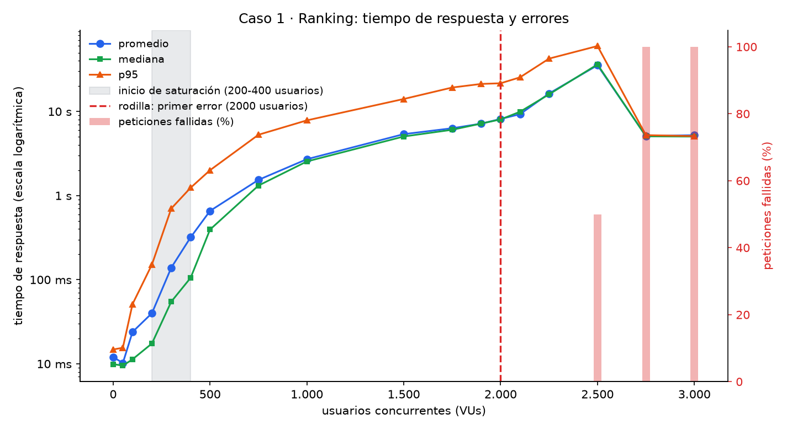
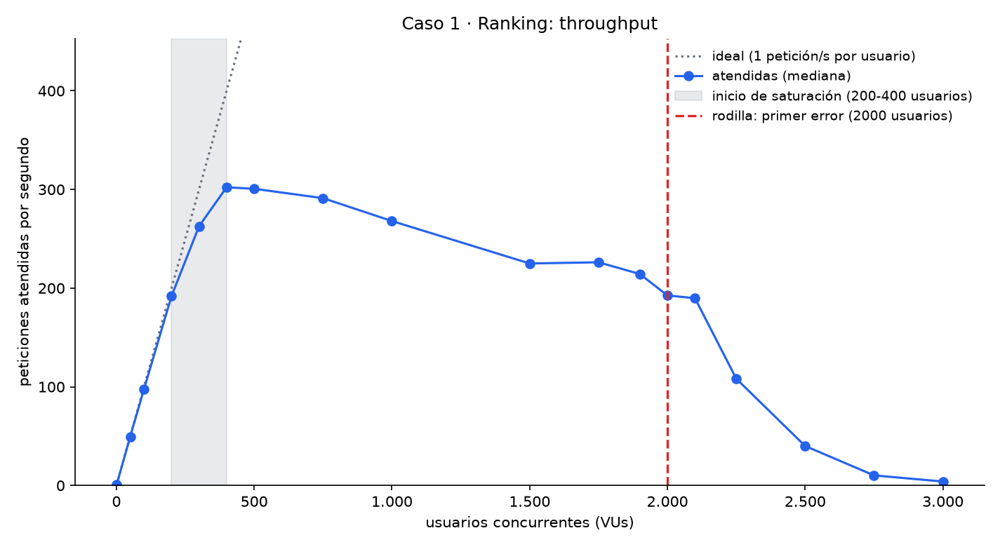
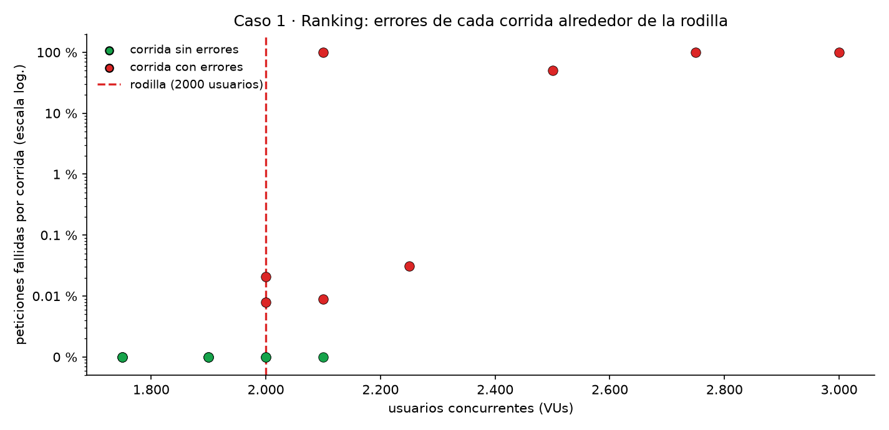
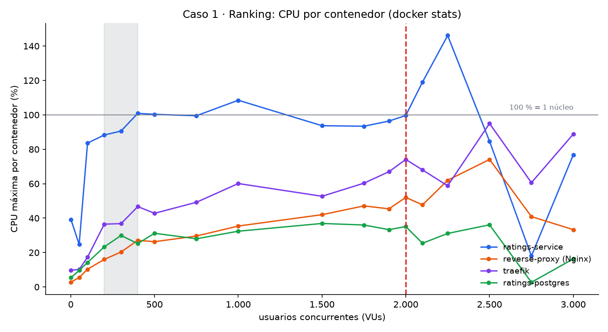

# Caso 1 · Consultar el ranking (`GET /api/ratings/leaderboard`)

| Pregunta | Respuesta corta |
|---|---|
| ¿Qué se probó? | `GET /api/ratings/leaderboard?mode=CLASSIC&limit=20` (top 20), por el camino real: reverse proxy → API Gateway → `ratings-service` → PostgreSQL |
| ¿Con qué? | k6 v2.3.0 desde el host, fuera de la VM de Docker Desktop; 18 niveles de carga entre 1 y 3000 usuarios, 27 corridas válidas |
| ¿Dónde está la rodilla? | **2000 usuarios concurrentes**: es el nivel más bajo donde aparecen errores (2 de 4 corridas, 0,008 % y 0,021 %). Con 1900 usuarios, 0 errores en 3 de 3 corridas |
| ¿Cuándo empieza a saturarse? | Entre 200 y 400 usuarios: el throughput deja de seguir a la carga y toca su techo de **≈ 302 peticiones/s** |
| ¿Cuándo colapsa? | Con 2500 usuarios falla la mitad de las peticiones; con 2750 y 3000, el 100 % |
| ¿Cuello de botella? | `ratings-service`: un solo proceso de uvicorn al 100 % de un núcleo |
| ¿Qué provoca los errores? | La cola: con más de ≈ 2000 usuarios, las peticiones más lentas esperan más de 60 s y el cliente las abandona. En el colapso, además, Traefik deja de aceptar conexiones y Nginx responde `504` |

Fecha de las mediciones: 22 de noviembre de 2026, rama `feature/p3-esc2` (`e380dd7`). Scripts y resultados crudos: [`perf/caso1-ranking/`](../../../perf/caso1-ranking/).

## 1. Objetivo y alcance

Encontrar la curva de desempeño de la consulta del ranking y su **rodilla**, entendida como **el nivel de carga más bajo en el que el sistema empieza a fallar**. También se identifica dónde empieza la saturación (el cambio de pendiente), qué componente la provoca y cómo falla el sistema cuando se supera la rodilla.

La consulta del ranking se eligió porque recorre los cuatro componentes que pide el enunciado del laboratorio (front-end web desplegado, API Gateway, microservicio y base de datos), es pública y de solo lectura (no ensucia el sistema) y su consulta SQL hace trabajo real: ordenar a todos los jugadores de un modo y calcular su posición.

```
k6 (host) ──HTTPS :443──▶ reverse-proxy (Nginx) ──HTTP──▶ traefik (API Gateway) ──HTTP──▶ ratings-service (FastAPI) ──SQL──▶ ratings-postgres
```

## 2. Entorno de la prueba

| Elemento | Detalle |
|---|---|
| Host | Portátil AMD Ryzen 5 3500U (4 núcleos, 8 hilos), 5,7 GB de RAM, Linux Mint 22.3, **conectado al cargador** |
| Docker | Docker Desktop 29.7.2. VM con **4 CPU y 1,4 GB de RAM**; los 13 contenedores del sistema encendidos |
| Generador de carga | k6 v2.3.0 en el host, fijado a los hilos 4–7 con `taskset` para no competir con los núcleos de la VM |
| Reverse proxy | `nginx:1.30.5-alpine`, TLS 1.2/1.3, `worker_connections 4096`, `reuseport` (escenario 2) |
| API Gateway | `traefik:v3.7.14`, entrypoint `web` en `:8000` |
| Microservicio | `ratings-service`: Python 3.12, FastAPI, **uvicorn con un solo proceso**, pool `asyncpg` de 1 a 10 conexiones. *Healthcheck* cada 10 s con 3 s de *timeout* |
| Base de datos | `postgres:16.15-alpine`, 10 016 filas en `ratings` (5000 jugadores ficticios `perf-` por modo, con rating de distribución normal, más 16 reales) |
| Front-end web | `presentation-ssr` desplegado y sano durante toda la prueba; no recibe carga en este caso (se mide en el caso 2) |
| Verificación TLS | Con la CA del proyecto (`SSL_CERT_FILE`), sin desactivar la verificación |

## 3. Metodología

**Definición de error.** Una petición falla si no devuelve `200` con una lista `players`: errores `5xx` o `4xx`, conexiones rechazadas o peticiones sin respuesta en **60 s** (el *timeout* de k6). Es `http_req_failed`.

**Cada corrida** ([`ranking.js`](../../../perf/caso1-ranking/ranking.js)):
- **Rampa de 15 s** desde 0 hasta N usuarios y **60 s sostenidos** con N usuarios. Las métricas se toman solo de la fase sostenida (etiqueta `fase:sostenida`), así la llegada escalonada de los usuarios no se mezcla con la carga constante.
- Cada usuario hace la petición, la valida y espera 1 s (`sleep(1)`, el "tiempo de pensar" del enunciado). La carga ideal es N peticiones/s.
- En paralelo se registran la CPU y la memoria de cada contenedor (`docker stats` cada 10 s), el estado de salud de `ratings-service`, `traefik` y `reverse-proxy` (cada 2 s), los códigos de estado del log de Nginx y la memoria de k6.

**Barrido** ([`barrido.sh`](../../../perf/caso1-ranking/barrido.sh)), en tres pasos:
1. **Grueso:** 1, 50, 100, 200, 300, 400, 500, 750, 1000, 1500, 2000 y 3000 usuarios. Primer error entre 2000 (0 %) y 3000 (100 %).
2. **Refinamiento 1:** 2250, 2500 y 2750 usuarios. Primer error con 2250.
3. **Refinamiento 2:** 1750, 1900, 2000 y 2100 usuarios, **3 corridas por nivel**. Ubica el nivel más bajo con errores y muestra cuán estable es.

**Reposo entre corridas.** Tras cada corrida se esperan 20 s y luego hasta que `ratings-service`, `traefik` y `reverse-proxy` estén por debajo de 5 % de CPU y sanos (tardó entre 9 y 18 s). Sin esta espera, una corrida arrancaba con la cola de la anterior todavía en proceso y colapsaba (ver §8).

**Resumen por nivel.** Cuando un nivel tiene varias corridas se reporta la **mediana**, para que una corrida atípica no distorsione el valor.

## 4. Resultados

| Usuarios | Corridas | Pet./s | Promedio | Mediana | p95 | p99 | Errores (mediana) | Errores por corrida | CPU máx. ratings |
|---|---|---|---|---|---|---|---|---|---|
| 1 | 1 | 1,0 | 12 ms | 10 ms | 15 ms | 64 ms | 0 % | 0 | 39 % |
| 50 | 1 | 49,5 | 10 ms | 10 ms | 16 ms | 23 ms | 0 % | 0 | 25 % |
| 100 | 1 | 97,5 | 24 ms | 11 ms | 51 ms | 354 ms | 0 % | 0 | 84 % |
| 200 | 1 | 191,9 | 40 ms | 17 ms | 151 ms | 310 ms | 0 % | 0 | 88 % |
| 300 | 1 | 262,8 | 139 ms | 55 ms | 702 ms | 1,1 s | 0 % | 0 | 91 % |
| 400 | 1 | **302,2** | 319 ms | 105 ms | 1,2 s | 1,7 s | 0 % | 0 | 101 % |
| 500 | 1 | 300,7 | 657 ms | 394 ms | 2,0 s | 3,3 s | 0 % | 0 | 100 % |
| 750 | 1 | 291,2 | 1,5 s | 1,3 s | 5,3 s | 8,2 s | 0 % | 0 | 100 % |
| 1000 | 1 | 268,0 | 2,7 s | 2,5 s | 7,8 s | 12,1 s | 0 % | 0 | 108 % |
| 1500 | 1 | 225,0 | 5,4 s | 5,0 s | 14,1 s | 19,1 s | 0 % | 0 | 94 % |
| 1750 | 3 | 226,2 | 6,3 s | 6,1 s | 19,3 s | 27,5 s | 0 % | 0 / 0 / 0 | 93 % |
| 1900 | 3 | 214,3 | 7,2 s | 7,2 s | 21,3 s | 30,1 s | 0 % | 0 / 0 / 0 | 96 % |
| **2000** | 4 | 192,6 | 8,1 s | 8,0 s | 21,6 s | 31,3 s | **0,004 %** | **0 / 0,008 / 0 / 0,021 %** | 100 % |
| 2100 | 3 | 189,8 | 9,3 s | 9,9 s | 25,5 s | 36,5 s | 0,009 % | 0,009 / **100** / 0 % | 119 % |
| 2250 | 1 | 108,2 | 16,4 s | 16,0 s | 42,5 s | 56,2 s | 0,031 % | 0,031 % | 146 % |
| 2500 | 1 | 40,0 | 35,5 s | 36,2 s | 60,0 s | 60,0 s | **49,9 %** | 49,9 % | 85 % |
| 2750 | 1 | 10,2 | 5,1 s* | 5,1 s* | 5,2 s* | 5,3 s* | **100 %** | 100 % | 18 % |
| 3000 | 1 | 4,0 | 5,2 s* | 5,0 s* | 5,1 s* | 5,1 s* | **100 %** | 100 % | 77 % |

\* Con 2750 y 3000 usuarios casi todas las respuestas son `504` que Nginx devuelve a los 5 s; esos tiempos no son de peticiones atendidas.

Ningún contenedor se reinició en estas corridas.

## 5. Curvas



*Figura 1. Tiempo de respuesta (escala logarítmica) y porcentaje de errores contra usuarios concurrentes. La franja gris marca el inicio de la saturación; la línea roja, la rodilla.*



*Figura 2. Peticiones atendidas por segundo contra lo ideal (1 petición/s por usuario).*



*Figura 3. Errores de cada corrida entre 1750 y 3000 usuarios. 1750 y 1900 nunca fallan; desde 2000 aparecen los primeros errores.*



*Figura 4. CPU máxima de cada contenedor (`docker stats`). 100 % equivale a un núcleo completo.*

## 6. Análisis

### 6.1 Las zonas de la curva

| Zona | Usuarios | Qué se observa |
|---|---|---|
| Holgada | 1 a 200 | El throughput sigue la carga casi exacto (191,9 de 200 peticiones/s) y la mediana se queda entre 10 y 17 ms |
| Inicio de saturación | 200 a 400 | El throughput se separa de lo ideal (262,8 de 300) y toca su techo de 302,2 peticiones/s. El promedio pasa de 40 ms a 319 ms: empieza a formarse cola |
| Saturación sin errores | 400 a 1900 | El throughput no sube más; cada usuario extra solo agrega espera (de 0,3 s a 7,2 s de promedio). El sistema sigue respondiendo todo |
| **Rodilla** | **2000** | **Aparecen los primeros errores** (0,008 % y 0,021 %): las peticiones más lentas superan los 60 s |
| Degradación | 2000 a 2250 | Errores pequeños pero en aumento, y corridas inestables (una de 2100 colapsó por completo) |
| Colapso | 2500 a 3000 | Falla la mitad y luego el 100 % de las peticiones |

**Rodilla: 2000 usuarios concurrentes.** Es el nivel más bajo con errores, y el inmediatamente anterior que se probó, 1900, no tuvo errores en ninguna de sus 3 corridas. En ese punto el sistema atiende ≈ 193 peticiones/s con un tiempo de respuesta promedio de 8,1 s.

### 6.2 Por qué la curva tiene esa forma

Con `sleep(1)` cada usuario espera su respuesta antes de pedir otra: es un **sistema cerrado**, que cumple la ley del tiempo de respuesta interactivo:

> **R = N / X − Z**  (R: tiempo de respuesta, N: usuarios, X: peticiones/s atendidas, Z: tiempo de pensar = 1 s)

| N | X medido | R = N/X − 1 | R medido (promedio) |
|---|---|---|---|
| 500 | 300,7 | 0,66 s | 0,66 s |
| 1000 | 268,0 | 2,73 s | 2,71 s |
| 2000 | 192,6 | 9,38 s | 8,15 s |

Los valores coinciden. La lectura: cuando X ya no puede crecer, todo usuario adicional se convierte directamente en espera. Por eso, desde 400 usuarios, la latencia crece casi en línea recta con la carga.

**De dónde salen los errores.** El sistema no rechaza peticiones: las encola. Con 2000 usuarios el p99 ya es 31 s, y la cola de la distribución empieza a pasar de los 60 s que espera el cliente. Esas son las primeras fallas: Nginx las registra como `499` (el cliente cerró la conexión) sin respuesta del gateway. A partir de ahí el error crece rápido, porque cada abandono se reemplaza por una petición nueva que vuelve a la cola.

### 6.3 El cuello de botella: `ratings-service`

- Su CPU sube con la carga hasta **≈ 100 % desde 400 usuarios** (Figura 4), justo donde el throughput toca techo. Nginx, Traefik y PostgreSQL se mantienen por debajo de esa cifra en ese rango.
- `ratings-service` arranca con `uvicorn ... --factory` **sin `--workers`**: un solo proceso de Python. Por el GIL, ese proceso solo usa un núcleo, aunque la VM tenga cuatro. 100 % significa que ya no puede atender más.
- Cada petición le cuesta recibir la conexión, consultar PostgreSQL, convertir 20 filas a objetos y serializarlas a JSON. A ≈ 300 peticiones/s eso llena el núcleo.
- Pasado el techo, el throughput **baja** (302 → 193 peticiones/s con 2000 usuarios): mantener miles de conexiones abiertas y en espera también consume CPU en el proxy, el gateway y el propio servicio.

### 6.4 Cómo colapsa

- **2500 usuarios:** la espera promedio llega a 35 s y la mitad de las peticiones supera los 60 s.
- **2750 y 3000 usuarios:** Traefik, con miles de conexiones abiertas (llegó a 95 % de CPU con 2500 usuarios), deja de aceptar conexiones nuevas a tiempo. Nginx espera 5 s (`proxy_connect_timeout`) y responde **`504`**. El *healthcheck* de Traefik deja de responder y Docker lo marca como *unhealthy*.
- **Inestabilidad cerca de la rodilla.** Una corrida de 2100 usuarios, que arrancó con el sistema en reposo, colapsó al 100 % mientras las otras dos tuvieron 0 % y 0,009 %. En esa corrida `ratings-service` pasó a *unhealthy*: su *healthcheck* (3 s de *timeout*) no recibe turno en un proceso saturado. Por encima de la rodilla, el sistema puede pasar de "lento" a "caído" sin cambio de carga.
- En una corrida preliminar con el host sobrecargado, Traefik llegó a quedarse sin memoria (OOM) con 3000 usuarios y Docker lo reinició. La VM tiene 1,4 GB para 13 contenedores.

### 6.5 Comparación con el Laboratorio 6

| | Lab 6 (16 nov) | Caso 1 (22 nov) |
|---|---|---|
| Promedio con 200 / 300 usuarios | 44,8 ms / 189,5 ms | 39,9 ms / 138,9 ms |
| Techo de throughput | ≈ 337 peticiones/s | ≈ 302 peticiones/s |
| Cuello de botella | `ratings-service` al 100 % | `ratings-service` al 100 % |
| Primer error | 2000 usuarios, 17,25 %: Nginx sin conexiones (`worker_connections 1024`) | 2000 usuarios, 0,008–0,021 %: peticiones que superan 60 s en cola |

La saturación y el cuello de botella coinciden. Lo que cambió es **cómo** falla en la rodilla: en el Lab 6 el primero en romperse era Nginx, por falta de conexiones; tras subir `worker_connections` a 4096 (escenario 2), el proxy ya no falla primero y el error lo produce la cola del servicio.

## 7. Hallazgos para la arquitectura

| Hallazgo | Consecuencia | Táctica candidata |
|---|---|---|
| `ratings-service` usa un núcleo de cuatro | El techo de ≈ 300 peticiones/s lo pone un solo proceso | **Introducir concurrencia:** `uvicorn --workers 4`, o varias réplicas detrás de Traefik |
| La consulta del ranking es igual para todos | Se recalcula en cada petición | **Mantener copias de los datos:** caché de 1 s del *leaderboard* en Nginx o en el servicio |
| El sistema encola sin límite | Por encima de la rodilla, todos esperan decenas de segundos y luego fallan | **Limitar la tasa o la cola** (*load shedding*): rechazar rápido con `429`/`503` el exceso, en lugar de hacer esperar 60 s a todos. Se conecta con el escenario 5 (rate limiting) |
| El *healthcheck* comparte el proceso saturado | Bajo carga, el servicio aparece *unhealthy* aunque esté atendiendo, y se vuelve inestable | Un *healthcheck* más tolerante, o un proceso aparte para la salud |
| Traefik y la VM se quedan sin recursos en el colapso | 504 y, con el host cargado, OOM | Más memoria para la VM y límite de conexiones en el proxy |

## 8. Limitaciones

1. **El host no es un nodo independiente.** k6 corre en el mismo portátil, aunque fuera de la VM y en hilos aparte. Comparten memoria, disco y temperatura.
2. **Sensibilidad al entorno.** Se descartaron dos barridos completos: uno con el navegador abierto (carga 15 en 8 núcleos y 1,3 GB en swap) y otro con batería (CPU a 1,8 GHz). Ambos daban la mitad de capacidad. Están en `resultados/descartado-host-cargado/` y `resultados/descartado-bateria/`.
3. **Se descartó un refinamiento** (`resultados/descartado-sin-reposo/`) porque las corridas no esperaban el reposo del sistema y arrancaban con la cola de la anterior; de ahí salió la espera de reposo descrita en §3.
4. **Una sola corrida en los niveles lejanos a la rodilla.** Las 3 corridas se hicieron en 1750–2100 usuarios, donde importa ubicar el primer error.
5. **El error depende del *timeout* del cliente (60 s).** Con un cliente más impaciente, la rodilla aparecería con menos usuarios.
6. **Un solo endpoint de lectura con datos sembrados.** PostgreSQL probablemente respondió desde memoria.
7. **`docker stats` cada 10 s.** La CPU máxima es aproximada; puede pasar de 100 % porque el servicio también usa hilos fuera del intérprete (red y base de datos).

## 9. Cómo repetir

```bash
cd ArchSoft-Group1F
docker compose up -d --wait
docker compose exec -T ratings-postgres sh -c 'psql -v ON_ERROR_STOP=1 -U "$POSTGRES_USER" -d "$POSTGRES_DB"' < perf/datos/seed_ratings.sql
./perf/caso1-ranking/barrido.sh grueso 1 50 100 200 300 400 500 750 1000 1500 2000 3000
REPS=3 ./perf/caso1-ranking/barrido.sh refino 1750 1900 2000 2100
python3 perf/lib/graficar.py docs/p3/performance/img/caso1 "Caso 1 · Ranking" perf/caso1-ranking/resultados/*.csv
docker compose exec -T ratings-postgres sh -c 'psql -U "$POSTGRES_USER" -d "$POSTGRES_DB"' < perf/datos/cleanup_ratings.sql
```

Antes de medir: cargador conectado, navegador y aplicaciones pesadas cerradas, y no usar el equipo mientras corre el barrido. `graficar.py` necesita `matplotlib`; las variables `SATURACION=200-400 RODILLA=2000 ZOOM=1700-3000` marcan las zonas en las gráficas.
