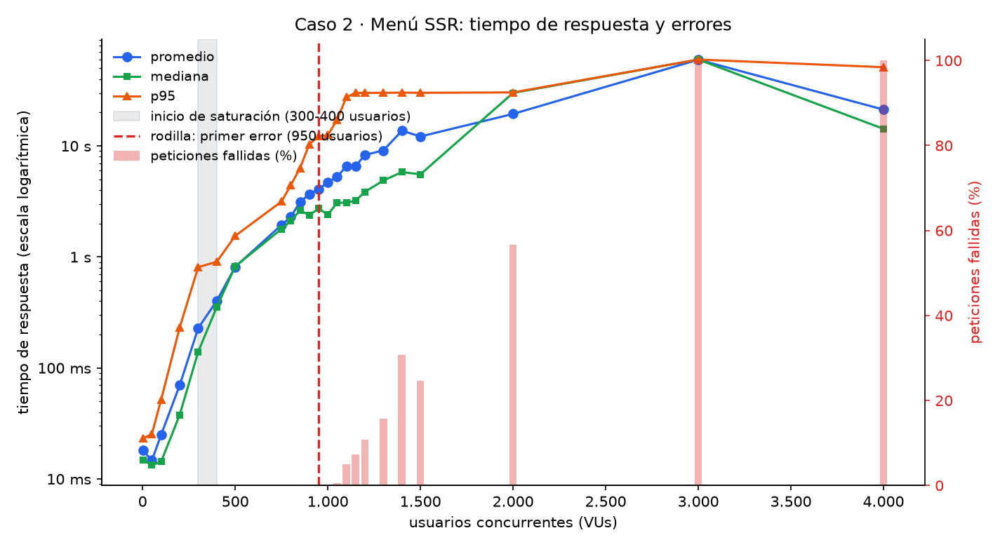
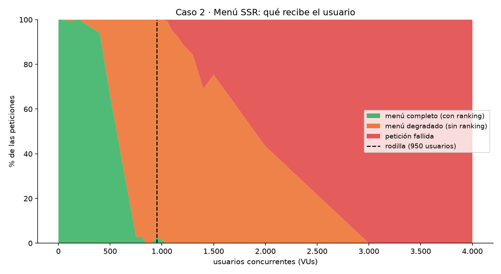
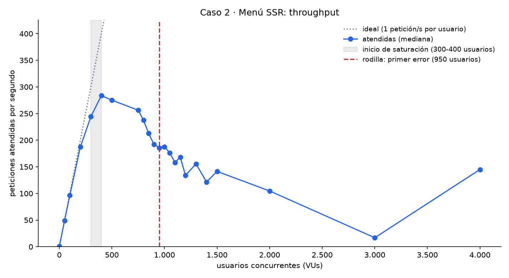
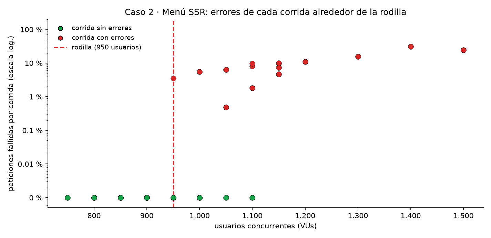
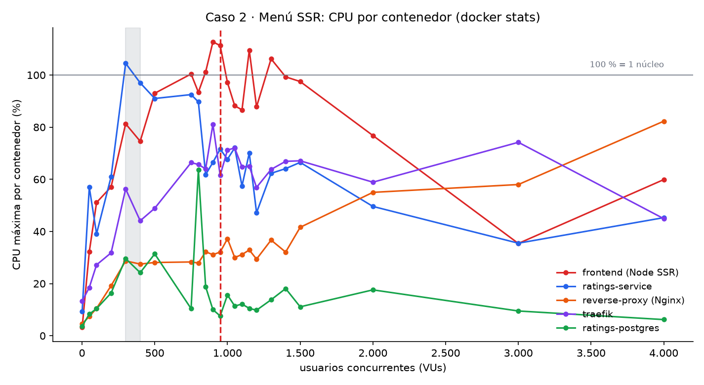

# Caso 2 · Cargar el menú (`GET /menu/`, renderizado en el servidor)

| Pregunta | Respuesta corta |
|---|---|
| ¿Qué se probó? | `GET /menu/`: la página principal, que el front-end SSR arma en el servidor e incluye el top 10 del ranking |
| ¿Por dónde pasa? | reverse proxy → API Gateway → `frontend` (Node.js) → `ratings-service` (conector C20, directo y con límite de 800 ms) → PostgreSQL |
| ¿Con qué? | k6 v2.3.0 desde el host; 23 niveles entre 1 y 4000 usuarios, 41 corridas |
| ¿Dónde está la rodilla? | **950 usuarios concurrentes**: es el nivel más bajo con errores (1 de 3 corridas, 3,5 %). Con 900 usuarios, 0 errores en 3 de 3 corridas |
| ¿Cuándo empieza a saturarse? | Entre 300 y 400 usuarios: techo de **≈ 284 peticiones/s** |
| ¿Qué pasa antes de la rodilla? | **El menú se degrada en vez de fallar.** Desde 300 usuarios, ratings no alcanza a responder en 800 ms y el SSR entrega el menú sin ranking: 34 % de las páginas con 500 usuarios y ≈ 100 % desde 750 |
| ¿Cuello de botella? | El `frontend`: un solo proceso de Node.js al 100 % de un núcleo desde 750 usuarios |
| ¿Qué provoca los errores? | Páginas que tardan más de 30 s: Nginx corta la espera y responde `504`. Cuando el *healthcheck* del `frontend` falla, Traefik además lo saca del enrutamiento y responde `404` |

Fecha de las mediciones: 22 de noviembre de 2026, rama `feature/p3-esc2` (`e380dd7`). Scripts y resultados crudos: [`perf/caso2-menu/`](../../../perf/caso2-menu/). Mismo entorno y método que el [caso 1](caso1-ranking.md).

## 1. Objetivo y alcance

Encontrar la curva de desempeño y la **rodilla** (el nivel más bajo de usuarios donde aparece el primer error) de la página que carga todo jugador al entrar. A diferencia del caso 1, aquí interviene el **front-end web** y una dependencia entre servicios: el SSR necesita a `ratings-service` para armar la página.

```
k6 ──HTTPS──▶ reverse-proxy ──HTTP──▶ traefik ──HTTP──▶ frontend (Node SSR) ──HTTP, máx. 800 ms──▶ ratings-service ──SQL──▶ ratings-postgres
```

Cómo arma el `frontend` cada menú ([`presentation-ssr/src/views.js`](../../../presentation-ssr/src/views.js)):
1. Lee la plantilla `menu.html` del disco.
2. Pide `GET /api/ratings/leaderboard?mode=CLASSIC&limit=10` directo a `ratings-service` (C20), con `AbortSignal.timeout(800)`.
3. Si ratings responde a tiempo, inserta la tabla del ranking. Si no, responde igual con *"El ranking no está disponible por ahora"*.

Solo se pide el HTML de la página, no sus archivos estáticos (JavaScript, CSS e imágenes), como indica el enunciado del laboratorio.

## 2. Entorno de la prueba

El mismo del caso 1 ([§2](caso1-ranking.md#2-entorno-de-la-prueba)): portátil Ryzen 5 3500U conectado al cargador, Docker Desktop con una VM de 4 CPU y 1,4 GB, k6 en los hilos 4–7 del host. Específico de este caso:

| Elemento | Detalle |
|---|---|
| Front-end | `frontend`: `node:22.14.0-alpine`, `node:http` sin dependencias, **un solo proceso**. *Healthcheck* `wget /healthz` cada 10 s con 3 s de *timeout* |
| Límite del SSR hacia ratings | 800 ms (`SSR_DATA_TIMEOUT_MS`) |
| Límite de Nginx para la página | `proxy_read_timeout 30s` (las rutas de páginas usan el valor del servidor) |
| Datos | Los mismos 10 016 jugadores del caso 1 |

## 3. Metodología

Igual que el caso 1 ([§3](caso1-ranking.md#3-metodología)): rampa de 15 s, 60 s sostenidos, métricas solo de la fase sostenida, `sleep(1)` entre peticiones, reposo verificado entre corridas y mediana por nivel.

**Clasificación de cada respuesta** ([`menu.js`](../../../perf/caso2-menu/menu.js)):

| Resultado | Condición |
|---|---|
| Completa | `200` y la página trae la tabla del ranking |
| **Degradada** | `200`, pero con *"El ranking no está disponible por ahora"* |
| Error | Sin respuesta en 60 s, `4xx` o `5xx` |

Una página degradada **no cuenta como error**: el usuario recibe el menú y puede jugar. La rodilla se define, como en el caso 1, por el primer error.

**Barrido**, en cuatro pasos:
1. **Grueso:** 1, 50, 100, 200, 300, 400, 500, 750, 1000, 1500, 2000, 3000 y 4000. Primer error entre 1000 (0 %) y 1500 (24,6 %).
2. **Refinamiento 1:** 1100, 1200, 1300 y 1400. Primer error con 1200.
3. **Refinamiento 2:** 1000, 1050, 1100 y 1150, **3 corridas** cada uno. Aparecen errores ya con 1000 (1 de 3 corridas).
4. **Refinamiento 3:** 800, 850, 900 y 950, **3 corridas** cada uno. 900 queda limpio en las 3; 950 falla en 1.

## 4. Resultados

| Usuarios | Corridas | Pet./s | Promedio | Mediana | p95 | Degradadas | Errores (mediana) | Errores por corrida | CPU máx. frontend | CPU máx. ratings |
|---|---|---|---|---|---|---|---|---|---|---|
| 1 | 1 | 1,0 | 18 ms | 15 ms | 23 ms | 0 % | 0 % | 0 | 3 % | 9 % |
| 50 | 1 | 49,2 | 15 ms | 13 ms | 25 ms | 0 % | 0 % | 0 | 32 % | 57 % |
| 100 | 1 | 96,5 | 25 ms | 14 ms | 52 ms | 0,6 % | 0 % | 0 | 51 % | 39 % |
| 200 | 1 | 187,2 | 70 ms | 38 ms | 231 ms | 0 % | 0 % | 0 | 57 % | 61 % |
| 300 | 1 | 244,1 | 228 ms | 140 ms | 809 ms | 3,0 % | 0 % | 0 | 81 % | 104 % |
| 400 | 1 | **283,8** | 402 ms | 353 ms | 904 ms | 5,9 % | 0 % | 0 | 75 % | 97 % |
| 500 | 1 | 275,1 | 814 ms | 823 ms | 1,5 s | 34,0 % | 0 % | 0 | 93 % | 91 % |
| 750 | 1 | 256,4 | 1,9 s | 1,8 s | 3,2 s | 97,3 % | 0 % | 0 | 100 % | 92 % |
| 800 | 3 | 237,9 | 2,3 s | 2,1 s | 4,4 s | 97,0 % | 0 % | 0 / 0 / 0 | 93 % | 90 % |
| 850 | 3 | 212,6 | 3,1 s | 2,6 s | 6,3 s | 100 % | 0 % | 0 / 0 / 0 | 101 % | 62 % |
| 900 | 3 | 192,4 | 3,7 s | 2,4 s | 10,4 s | 100 % | 0 % | 0 / 0 / 0 | 113 % | 66 % |
| **950** | 3 | 185,8 | 4,0 s | 2,7 s | 12,2 s | 97,4 % | 0 % | **3,5 / 0 / 0 %** | 111 % | 72 % |
| 1000 | 4 | 187,8 | 4,7 s | 2,4 s | 12,5 s | 98,8 % | 0 % | 0 / 0 / 0 / 5,6 % | 97 % | 68 % |
| 1050 | 3 | 176,1 | 5,3 s | 3,1 s | 17,2 s | 99,5 % | 0,5 % | 6,4 / 0 / 0,5 % | 88 % | 72 % |
| 1100 | 4 | 158,2 | 6,6 s | 3,1 s | 27,5 s | 95,0 % | 5,0 % | 0 / 8,1 / 1,8 / 9,7 % | 87 % | 57 % |
| 1150 | 3 | 168,3 | 6,6 s | 3,2 s | 30,0 s | 92,6 % | 7,4 % | 7,4 / 10,1 / 4,7 % | 110 % | 70 % |
| 1200 | 1 | 133,9 | 8,3 s | 3,9 s | 30,1 s | 89,2 % | 10,8 % | 10,8 % | 88 % | 47 % |
| 1300 | 1 | 155,6 | 9,1 s | 4,9 s | 30,1 s | 84,3 % | 15,7 % | 15,7 % | 106 % | 62 % |
| 1400 | 1 | 121,6 | 13,7 s | 5,8 s | 30,2 s | 69,2 % | 30,8 % | 30,8 % | 99 % | 64 % |
| 1500 | 1 | 141,4 | 12,2 s | 5,6 s | 30,1 s | 75,4 % | 24,6 % | 24,6 % | 98 % | 66 % |
| 2000 | 1 | 104,7 | 19,4 s | 30,0 s | 30,3 s | 43,4 % | 56,6 % | 56,6 % | 77 % | 50 % |
| 3000 | 1 | 16,9 | 59,8 s | 60,0 s | 60,0 s | 0 % | **100 %** | 100 % | 35 % | 36 % |
| 4000 | 1 | 145,0 | 21,2 s | 14,3 s | 51,2 s | 0 % | **100 %** | 100 % | 60 % | 45 % |

"Degradadas" es el porcentaje de todas las peticiones que recibió el menú sin ranking. Ningún contenedor se reinició.

## 5. Curvas



*Figura 1. Tiempo de respuesta (escala logarítmica) y errores. El p95 se aplana en 30 s desde 1150 usuarios: es el límite de Nginx.*



*Figura 2. Composición de las respuestas: menú completo, menú sin ranking y petición fallida.*



*Figura 3. Peticiones atendidas por segundo contra lo ideal.*



*Figura 4. Errores de cada corrida entre 750 y 1500 usuarios. Hasta 900 nunca falla; desde 950 aparecen los primeros errores, y desde 1150 fallan todas las corridas.*



*Figura 5. CPU máxima de cada contenedor. El `frontend` llega a un núcleo completo desde 750 usuarios.*

## 6. Análisis

### 6.1 Las zonas de la curva

| Zona | Usuarios | Qué se observa |
|---|---|---|
| Holgada | 1 a 200 | El throughput sigue a la carga (187 de 200 peticiones/s) y los menús salen completos en 15–70 ms |
| Inicio de saturación | 300 a 400 | El throughput toca su techo de 284 peticiones/s. Ratings llega a un núcleo y empiezan las primeras páginas sin ranking (3–6 %) |
| **Degradación sin errores** | 500 a 900 | El SSR deja de esperar a ratings: con 500 usuarios, un tercio de los menús sale sin ranking; con 750, casi todos. **Ningún usuario recibe un error.** El `frontend` pasa a ser el cuello de botella |
| **Rodilla** | **950** | **Aparecen los primeros errores**: menús que tardan más de 30 s y Nginx corta con `504` |
| Inestabilidad | 950 a 1100 | Algunas corridas fallan y otras no, con la misma carga |
| Fallo creciente | 1150 a 2000 | Todas las corridas fallan, del 5 % al 57 % |
| Colapso | 3000 a 4000 | Falla el 100 % |

**Rodilla: 950 usuarios concurrentes.** Es el nivel más bajo con errores, y el anterior que se probó, 900, no falló en ninguna de sus 3 corridas. En ese punto el sistema atiende ≈ 186 peticiones/s con 4,0 s de promedio, y casi todos los menús salen sin ranking.

### 6.2 La degradación funcionó como estaba diseñada

El límite de 800 ms del SSR es una táctica de disponibilidad: **sacrificar una parte de la página para no perder la página entera**. La Figura 2 muestra que funciona:
- Con **750 a 900 usuarios**, ratings está saturado y casi ningún menú trae el ranking, pero **el 100 % de los usuarios recibe su menú** y puede entrar a jugar.
- Sin esa táctica, cada menú esperaría lo que tarde ratings, que en el caso 1 llegaba a varios segundos con esa carga. El menú quedaría atado al cuello de botella del ranking.

El costo es que la degradación es **total y temprana**: desde 750 usuarios, prácticamente nadie ve el ranking.

### 6.3 Por qué el cuello de botella pasa al `frontend`

- Hasta ≈ 400 usuarios, el que se satura es ratings (≈ 100 % de CPU), igual que en el caso 1.
- Cuando el SSR empieza a abandonar las consultas a ratings a los 800 ms, la carga del ranking deja de crecer y **el `frontend` se convierte en el límite**: un solo proceso de Node.js al 100 % de un núcleo desde 750 usuarios (Figura 5).
- Por cada menú, el `frontend` lee la plantilla del disco, abre una petición a ratings con su temporizador, arma el HTML y lo envía. Con ≈ 250 páginas/s eso llena su único hilo.
- Los números cuadran con la ley R = N/X − Z del caso 1: con 500 usuarios, 500/275,1 − 1 = 0,82 s calculados contra 0,81 s medidos; con 800, 2,36 s contra 2,29 s.

### 6.4 De dónde salen los errores

- **`504` a los 30 s.** Las rutas de páginas usan `proxy_read_timeout 30s` en Nginx, la mitad del límite del cliente (60 s). Cuando la cola del `frontend` supera los 30 s, Nginx corta. Por eso el p95 se aplana exactamente en 30 s desde 1150 usuarios.
- **`404` de Traefik.** En corridas de 1050 y 1100 usuarios aparecen respuestas `404 page not found` de 19 bytes en 4–6 ms. Es la respuesta de Traefik cuando no tiene ninguna ruta: el *healthcheck* del `frontend` no responde en 3 s porque su único hilo está saturado, Docker lo marca como *unhealthy* y **Traefik lo saca del enrutamiento aunque el proceso siga atendiendo**.
- **Por qué la rodilla llega antes que en el caso 1 (950 contra 2000 usuarios):**
  1. Nginx corta las páginas a los 30 s, y la API del ranking espera hasta 75 s (y el cliente, 60 s).
  2. El `frontend` hace más trabajo por petición que ratings, con un solo hilo igual.
  3. El *healthcheck* del `frontend` comparte ese hilo saturado, y su fallo saca al servicio del enrutamiento.

## 7. Hallazgos para la arquitectura

| Hallazgo | Consecuencia | Táctica candidata |
|---|---|---|
| El ranking es igual para todos los usuarios, pero el SSR lo pide en cada menú | Ratings se satura con el menú, y desde 750 usuarios nadie ve el ranking | **Mantener copias de los datos:** caché del *leaderboard* en el `frontend` (por ejemplo 5 s, sirviendo el último valor mientras se actualiza). Una consulta cada 5 s en vez de cientos por segundo, y el ranking seguiría visible bajo carga |
| El `frontend` es un solo proceso de Node.js | Techo de ≈ 250 páginas/s, aunque la VM tiene 4 núcleos | **Introducir concurrencia:** módulo `cluster` de Node o varias réplicas detrás de Traefik |
| La plantilla se lee del disco en cada menú | Trabajo repetido en el hilo saturado | Leerla una vez al arrancar |
| El *healthcheck* comparte el hilo saturado | El gateway deja de enrutar a un servicio vivo (`404`) | *Healthcheck* más tolerante (más reintentos o más *timeout*), o que no dependa del bucle saturado |
| Nginx corta las páginas a los 30 s | Define dónde aparece el error | Mantenerlo: es preferible un `504` a los 30 s a hacer esperar más. Lo mejor es rechazar antes (*load shedding* o rate limiting, escenario 5) |

## 8. Limitaciones

Las mismas del caso 1 ([§8](caso1-ranking.md#8-limitaciones)), y además:
1. **Solo el HTML.** Un navegador real también descarga los archivos estáticos del menú, que los sirve el mismo `frontend`; con ellos, la rodilla llegaría antes.
2. **Mayor variabilidad entre corridas cerca de la rodilla.** Entre 950 y 1100 usuarios, la misma carga a veces falla y a veces no, porque el resultado depende de si el *healthcheck* del `frontend` falla durante la corrida. Por eso se hicieron 3 o 4 corridas en esa zona.
3. **La degradación depende del límite de 800 ms**, que es configurable. Con otro valor cambiaría el reparto entre menús completos y degradados.

## 9. Cómo repetir

```bash
cd ArchSoft-Group1F
./perf/caso2-menu/barrido.sh grueso 1 50 100 200 300 400 500 750 1000 1500 2000 3000 4000
REPS=3 ./perf/caso2-menu/barrido.sh refino 800 850 900 950 1000 1050 1100
SATURACION=300-400 RODILLA=950 ZOOM=750-1500 \
  python3 perf/lib/graficar.py docs/p3/performance/img/caso2 "Caso 2 · Menú SSR" perf/caso2-menu/resultados/*.csv
```

Requiere los datos de prueba del caso 1 (`perf/datos/seed_ratings.sql`) y las mismas condiciones del host: cargador conectado y sin aplicaciones pesadas abiertas.
