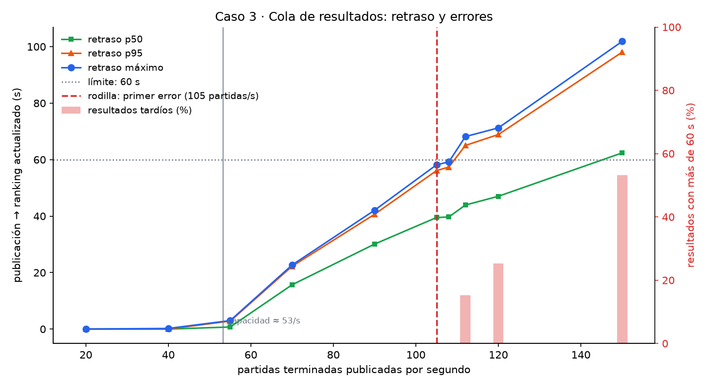
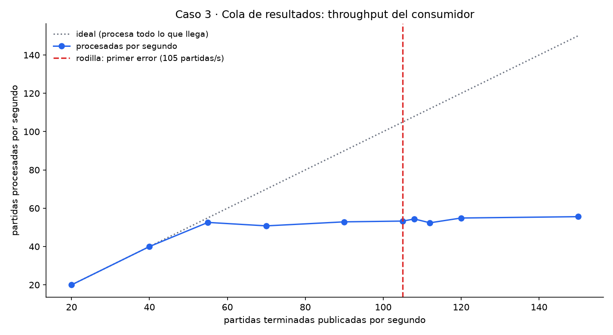
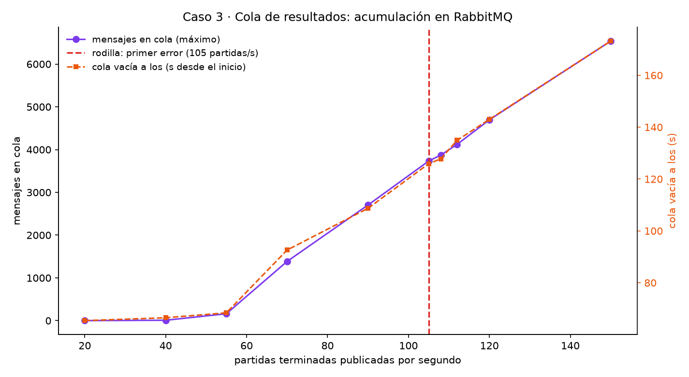
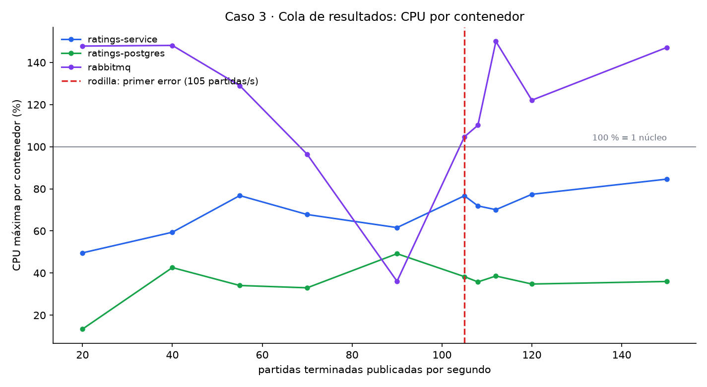

# Caso 3 · Procesar resultados de partidas (cola `ratings.game-finished`)

| Pregunta | Respuesta corta |
|---|---|
| ¿Qué se probó? | El consumidor asíncrono de `ratings-service`: recibe `game.finished` por RabbitMQ y actualiza el ranking Elo de los 4 jugadores de cada partida |
| ¿Cómo se cargó? | Publicando partidas terminadas a una tasa fija durante 60 s, de 20 a 150 partidas/s, y midiendo el retraso de cada una hasta quedar en el ranking |
| ¿Capacidad? | **≈ 53 partidas procesadas por segundo**, sin importar cuántas lleguen |
| ¿Dónde está la rodilla? | **105 partidas/s**: es la tasa más baja con errores (1 de 3 corridas, 7,3 % de resultados tardíos). Con 90 partidas/s, 0 errores y el más lento en 42 s |
| ¿Qué es un error aquí? | Un resultado que se pierde, que cae en la cola de descartados o que tarda **más de 60 s** en reflejarse en el ranking. No se perdió ni se descartó ningún mensaje: todos los errores son resultados tardíos |
| ¿Cuello de botella? | El procesamiento **en serie**: un mensaje a la vez (`prefetch_count=1`), con ≈ 11 consultas y un `COMMIT` a disco por partida. Ni ratings ni PostgreSQL llegan al 100 % de CPU |
| ¿Importa en la práctica? | No con la carga real: el lobby admite como máximo 10 partidas simultáneas, así que terminan muchas menos de 1 por segundo. El margen es de más de 50 veces |

Fecha de las mediciones: 22 de noviembre de 2026, rama `feature/p3-esc2` (`e380dd7`). Scripts y resultados crudos: [`perf/caso3-cola/`](../../../perf/caso3-cola/).

## 1. Objetivo y alcance

Medir la capacidad del camino asíncrono que actualiza el ranking cuando termina una partida, y encontrar la **rodilla**: la tasa de partidas terminadas más baja en la que el sistema empieza a fallar.

En el sistema real el flujo es: `game-logic` publica `game.ended` → `lobby-manager` lo registra y publica `game.finished` → `ratings-service` lo consume. Este caso aísla el último tramo, que es el que hace el trabajo pesado (calcular y guardar el Elo):

```
publicador (contenedor lobby-manager) ──AMQP──▶ rabbitmq (exchange bololo.events, cola ratings.game-finished) ──AMQP──▶ ratings-service ──SQL──▶ ratings-postgres
```

A diferencia de los casos 1 y 2, aquí no hay usuarios que esperan una respuesta: la carga se mide en **partidas terminadas por segundo**, y el tiempo de respuesta es el **retraso** entre que la partida termina y su resultado aparece en el ranking.

## 2. Entorno de la prueba

El mismo de los casos anteriores ([caso 1, §2](caso1-ranking.md#2-entorno-de-la-prueba)): portátil Ryzen 5 3500U conectado al cargador y Docker Desktop con una VM de 4 CPU y 1,4 GB. Específico de este caso:

| Elemento | Detalle |
|---|---|
| Broker | `rabbitmq:3.13.7-management-alpine`; cola durable `ratings.game-finished` con cola de descartados (`.dead`) |
| Consumidor | `ratings-service` (FastAPI + `aio_pika`), **`prefetch_count=1`**: un mensaje a la vez; confirma (`ack`) después del `COMMIT` |
| Trabajo por partida | Una transacción: registrar la partida, asegurar las 4 cuentas, bloquearlas (`FOR UPDATE`), actualizar sus 4 ratings e insertar 4 filas de historial (≈ 11 consultas) |
| Base de datos | `postgres:16.15-alpine`, `synchronous_commit=on` (cada `COMMIT` espera la escritura en disco) |
| Publicador | [`publicar.py`](../../../perf/caso3-cola/publicar.py), dentro del contenedor `lobby-manager` (tiene `aio_pika` y acceso a la red interna). Mensajes persistentes con confirmación del broker |
| Datos | Cada partida usa 4 de las 5000 cuentas `perf-` sembradas, elegidas al azar |

## 3. Metodología

**Cada corrida** ([`barrido.sh`](../../../perf/caso3-cola/barrido.sh)):
1. El publicador envía partidas a una **tasa constante λ durante 60 s**, la misma duración que la fase sostenida de los otros casos. Cada mensaje lleva en `finishedAt` la hora en que se publicó.
2. [`vigilar_cola.py`](../../../perf/caso3-cola/vigilar_cola.py) consulta cada segundo la API de administración de RabbitMQ: mensajes en cola y en proceso. Espera a que la cola quede vacía y registra el máximo acumulado y los mensajes nuevos en la cola de descartados.
3. Al terminar, se consulta en PostgreSQL el **retraso de cada partida**: `processed_at − finished_at`. `processed_at` lo pone la base de datos al guardar el resultado.
4. Se registran la CPU y la memoria de cada contenedor (`docker stats` cada 5 s).

**Definición de error.** Una partida falla si no se procesa (se pierde o cae en la cola de descartados), si el broker no confirma su publicación, o si su resultado **tarda más de 60 s** en llegar al ranking. Los 60 s son el mismo umbral de espera de los casos 1 y 2.

**Búsqueda de la rodilla**, para gastar menos corridas que en el caso 2:
1. **Ráfaga de capacidad:** 10 000 partidas en 10 s, para medir cuántas procesa por segundo.
2. **Barrido grueso:** 20, 40, 55, 70, 90, 120 y 150 partidas/s, una corrida cada una. Primer error entre 90 y 120.
3. **Bisección:** 105 (sin errores) y 112 (con errores).
4. **Confirmación:** 3 corridas en total con 105 y otras 3 con 108.

Total: 15 corridas, unos 45 minutos.

## 4. Resultados

| Partidas/s publicadas | Corridas | Procesadas/s | Retraso p50 | Retraso p95 | Retraso máx. | Cola máx. | Cola vacía a los | Tardías (> 60 s) por corrida | CPU máx. ratings |
|---|---|---|---|---|---|---|---|---|---|
| 20 | 1 | 20,0 | 0,00 s | 0,00 s | 0,02 s | 1 | ≤ 65 s* | 0 % | 50 % |
| 40 | 1 | 40,0 | 0,00 s | 0,01 s | 0,22 s | 9 | ≤ 67 s* | 0 % | 59 % |
| 55 | 1 | 52,6 | 0,74 s | 2,8 s | 3,0 s | 162 | ≤ 68 s* | 0 % | 77 % |
| 70 | 1 | 50,8 | 15,7 s | 22,2 s | 22,7 s | 1385 | 93 s | 0 % | 68 % |
| 90 | 1 | 52,9 | 30,1 s | 40,7 s | 42,1 s | 2704 | 109 s | 0 % | 62 % |
| **105** | 3 | 53,3 | 39,5 s | 56,1 s | 58,2 s | 3733 | 126 s | **0 / 7,3 / 0 %** | 77 % |
| 108 | 3 | 54,4 | 39,7 s | 57,4 s | 59,2 s | 3873 | 128 s | 0 / 0 / 0,7 % | 72 % |
| 112 | 1 | 52,4 | 43,9 s | 65,0 s | 68,2 s | 4121 | 135 s | 15,2 % | 70 % |
| 120 | 1 | 54,9 | 47,0 s | 68,9 s | 71,2 s | 4697 | 143 s | 25,2 % | 77 % |
| 150 | 1 | 55,6 | 62,4 s | 98,0 s | 101,9 s | 6539 | 173 s | 53,2 % | 85 % |
| Ráfaga: 1000 durante 10 s | 1 | 59,2 | 82,3 s | 151,3 s | 158,9 s | 9429 | 173 s | 64,8 % | 77 % |

"Cola vacía a los" cuenta desde que empieza la publicación, que dura 60 s (10 s en la ráfaga). \* El vigilante espera al menos 65 s antes de declarar la cola vacía, así que con tasas bajas ese valor es un piso del método: la cola se vaciaba casi al mismo tiempo que terminaba la publicación.

Con varias corridas se reporta la mediana. En las 15 corridas: **0 mensajes perdidos, 0 en la cola de descartados, 0 publicaciones rechazadas** y 0 reinicios de contenedores.

## 5. Curvas



*Figura 1. Retraso entre el fin de la partida y el ranking actualizado. La línea punteada es el límite de 60 s. Las barras son la mediana de resultados tardíos de cada tasa (con 105 y 108, la mediana es 0 % aunque una de las 3 corridas falló; ver la tabla).*



*Figura 2. Partidas procesadas por segundo. Desde ≈ 55 partidas/s el consumidor no procesa más, llegue lo que llegue.*



*Figura 3. Mensajes acumulados en la cola y momento en que la cola quedó vacía, contado desde el inicio de los 60 s de publicación.*



*Figura 4. CPU máxima de cada contenedor. Ninguno llega a un núcleo completo: el límite no es de cómputo.*

## 6. Análisis

### 6.1 Las zonas de la curva

| Zona | Partidas/s | Qué se observa |
|---|---|---|
| Holgada | hasta 40 | Cada resultado llega al ranking en milisegundos; la cola casi no existe |
| Capacidad | ≈ 53–55 | El consumidor llega a su techo. A 55 partidas/s ya se forma una cola de 162 mensajes |
| Acumulación sin errores | 55 a 100 | Lo que no alcanza a procesar se guarda en RabbitMQ y se procesa después. El retraso crece en línea recta (15 s con 70, 30 s con 90), pero todo llega antes de 60 s |
| **Rodilla** | **105** | **Primeros resultados tardíos**: los últimos mensajes de la ventana esperan más de 60 s |
| Fallo creciente | 112 a 150 | Del 15 % al 53 % de los resultados llegan tarde |

**Rodilla: 105 partidas terminadas por segundo.** Es la tasa más baja con errores (7,3 % en 1 de 3 corridas). La anterior que se probó, 90, terminó sin errores y con un retraso máximo de 42 s, lejos del límite.

### 6.2 Una cola no falla: acumula

A diferencia de los casos 1 y 2, aquí la sobrecarga **no produce rechazos ni pérdidas**. RabbitMQ guarda lo que el consumidor no alcanza y lo entrega después, y el consumidor solo confirma cada mensaje después de guardarlo. El precio es el **retraso**. Por eso la falla aparece como "el ranking se actualiza demasiado tarde" y no como un error HTTP.

La fórmula que gobierna el retraso, con una ventana de publicación W y una capacidad μ:

> **retraso máximo ≈ W · (λ − μ) / μ**

| λ (partidas/s) | μ medida | Retraso máx. calculado | Retraso máx. medido |
|---|---|---|---|
| 70 | 50,8 | 22,7 s | 22,7 s |
| 105 | 53,3 | 58,2 s | 58,2 s |
| 150 | 55,6 | 101,9 s | 101,9 s |

El retraso pasa de 60 s cuando λ > μ · (1 + 60 / W). Con W = 60 s, eso es **λ > 2μ ≈ 107 partidas/s**, justo donde se midió la rodilla. La variación entre corridas con 105 y 108 viene de que μ cambia ±3 % de una corrida a otra.

**Ojo:** la rodilla depende de cuánto dure la sobrecarga. Una ráfaga más larga a la misma tasa acumula más retraso, y una ráfaga corta casi no se nota: 10 000 partidas en 10 s no perdieron ningún mensaje.

### 6.3 El cuello de botella: el procesamiento en serie

- Con `prefetch_count=1`, RabbitMQ entrega **un mensaje a la vez**: el siguiente no sale hasta que ratings confirma el anterior.
- Cada partida es una transacción con ≈ 11 consultas a PostgreSQL más un `COMMIT` que espera la escritura en disco (`synchronous_commit=on`, `fdatasync`), y luego la confirmación a RabbitMQ. Son ≈ 19 ms por partida, lo que da ≈ 53 partidas/s.
- Ni `ratings-service` (60–85 %), ni PostgreSQL (≈ 35–45 %), ni RabbitMQ llegan a un núcleo completo (Figura 4). El tiempo se va en **esperar** viajes de red y escrituras a disco, uno tras otro, no en calcular.
- Por eso el techo no cambia con la carga (Figura 2): más mensajes en la cola no hacen que el consumidor vaya más rápido.

### 6.4 ¿Es un problema para Bololó?

No con la carga actual. El lobby admite **como máximo 10 salas activas** (límite fijo del reglamento, `max_lobbies = 10`), y una partida dura minutos. En el peor caso terminarían unas pocas partidas por minuto, frente a una capacidad de 53 por segundo: un margen de **más de 50 veces**. Aunque terminaran las 10 salas en el mismo segundo, la cola las procesaría en menos de medio segundo.

El límite se vuelve relevante solo si el sistema crece, por ejemplo si se quita el tope de 10 salas.

## 7. Hallazgos para la arquitectura

| Hallazgo | Consecuencia | Táctica candidata |
|---|---|---|
| La cola absorbe los picos sin perder datos | Una ráfaga de 10 000 partidas en 10 s se procesó completa, con retraso | Es el beneficio esperado del estilo asíncrono con broker: **desacopla la llegada del procesamiento** |
| El consumidor procesa un mensaje a la vez | Techo de ≈ 53 partidas/s, con CPU de sobra | **Introducir concurrencia:** subir `prefetch_count` y procesar varias partidas a la vez (cuidando el bloqueo de cuentas compartidas), o varias instancias consumidoras de la misma cola |
| Cada partida espera su propia escritura a disco | Buena parte de los 19 ms | **Procesar por lotes:** agrupar varias partidas en una transacción y confirmarlas juntas |
| La sobrecarga se ve como retraso, no como error | Nadie se entera si el ranking va 2 minutos atrasado | **Monitorear la profundidad de la cola** y alertar cuando pase un umbral |

## 8. Limitaciones

1. **Solo el tramo final del flujo.** El publicador envía `game.finished` directo; no pasa por `game-logic` ni por `lobby-manager`. El flujo completo agregaría el procesamiento del lobby.
2. **El publicador corre dentro de la VM** (en `lobby-manager`), así que comparte las 4 CPU con el sistema. Con estas tasas su consumo es bajo.
3. **El error depende de dos parámetros:** el límite de 60 s y la ventana de 60 s de publicación (§6.2).
4. **Una corrida por tasa fuera de la rodilla.** Con 90 partidas/s el margen es grande (42 s contra 60 s), así que no se repitió. No se probó entre 90 y 105.
5. **No se llevó al broker a su límite de memoria o disco.** Ahí RabbitMQ bloquea a los publicadores y aparecerían errores de publicación, pero alcanzarlo exige acumular cientos de miles de mensajes.
6. Las mismas limitaciones generales del [caso 1, §8](caso1-ranking.md#8-limitaciones).

## 9. Cómo repetir

```bash
cd ArchSoft-Group1F
SEGUNDOS=10 ./perf/caso3-cola/barrido.sh capacidad 1000
./perf/caso3-cola/barrido.sh barrido 20 40 55 70 90 120 150
REPS=3 ./perf/caso3-cola/barrido.sh confirma 105 108
RODILLA=105 python3 perf/caso3-cola/graficar_cola.py docs/p3/performance/img/caso3 \
  perf/caso3-cola/resultados/{barrido,confirma}.csv
```

Cada etiqueta debe ser nueva: el identificador de cada partida incluye la etiqueta, y PostgreSQL ignora las partidas repetidas. `perf/datos/cleanup_ratings.sql` borra las partidas `perf-` junto con los jugadores ficticios.
