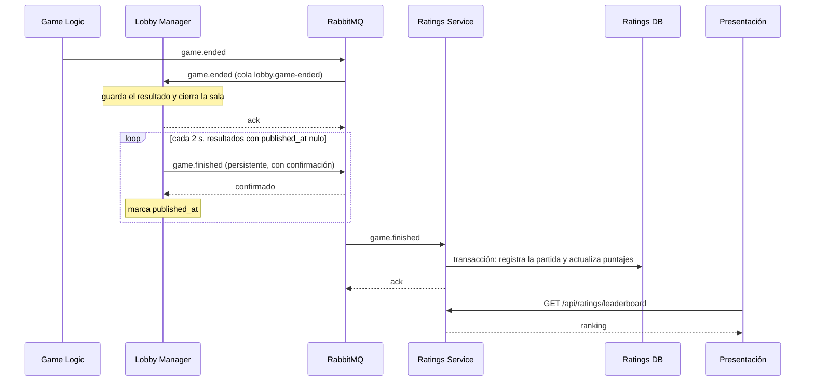

# Bololó - Ratings Service: contrato de integración

| | |
|---|---|
| Componente | Ratings Service y RabbitMQ |
| Tecnología | Python 3.12, FastAPI, aio-pika, PostgreSQL 16, RabbitMQ 3.13 |
| Tipo | Lógico, datos y conector asíncrono |
| Estado | Implementado, versión 1.0 (noviembre 2026) |

Mantiene un ranking de jugadores por modo de juego. Se alimenta solo: cuando termina una partida, Game Logic publica `game.ended`, el Lobby Manager lo registra y publica `game.finished` en RabbitMQ y este servicio lo procesa por su cuenta. Ningún jugador espera ese cálculo y ninguna partida depende de que el ranking esté disponible.

## 1. Idea central



Hay tres garantías, y cada una resuelve una falla concreta:

| Garantía | Cómo se logra | Falla que cubre |
|---|---|---|
| Un resultado no se pierde si RabbitMQ está caído | `game_results.published_at` funciona como bandeja de salida: el resultado se guarda primero en PostgreSQL y se publica después | Broker caído al terminar la partida |
| Un mensaje no se pierde una vez publicado | Exchange y cola durables, mensajes persistentes, confirmación del broker y `ack` solo después del commit | Reinicio de RabbitMQ o de Ratings |
| Una partida nunca cuenta dos veces | `processed_games.game_id` es clave primaria y se escribe en la misma transacción que los puntajes | RabbitMQ entrega al menos una vez, así que puede repetir mensajes |

## 2. Para Presentación

Las rutas pasan por el gateway y son públicas: un ranking no contiene datos privados.

| Método y ruta | Respuesta |
|---|---|
| `GET /api/ratings/leaderboard?mode=CLASSIC&limit=20` | `200 {mode, players: [{position, accountId, nickname, rating, games, wins}]}` |
| `GET /api/ratings/players/{accountId}` | `200 {accountId, nickname, ratings: [{mode, position, rating, games, wins}]}` |
| `GET /api/ratings/players/{accountId}/history?limit=20` | `200 {accountId, changes: [{gameId, mode, rank, ratingBefore, ratingAfter, finishedAt}]}` |

- `mode` es `CLASSIC` (por defecto) o `CHAMELEON`. Otro valor responde `422`.
- `limit` va de 1 a 100.
- Una cuenta sin partidas puntuadas responde `200` con `ratings: []`.
- El `accountId` llega en el campo `account` de `POST /auth/login` y `POST /auth/register`.

## 3. Para el Lobby Manager: el evento

| | |
|---|---|
| Exchange | `bololo.events` (topic, durable) |
| Routing key | `game.finished` |
| Cola | `ratings.game-finished` (durable) |
| Mensajes inválidos | Exchange `bololo.events.dead`, cola `ratings.game-finished.dead` |

```json
{
  "gameId": "g_123",
  "lobbyId": "l_456",
  "mode": "CLASSIC",
  "endReason": "completed",
  "finishedAt": "2026-11-01T15:00:00+00:00",
  "winners": ["p_1"],
  "players": [
    {"playerId": "p_1", "accountId": "9f6c...", "nickname": "ana", "rank": 1},
    {"playerId": "p_2", "accountId": null, "nickname": "Bot Cometa", "rank": 2}
  ]
}
```

`accountId` es `null` para invitados y bots. `rank` empieza en 1 y los empates comparten posición. Las victorias se cuentan con `winners` y no con `rank`: una partida de Camaleón que acaba por tiempo con 0 colores deja a todos en `rank` 1 y a `winners` vacío.

El Lobby publica con `mandatory`: si la cola aún no existe porque Ratings no ha arrancado, el mensaje vuelve, el resultado sigue pendiente y se reintenta.

## 4. Cómo se calcula el puntaje

Se usa Elo adaptado a varios jugadores. Cada cuenta empieza en 1000 puntos y la partida se reparte en duelos entre todos los pares.

```
esperado(A, B) = 1 / (1 + 10 ^ ((puntaje B - puntaje A) / 400))
obtenido(A, B) = 1 si A quedó por encima, 0.5 si empataron, 0 si quedó por debajo
cambio(A)      = 32 / (n - 1) * suma de (obtenido - esperado) contra cada rival
```

- **Ganarle a alguien mejor da más puntos** que ganarle a alguien peor.
- **Es de suma cero:** lo que unos ganan, otros lo pierden.
- **El cambio máximo no depende de `n`:** una partida de 4 no vale más que una de 2.

Tres reglas de negocio:

| Regla | Por qué |
|---|---|
| Solo puntúan las cuentas | Un invitado no tiene identidad estable entre sesiones |
| Se necesitan al menos 2 cuentas en la partida | Evita subir en el ranking jugando contra bots |
| Cada modo tiene su ranking | Clásico y Camaleón miden habilidades distintas |

Invitados y bots se ignoran al calcular: entre dos cuentas que quedan 1.ª y 4.ª en una mesa con dos bots, el duelo es solo entre ellas.

## 5. Para despliegue

| Contenedor | Imagen | Red | Puerto interno |
|---|---|---|---|
| `ratings-service` | `./ratings-service` | `internal` | 8000 |
| `ratings-postgres` | `postgres:16.15-alpine` | `internal` | 5432 |
| `rabbitmq` | `rabbitmq:3.13.7-management-alpine` | `internal` | 5672 |

Traefik enruta `/api/ratings/` a `ratings-service` con prioridad 30, por encima de `/api/`. RabbitMQ no se publica. Para verlo en la demostración:

```bash
docker compose exec rabbitmq rabbitmqctl list_queues name durable messages
docker compose exec rabbitmq rabbitmqctl list_consumers
docker compose logs ratings-service
```

| Si falla | Qué pasa |
|---|---|
| RabbitMQ | Las partidas terminan y se registran. Los resultados esperan en PostgreSQL y salen cuando vuelve. El ranking se puede seguir consultando |
| Ratings Service | Los mensajes esperan en la cola. El menú muestra que el ranking no está disponible y el resto funciona |
| Ratings DB | El mensaje vuelve a la cola y se reintenta |
