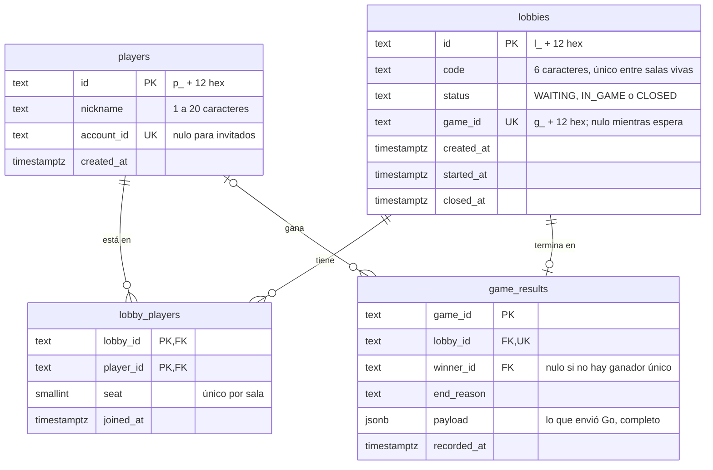
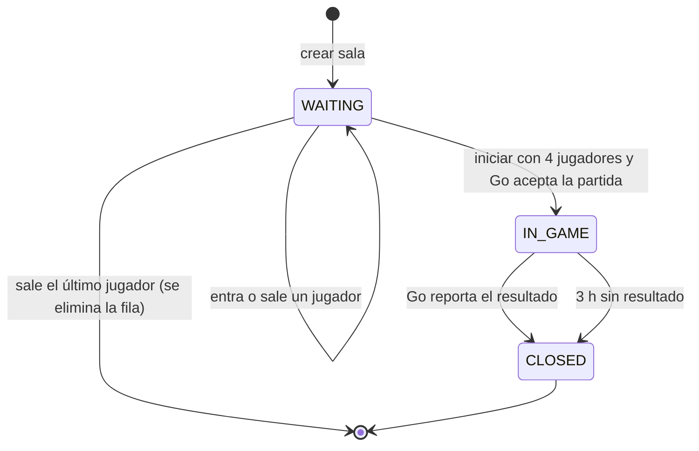

# Modelo de datos: Lobby Manager (PostgreSQL)

PostgreSQL pertenece solo al Lobby Manager. Guarda jugadores (incluida la referencia a una cuenta de Auth), salas, quién está en cada sala y el resultado de cada partida. Las credenciales de cuenta viven en la base propia de Auth. El estado de la partida en curso no vive aquí: es de Game Logic (Redis).

El esquema está en [`app/schema.sql`](../app/schema.sql) y el servicio lo aplica al arrancar.

## 1. Diagrama



## 2. Tablas

### `players`

Un jugador invitado se crea por ingreso con nombre (RF-01). Para cuentas registradas, `account_id` guarda el UUID externo de Auth y tiene un índice único; es nulo en jugadores invitados. Las contraseñas no se guardan aquí. El `id` de jugador se genera en el Lobby y viaja firmado dentro del token de sesión. Dos jugadores pueden tener el mismo `nickname`.

### `lobbies`

| Columna | Notas |
|---|---|
| `id` | Identificador que usan las rutas y Go (`lobbyId`) |
| `code` | Código que se comparte para entrar (RF-05). Alfabeto sin `0 O 1 I L` para que se pueda dictar. El índice `lobbies_active_code` lo hace único solo entre salas no cerradas, así una sala cerrada libera su código |
| `status` | Ver los estados abajo |
| `game_id` | Lo genera el Lobby al iniciar. La restricción `(status = 'WAITING') = (game_id IS NULL)` impide una sala iniciada sin partida o una sala en espera con partida |

### `lobby_players`

Quién está en cada sala. `seat` es el orden de llegada y es el orden en que se envían los jugadores a Go, que lo usa como orden de la mesa. Si alguien sale, su asiento no se reutiliza: quien entra después recibe el siguiente número, así el orden relativo se conserva.

Al eliminar una sala vacía, sus filas se borran en cascada. En una sala cerrada se conservan como registro de quiénes jugaron.

### `game_results`

Un registro por partida terminada (RF-36). `game_id` es la clave primaria: es lo que garantiza el registro único (RNF-04). `payload` guarda el cuerpo completo que envió Go (por ejemplo la tabla de posiciones), sin que este servicio tenga que conocer su forma.

## 3. Estados de la sala



| Estado | Aparece en la lista | Ocupa cupo de las 10 | Se puede entrar o salir |
|---|---|---|---|
| `WAITING` | Sí | Sí | Sí |
| `IN_GAME` | No | Sí | No |
| `CLOSED` | No | No | No |

## 4. Control de concurrencia

Los límites del reglamento deben cumplirse aunque varias peticiones lleguen a la vez. Cada operación es una transacción que primero toma un candado, de modo que las que compiten se aplican una tras otra y la segunda ve lo que dejó la primera.

| Regla | Mecanismo | Qué pasaría sin él |
|---|---|---|
| Máximo 4 jugadores por sala (RF-06) | `SELECT ... FROM lobbies WHERE id = $1 FOR UPDATE` antes de contar los cupos | Dos jugadores verían 3 ocupados y entrarían ambos: 5 en la sala |
| Máximo 10 salas (RF-03) | `pg_advisory_xact_lock` antes de contar las salas. No hay una fila que bloquear porque la sala aún no existe | Dos creaciones verían 9 salas y habría 11 |
| Un jugador en una sola sala | `SELECT ... FROM players WHERE id = $1 FOR UPDATE` antes de revisar en qué sala está | El mismo jugador, con dos pestañas, quedaría en dos salas |
| Una sola partida por sala | El inicio bloquea la sala con `FOR UPDATE`; el segundo en llegar la encuentra `IN_GAME` y recibe la misma partida | Go recibiría dos partidas para la misma sala |
| Resultado registrado una vez (RNF-04) | `INSERT ... ON CONFLICT (game_id) DO NOTHING`, con la sala bloqueada | Un reintento de Go crearía un segundo resultado |

Los candados siempre se toman en el mismo orden (jugador, límite de salas, sala), así que dos transacciones nunca se esperan mutuamente.

`tests/test_concurrency.py` lanza estas carreras de verdad: 8 jugadores por 3 cupos, 15 creaciones simultáneas, un jugador entrando a 4 salas a la vez, 4 inicios simultáneos y el resultado enviado 6 veces en paralelo.

## 5. Consultas útiles

```sql
-- Salas vivas y cuántos jugadores tienen
SELECT l.code, l.status, count(lp.player_id) AS jugadores
FROM lobbies l LEFT JOIN lobby_players lp ON lp.lobby_id = l.id
WHERE l.status <> 'CLOSED' GROUP BY l.id;

-- Historial de partidas con su ganador
SELECT r.game_id, p.nickname AS ganador, r.end_reason, r.recorded_at
FROM game_results r LEFT JOIN players p ON p.id = r.winner_id
ORDER BY r.recorded_at DESC;
```

En el entorno de desarrollo: `docker compose -f lobby-manager/compose.dev.yaml exec postgres psql -U bololo -d bololo`.
